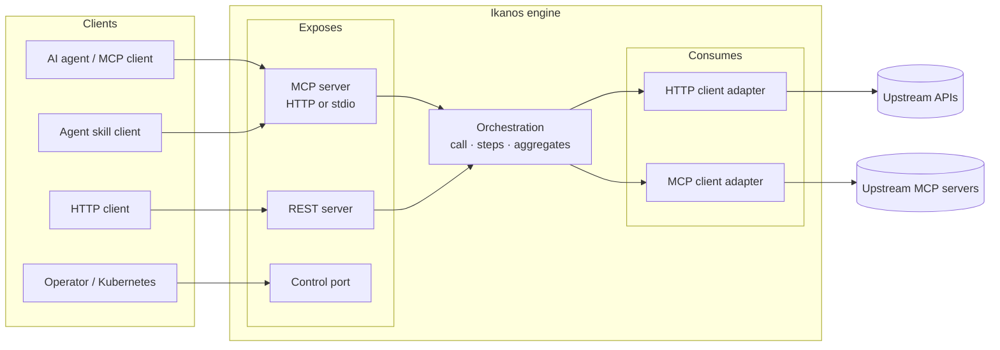
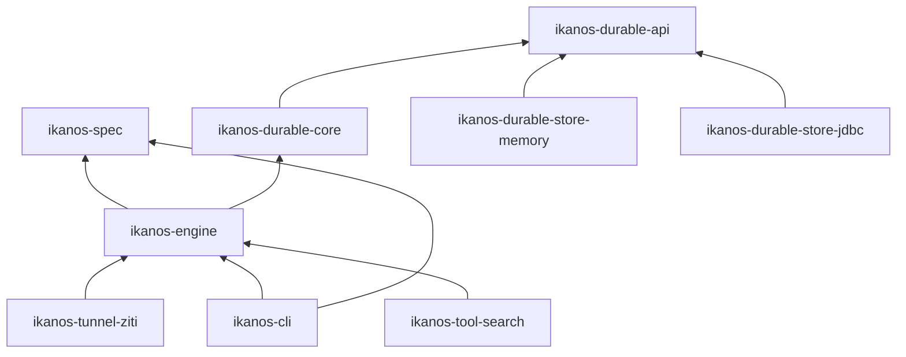
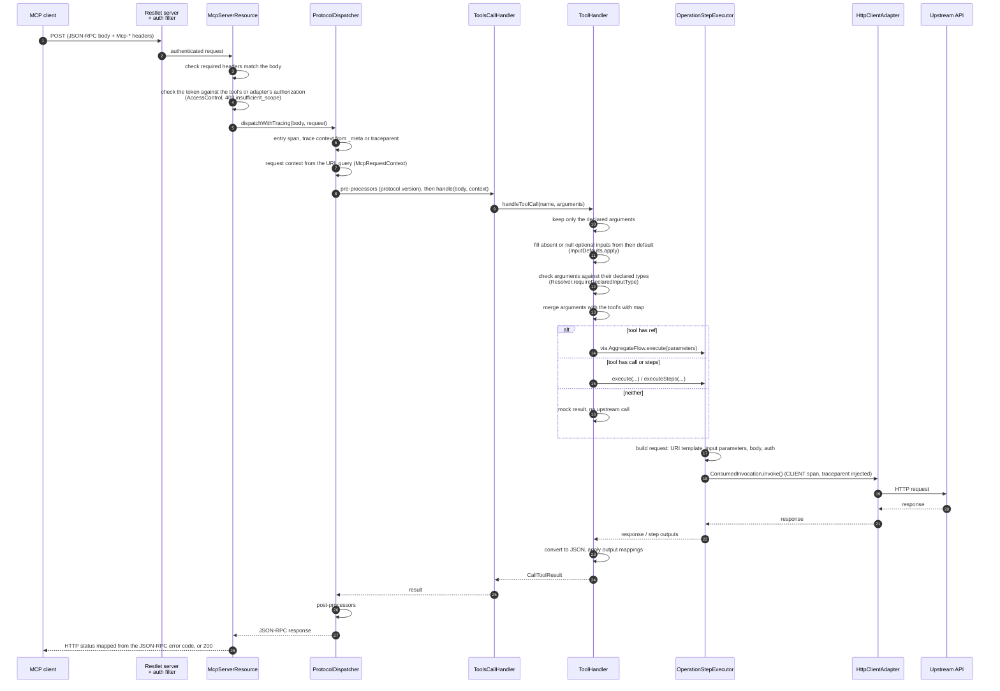

# Ikanos Architecture

This document explains how the Ikanos engine works inside: its modules, how a capability is loaded and started, and the path a request takes through the engine. It is written for contributors, people and coding agents, who need a mental model of the code before changing it.

It is not a user guide. What a capability author can declare, and what each feature does, is described in the [Ikanos specification on Shipyard](https://shipyard.naftiko.io/ikanos/spec/). This document covers how the engine implements it, where that code lives, and why it is built this way. For per-class detail, read the Javadoc and the `package-info.java` of each package.

> **Keep this file accurate.** Read the sections that cover the code you are about to change, and check them again after your change. If they are no longer true, update them in the same PR. The rule, and the changes that trigger it, are defined in [AGENTS.md](../../AGENTS.md#contribution-workflow).

## The big picture

A **capability** is a single YAML file. It declares which upstream APIs it **consumes**, how calls to them are combined (**orchestration**), and how the result is **exposed** to clients: as MCP tools, REST endpoints, or agent skills. Ikanos reads that file and runs it. There is no generated code and no Java written by the capability author.

The same three ideas appear everywhere in the code:

- **Spec model.** The YAML is deserialized into plain Java objects (`*Spec` classes in `ikanos-spec`). Nothing runs at this stage.
- **Adapters.** At startup, each `consumes` entry becomes a *client adapter* and each `exposes` entry becomes a *server adapter*. Adapters are the runtime objects that own sockets, routes and HTTP clients.
- **Execution.** When a request arrives, a server adapter resolves its parameters, hands them to the orchestration layer (`OperationStepExecutor`, or an `AggregateFlow`), which calls client adapters and maps their responses back into the shape the client expects.

## Code map

### Modules

| Module | What it owns |
|---|---|
| `modules/ikanos-spec` | The specification. The JSON Schema (`schemas/ikanos-schema.json`, the source of truth for the YAML format), the ruleset (`rules/ikanos-rules.yml`), the Jackson model the YAML is read into (`io.ikanos.spec`), and OpenAPI import/export (`io.ikanos.spec.openapi`). It has no runtime behaviour. |
| `modules/ikanos-engine` | The runtime. Loads a spec, builds the adapters, runs requests, and handles telemetry. Usable as a library (see [Extension points](#extension-points)). |
| `modules/ikanos-cli` | The `ikanos` command (Picocli, `io.ikanos.cli`): `serve`, `validate`, the import/export and scaffolding commands, and the clients of the control port. It builds the shaded `ikanos.jar`, which the jlink package (jar plus a trimmed JRE, built by JReleaser from `jreleaser.yml` and installed by `docs/install.sh` and `docs/install.ps1`) and the Docker image both run. |
| `modules/ikanos-durable-api` | The API of the durable execution engine: the `Interpreter` contract, the command set, the execution view, `Runner` and the (provisional) storage interfaces. It depends on the JDK only and carries no Ikanos concept; a Maven Enforcer rule fails the build if it, the core or the memory store depends on anything else (store modules that need a library, such as the JDBC store, do not apply it). Store modules are discovered with `ServiceLoader` through its `StoreProvider` SPI. |
| `modules/ikanos-durable-core` | The core of the durable execution engine: the `DirectRunner` of the `none` durability mode, which carries the Interpreter's commands out inline and keeps nothing, and the `JournaledRunner` of the durable modes, which journals every action before invoking it (`ACTION_SCHEDULED`, carrying its idempotency key, the execution ID and path) and every outcome, decision and update, and resumes from the journal: an action scheduled without an outcome runs again with the same key; a journal that recorded the execution's end brings the index up to date. Same dependency rule. The engine runs every step through it (see [Steps](#steps)). |
| `modules/ikanos-durable-store-memory` | The `memory` store: journal, execution index, work queue, signal inbox and blob store in process memory, registered as store type `memory`. Same dependency rule. |
| `modules/ikanos-durable-store-jdbc` | The store of the `local` mode: the same five stores in one embedded H2 file (`durability.store.path`), registered as store type `h2`. One connection, one transaction per operation, `WRITE_DELAY=0`, forward-only schema migrations, and a refusal to open a file from a newer schema or another H2 minor version. The only durable module allowed a third-party dependency (H2); the CLI's jar, and so the jlink package and the Docker image, include it. Every store passes the conformance suite in `ikanos-durable-api`'s test JAR (`StoreConformanceTest`). |
| `modules/ikanos-tunnel-ziti` | An optional OpenZiti implementation of the reverse-tunnel SPI. It is discovered with `ServiceLoader` when the jar is on the classpath. |
| `modules/ikanos-tool-search` | An optional Apache Lucene implementation of the MCP tool search SPI (`ToolSearchIndexFactory`, in `io.ikanos.engine.exposes.mcp.search`): an in-memory BM25 index over an endpoint's tools. It is discovered with `ServiceLoader` when the jar is on the classpath; neither the engine nor the CLI depends on it, so `ikanos.jar` carries no Lucene. Its `-all` jar bundles Lucene for the image's `/app/lib`. |
| `modules/ikanos-docs` | No code. This document, the tutorial capabilities (`tutorial/`), demos, and test documentation. |
| `modules/ikanos-coverage` | No code. Aggregates JaCoCo coverage across modules for the quality gate. |
| `modules/ikanos-rules-tests` | Test code only, not published. Lints `ikanos-spec`'s ruleset fixtures with the Polychro library, in process. A module of its own because Polychro and `ikanos-spec` need incompatible versions of `json-schema-validator` (and GraalVM). |

The JSON Schema and the ruleset are also synchronized to Crafter, the Naftiko VS Code extension, by the `synchronize-schema-and-rules` workflow. A change to either one reaches editors too.

### Engine packages

All engine code lives under `io.ikanos`, in `modules/ikanos-engine/src/main/java`:

| Package | Role |
|---|---|
| `io.ikanos` | `Capability`: the root runtime object. Builds and holds every adapter, the aggregates and the resolved bindings. |
| `io.ikanos.bootstrap` | `CapabilityRuntime`: what `ikanos serve` runs. Reads the file, starts telemetry, starts the capability, waits for shutdown. |
| `io.ikanos.engine` | `Adapter`: the start/stop contract shared by all adapters. |
| `io.ikanos.engine.consumes` | `ClientAdapter` base class, the protocol-neutral call carriers (`ConsumedInvocation`, `ConsumedResult`, `Outcome`) and the `ClientAdapterRegistry` that creates adapters by `type`. |
| `io.ikanos.engine.consumes.http` | `HttpClientAdapter`: calls an upstream HTTP API. Also `ConsumedAuthentication`, which applies the outgoing credentials for every client adapter. |
| `io.ikanos.engine.consumes.mcp` | `McpClientAdapter`: calls the declared tools of an upstream MCP server, through a stateless Streamable HTTP transport (`McpStreamableHttpTransport`). |
| `io.ikanos.engine.consumes.sql` | `SqlClientAdapter`: calls the declared procedures of a relational database over JDBC, through a HikariCP pool, and returns their rows as a JSON document (`SqlRowDocument`). |
| `io.ikanos.engine.consumes.tunnel` | The reverse-tunnel SPI (`Tunnel`) and its bootstrap. |
| `io.ikanos.engine.util` | The orchestration core: `OperationStepExecutor` (runs calls and steps), `Resolver` (Mustache templates, parameter extraction, output mapping), `Converter` (non-JSON formats to JSON), `LookupExecutor`, `BindingResolver`, `Secrets` (renders and compares credentials, for server and client adapters alike). |
| `io.ikanos.engine.aggregates` | Reusable domain flows (`Aggregate`, `AggregateFlow`), the load-time `ref` resolution (`AggregateRefResolver`), flow-to-flow calls (`FlowInvocation`, `FlowConsumedResult`) and their load-time checks (`FlowCallValidator`). |
| `io.ikanos.engine.scripting` | `ScriptStepExecutor`: sandboxed script steps. |
| `io.ikanos.engine.step` | The embedding API: Java `StepHandler`s registered by step name. |
| `io.ikanos.engine.imports` | Resolves `import` entries in `consumes`, `exposes`, `aggregates` and `binds` before anything else runs. |
| `io.ikanos.engine.definitions` | `DefinitionsExpander`: expands the shared `definitions` of MCP adapters, REST adapters and aggregates (`inputParameterSets`, `schema:`) into the inline equivalent at load time. Also run by `ikanos validate` and `ikanos export openapi`. |
| `io.ikanos.engine.exposes` | `ServerAdapter` base class, the shared authentication filters, and `ServerHost`, which mounts adapters that share an address and port on one listener. |
| `io.ikanos.engine.exposes.mcp` | The MCP server: transports, `ProtocolDispatcher`, per-method handlers, tool/resource/prompt handlers, and the skill handler that serves Agent Skills through the Skills Extension (SEP-2640). |
| `io.ikanos.engine.exposes.rest` | The REST server: routing and `ResourceRestlet`. |
| `io.ikanos.engine.exposes.control` | The control port: health, status, metrics, traces, scripting management. |
| `io.ikanos.engine.observability` | OpenTelemetry bootstrap, metrics, trace context propagation. |

The HTTP layer on both sides is Restlet. Server adapters are Restlet `Server`s with a chain of `Restlet`s; client adapters wrap a Restlet `Client`.

## Spec and validation

The YAML format is defined once, in `modules/ikanos-spec/src/main/resources/schemas/ikanos-schema.json`. Everything else follows it:

| Layer | Where | Role |
|---|---|---|
| JSON Schema | `schemas/ikanos-schema.json` | The source of truth for structure: which keys exist, their types, which are required. `schemas/README.md` describes the directory and the version rule and points to the field-by-field specification on Shipyard, and `schemas/examples/` holds reference capabilities. |
| Ruleset | `rules/ikanos-rules.yml` | Checks the schema cannot express: cross-object consistency (a `call` points to a declared operation), quality and security rules. Polychro applies it: in the `lint-capabilities` CI job through the Polychro CLI, and in process in the ruleset tests (`modules/ikanos-rules-tests`). Custom functions (`rules/functions/*.js`) are called as `function(input, options)` and return paths relative to the node the rule targets. |
| Jackson model | `io.ikanos.spec` | The `*Spec` classes the YAML is read into. Polymorphic sections are picked by custom deserializers: `ServerSpecDeserializer` by `type`, `ClientSpecDeserializer` by the presence of `from` (an import), and similar ones for parameters, steps and bindings. The model is read with Jackson 3; every mapper comes from `IkanosMappers`, which restores the Jackson 2 defaults the model relies on (setter-less `final` collections filled through their getters, declaration order on output, unknown properties rejected unless a loader asks for a lenient mapper). Jackson reads a YAML alias (`*name`) as a plain string, so every reader of a capability or imported file first calls `YamlAliases.reject`, which fails on the first alias with its line and column: Ikanos does not support anchors and aliases. |

The model also applies the schema defaults that the engine reads, so no engine code handles a missing value. For example, an `McpToolInputParameter` (an MCP tool input, an aggregate flow input or a consumed MCP tool argument) without `type` gets `string` when the parameters are set on `McpServerToolSpec`, `AggregateFlowSpec` or `McpClientToolSpec` (`InputParameterSpec.applyMcpToolInputDefaults`). The input schema, the argument type check and the exports then all see `string`. An input that references a schema of the definitions (`schema: name`) stays untyped until `DefinitionsExpander` replaces it with the schema's copy, which is set again and defaulted like an inline input. REST inputs (`ExposedInputParameter`, `ConsumedInputParameter`) get no default type.

Validation runs **outside** the runtime:

- `ikanos validate` checks a file against the JSON Schema. It builds its validator with `IkanosMetaSchemaFactory`, which teaches the schema library the Ikanos `name` keyword. A root `consumes`, `exposes`, `aggregates` or `binds` next to `capability` is reported with the engine's message (`RootSectionsValidator.message`), saying where to move it, instead of the schema's `oneOf` mismatch. A `steps` map keyed by step name, or a step's `call:` (now `what:`), is reported with the `ikanos migrate` hint (`StepsMigrator.findEarlierForms`), and the rest of the document is validated as `ikanos migrate` would rewrite it. Once the file matches the schema, it also compiles the consumed templates (`ConsumedTemplateValidator`), expands the shared definitions (`DefinitionsExpander`) and checks the MCP tool calls inferred from tool names (`InferredToolCallResolver`) the way the engine does at load time, and prints the unused definitions as warnings. `ikanos export openapi` expands the definitions too before it builds the document, so the exported contract is the inline equivalent.
- In CI, the `Lint Ikanos Capabilities` workflow runs `scripts/lint-capabilities.sh`, which checks the tutorial, the examples, the test fixtures and the e2e feature capabilities with Polychro against both the JSON Schema and the ruleset. The e2e capabilities run against a plain-HTTP Keycloak, so `ikanos-oauth2-https-authserver` is reported for them as allowed and does not fail the lint. Run the same script locally with `POLYCHRO=/path/to/polychro scripts/lint-capabilities.sh`.

The spec version (`ikanos: "1.0.0-..."`) comes from the Maven build: `VersionHelper` reads it from the filtered `version.properties`, and `scripts/sync-schema-version.py` updates the version strings in fixtures and examples at each bump.

## Life of a capability: startup and shutdown

`ikanos serve [file]` calls `CapabilityRuntime.serve`. From there, the order matters, and the comments in `Capability`'s constructor explain why:

1. **Read the YAML** into an `IkanosSpec` with Jackson. Unknown properties are ignored, and the file is **not** validated against the JSON Schema here (see [Invariants](#invariants-and-design-decisions)).
2. **Start telemetry** (`TelemetryBootstrap.init`), configured from the control adapter's `observability` block if there is one.
3. **Build the `Capability`**:
    1. **Resolve imports** in a fixed order: `consumes`, then `aggregates`, then `exposes`, then `binds` (`ImportResolver`, with one `ImportStrategy` per section). After this pass every section contains only inline entries. Before it, `RootSectionsValidator` rejects a root `consumes`, `exposes`, `aggregates` or `binds` next to `capability`: those belong to standalone files, the engine reads a capability's sections only under `capability`, and the schema is not checked here, so a root section would otherwise be ignored silently. An imported entry is a deep copy made by writing the source entry to YAML and reading it back (`SourceFileLoader.deepCopy`), so whatever the engine reads from a spec class must survive that round trip: an MCP tool's mock output parameters, for example, keep their static `value`s and stay a mock.
    2. **Check namespace uniqueness across sections** (`NamespaceUniquenessValidator`). `ImportResolver` checks each section on its own; this pass rejects a namespace declared in two of `consumes`, `exposes`, `aggregates` and `binds`, so `call: <namespace>.<name>` has a single owner.
    3. **Expand shared definitions** (`DefinitionsExpander`). An MCP adapter, a REST adapter or an aggregate may declare `definitions` (input parameter sets and schemas) that its own tools, resources and operations, or flows use with `inputParameterSets: [names]` and `schema: name`. Every use is replaced by a copy of the definition, so from here on the spec holds only the inline equivalent: `tools/list` advertises exactly what the inline form would, and a REST resource's sets become its own `inputParameters`, which its operations inherit as before. REST inputs are flat, so `schema:` on one fails startup: a REST adapter uses its schemas in outputs only. In a mapped (call-mode) output, `schema:` comes with `mappings`, the inline `mapping` of each path of the schema (`crew[].fullName`; #1036), and the use expands to the inline mapped output; a scalar, array or object without properties left unbound, a path the schema does not have, a binding the runtime never reads (object items, below nested arrays) or a value that is not a JSONPath fails startup. In a mock output (static values) and in an MCP resource output, `schema:` and `mappings` fail startup. This runs after imports, which carry the definitions with their adapter or aggregate, and before refs, so a `ref` tool or operation whose sets give it inputs advertises them instead of the flow's. A `ref` REST operation takes its flow's inputs only when neither it nor its resource declares any, inline or through sets (#1039; see [Execution modes](#execution-modes)). An unknown or wrong-kind reference, a JSON Schema `$ref` (rejected by its presence: the deserializers keep it apart from `schema`), an input from two sets of one unit, a cycle between schemas or keys beside `schema:` fail startup; an unused definition is logged as a warning. Each definition's content is checked once, as declared, without expanding it. Expansion is bounded per namespace (`MAX_EXPANDED_NODES`) and charged with the declarations the tools and flows actually emit: an inline declaration counts one, a schema use the size of the copy it emits (for an orchestrated output, the size of the output shape it gives: the branches an output does not declare, such as items that are not objects with properties, are neither charged nor materialized). The nesting depth of an expanded schema, through the schemas it uses, is bounded too (`MAX_EXPANDED_DEPTH`), and the walks over schema references (cycles, use, checks) are iterative, so a long chain of schemas cannot overflow the stack.
    4. **Infer MCP tool calls** (`InferredToolCallResolver`). An MCP tool that declares none of `call`, `steps`, `ref` or mock `outputParameters` (a map, or an array of static `value`s only, the form the engine has always run as a mock) calls the consumed operation with the same name as the tool: an HTTP operation or a consumed MCP tool. Exactly one consumed namespace must have one, or startup fails naming the tool. The inferred `call` is set on the tool, so every later step, the request path and tracing see an explicit `call`. `ikanos validate` runs the same check through `InferredToolCallResolver.findErrors`.
    5. **Resolve aggregate refs** (`AggregateRefResolver`). Every `ref` must point to a known flow, and a unit with a `ref` must not declare its own `call`, `steps` or `mappings`, which the flow would replace; otherwise startup fails. MCP tool hints are derived from the flow's `semantics`, with the tool's own `hints` merged over them. The server's default `hints` are not applied here but when the adapter builds the tool annotations, so they always rank last.
    6. **Check calls between flows** (`FlowCallValidator`): a call naming an aggregate must name an existing flow, flows must not call each other in a cycle, and an exposed unit must reach a flow through `ref`, not its own `call`. A `call` step may name a flow (an MCP resource has no `ref`); the lint rule `ikanos-flow-call-semantics-conservative` then checks the tool's `readOnly` / `idempotent` hints against that flow (#828).
    7. **Find the management settings** on the control adapter, if any: scripting, and the flow call depth limit (`management.flows.maxCallDepth`, default 8).
    8. **Build the aggregates** (`Aggregate` / `AggregateFlow`), sharing one `OperationStepExecutor`. The executor holds no per-flow state: each flow passes its own namespace with every call, so flows of different namespaces can run concurrently and call each other.
    9. **Resolve bindings** (`BindingResolver.resolveBindings`) declared in `capability.binds`, imported ones included: from a file when the binding has a `location`, otherwise from the runtime environment. A template names a binding by its key, `{{CRM_TOKEN}}`, or by its bind's namespace and key, `{{secrets.CRM_TOKEN}}`: the bindings map holds each key by name and each namespace as a map of its keys (#942). When two binds declare the same key, `{{KEY}}` gets the later one and the namespaced form tells them apart. A key named like a namespace keeps that name, and a warning says that bind's keys are only offered by name. A credential must name a key: one that names a whole namespace, such as `{{secrets}}`, would render every value it holds, so the capability refuses to load, also when an input parameter has that name, since bindings come before call parameters.
    10. **Construct the server adapters**, one per `exposes` entry, chosen by its `type`. A capability must expose at least one.
    11. **Plan the listeners** (`ServerHost.build`): group the HTTP adapters by address and port, resolve Mustache `hosts` entries from the bindings, and reject ambiguous mounts (see [Shared listeners](#shared-listeners)).
    12. **Discover and start tunnels** declared by `consumes` entries (`TunnelBootstrap.discoverAndStart`), and wait for them to be ready, with a timeout set by the caller.
    13. **Construct the client adapters**, one per `consumes` entry, handing each its tunnel if it has one.
4. **Start**: client adapters first, then the shared listeners (`ServerHost.start`), then server adapters, so nothing accepts a request before it can call upstream. An MCP client adapter with `discovery: verify` lists the upstream tools here and fails startup if a declared tool or a required argument is missing.
5. **Wait** until the JVM shuts down. A shutdown hook stops the capability once: server adapters first, then the shared listeners, then client adapters.

Two consequences for contributors:

- An adapter **constructor must not** call `getClientAdapters()` or `getServerAdapters()`: they are not published until the end of the `Capability` constructor. Do cross-adapter lookups at request time or in `start()`.
- Anything that can be checked at load time (an unknown `ref`, a cycle between flows, a skill that depends on an undeclared tool) should fail **here**, not on the first request.

## Life of a request

### An MCP `tools/call` over HTTP

This is the most complete path through the engine:

What this path shows about the MCP adapter:

- **Transport and protocol are separate.** In the MCP adapter, `McpServerResource` holds everything specific to HTTP (header checks, HTTP status codes, content types), and `ProtocolDispatcher` holds the MCP protocol, shared with the stdio transport (`StdioJsonRpcHandler`). A protocol change belongs in the dispatcher or a handler, never in a transport.
- **One handler per JSON-RPC method.** Each method has its own `McpCallHandler` subclass in `exposes.mcp.handler`, built once per adapter by `McpCallHandlersFactory`, which is the list of supported methods. Each handler declares the MCP headers it requires, its pre-processors and its post-processors (`exposes.mcp.processor`).
- **Per-request context from the endpoint URL.** MCP 2026-07-28 is stateless, so a client that wants a different view of the endpoint states it on every request, on the URL its operator configured. `ProtocolDispatcher.dispatchWithTracing` reads the query string once into a `McpRequestContext` and passes it to `McpCallHandler.handle(body, context)`; handlers that ignore it keep the default, which calls `handle(body)`. On stdio there is no URL, so every request gets `McpRequestContext.DEFAULT`. The context carries the `tools/list` tag filter (`?tags=a,b`): `ToolsListHandler` keeps the tools that carry any of those tags. The filter limits discovery, not access: `tools/call` still resolves a tool it left out. It also carries the tool search mode (`?toolSearch=listed|deferred`), resolved against the endpoint's `toolSearch` block by its `ToolSearchCatalog`; an unknown value is answered with `INVALID_REQUEST`.
- **Tool search (deferred mode).** Each adapter builds one `ToolSearchCatalog` (`exposes.mcp.search`) after its tools: it validates the `toolSearch` block at load time, splits the tools into pinned ones (`alwaysListed`, and destructive tools unless `deferDestructive`, with the MCP defaults for omitted hints, so a tool without `readOnly: true` or `destructive: false` counts as destructive; and app-only tools, whose `ui.visibility` leaves out `model`) and searchable ones, and builds the two meta-tools. In deferred mode, `ToolsListHandler` returns the meta-tools then the pinned tools, a list that never changes between requests; `ToolsCallHandler` answers the search meta-tool with the full definitions of the best matches, written by `McpToolJson` as in `tools/list` (a URL tag filter and the `tags` argument are two conditions a match meets separately), and the call meta-tool by calling each named searchable tool through `ToolHandler.handleToolCall` (a pinned tool is called directly, so approval prompts see its own hints), as a direct `tools/call` does: up to `maxToolCalls` tools per request, in sequence and in call order, each with its own result, so one failure does not stop the others. Each meta-tool's text block is exactly the JSON of its `structuredContent`, as MCP asks of a tool with structured content: a search that matches nothing says so in a `hint` property, and the call meta-tool leaves out of each result a text block that only repeats that result's `structuredContent`, and moves image, audio and resource blocks after its own text block, each result showing them without their data and with their `contentIndex`, so no output reaches the model twice. A tool that may ask for input, or that runs as a task, needs the round trips of a direct `tools/call`, so the call meta-tool answers it with a tool error that says to call it directly. Each tool the call meta-tool runs keeps its own `authorization`: `ProtocolDispatcher.requirementsFor` gives `McpServerResource` the requirement of every tool the batch names, checked in call order before dispatch, so a token that falls short of one gets the same `403` and `insufficient_scope` challenge as a direct call of that tool, and nothing in the batch runs. The search meta-tool, like `tools/list`, returns tools whatever the token may call. The meta-tools exist only in deferred mode, and a direct call of any tool keeps working. The index comes from the `ToolSearchIndexFactory` that `ToolSearchProviders` finds with `ServiceLoader` (the optional `ikanos-tool-search` module) and is built on the first search. Without a provider, a client that asks for deferred mode gets the full listing, and a spec that declares `mode: deferred` fails to load; a provider that fails at search time only turns the search into a tool error.
- **One serialiser for tool definitions.** `McpToolJson.write` writes every tool definition a client receives, so their bytes, which clients cache as part of the prompt prefix, cannot drift. `ToolsListHandlerGoldenTest` guards them.
- **Extensions.** `server/discover` advertises every extension in one `capabilities.extensions` object: MCP Apps (`McpAppsMetadata`) when a tool links a `ui://` view, Skills (`SkillHandler`) when the adapter declares skills. Skills is advertised with `directoryRead: true`. The Skills methods (`skills/list`, `skills/get`, `resources/directory/read`) are only registered when the adapter serves skills, so a server without skills answers them with `method not found`. Tasks (SEP-2663, `RequestClientCapabilities.TASKS_EXTENSION`) are advertised, and `tasks/get`, `tasks/cancel` and `tasks/update` registered, only when the capability runs in a durable mode and at least one tool's flow declares `semantics.interaction.mode: task`.
- **Protocol versions.** The supported versions are defined in one place, `ProtocolDispatcher.SUPPORTED_PROTOCOL_VERSIONS` (at the time of writing, 2026-07-28 only). A request with an unsupported version, including a legacy `initialize` (`LegacyInitializeHandler`), gets an explicit `UnsupportedProtocolVersionError` that names the supported versions.
- **Notifications.** A notification, a request object with `"jsonrpc":"2.0"`, a string `method` and no `id`, gets no response, as JSON-RPC requires: `ProtocolDispatcher.dispatch` returns no body, which `McpServerResource` answers with `202 Accepted` once the headers are valid, and `StdioJsonRpcHandler` with nothing. A notification is never executed, even for a method that has a handler; any other message without an `id`, such as a batch array or an object whose `jsonrpc` is missing or not `"2.0"`, still gets an error.

### Errors

Every adapter keeps internal detail out of its responses: an unexpected failure returns a generic message with a reference id, and the detail is logged under that id (`ErrorReference`). The one exception is the body of an upstream HTTP error, which MCP tools return to the agent (see below). How the failure is reported depends on the adapter:

- **MCP**: a bad argument (`IllegalArgumentException`) becomes a JSON-RPC `invalid params` error. Any other failure while running a tool becomes a tool result with `isError: true` (`ToolsCallHandler`).
- **REST**: a bad input becomes `400`, a failed upstream call (`StepFailedException`) `502`, any other failure `500`, with a plain-text body (`ResourceRestlet.sendError`).
- **Both, before any work**: a token that does not meet an `authorization` block gets `403` with an `insufficient_scope` challenge (see [Authorization](#exposes-the-server-adapters)).

Whatever the adapter, an exception that escapes its handler chain gets a `500` with the same generic message and reference (`UncaughtExceptionFilter`). The filter wraps the whole chain, authentication included: `ServerAdapter.initServer` puts it in front of a dedicated listener, and `ServerHost` in front of each virtual host of a shared one. The REST adapter keeps the trace id of the failed request on it (`ErrorReference.rememberTrace`), so the reference still finds the trace once the span has ended, and the filter discards an unread body as an authentication rejection does, so a keep-alive connection stays usable. Without it, the connector logged the exception but never committed the response, so the client waited until it gave up (#897).

**An upstream error gets the same answer in every mode.** When a consumed call answers an HTTP error, or no HTTP answer at all, a single `call:`, `steps:` and a `ref:` to an aggregate flow answer the same way within each adapter (#879); only `2xx` counts as success (`OperationStepExecutor.failIfUnsuccessful`, the rule of a call step):

- **REST**: `502` "An upstream call failed (reference: …)". The upstream status, and the connection failure if any, are logged under the reference; the upstream body is never returned. `ResourceRestlet` applies `failIfUnsuccessful` to a single call and to the last result of a flow, so `call:` and `ref:` no longer pass the upstream status and body through.
- **MCP tools**: for an HTTP error, an error result (`isError: true`) carrying the upstream body, or "No response entity received (HTTP …)" when there is none, so the agent can tell an expired key from a missing scope or a rate limit (#925). `steps:` and `ref:` give the same answer as `call:`: `StepFailedException` keeps the body of the failing step (`getUpstreamBody`) for MCP only (`ToolHandler.stepFailedResult`). With no answer at all, the result is "An upstream call failed" with a reference (#873).
- **MCP resources**, which have no `isError`: `resources/read` answers a JSON-RPC internal error with "An upstream call failed" and a reference (`McpErrors.upstreamError`), never the error body as contents.

A flow with a single `call:` doesn't map an upstream error through its `outputParameters`: it returns the failing result, which each adapter then answers as above. A connection failure is reported by Restlet with a connector code from 1000 to 1099 instead of an HTTP status (`ConsumedResult.noResponseReceived`); the log line under the reference carries the failure Restlet keeps on the status (`ConsumedResult.failureCause`), such as a refused connection, a timeout or an unknown host, so an operator can tell them apart. The REST `forward` mode is a proxy: it still passes an upstream HTTP error through as is, and answers `502` with a reference only when no HTTP answer came back.

### Other entry points

- **MCP over stdio**: `StdioJsonRpcHandler` reads JSON-RPC lines from stdin and writes responses to stdout, through the same `ProtocolDispatcher`. Stdout is reserved for the protocol, so all logs go to stderr.
- **REST**: `RestServerAdapter` attaches one `ResourceRestlet` per resource path. `ResourceRestlet` first looks for an operation matching the HTTP method, checks its `authorization` and runs it (see [Execution modes](#execution-modes)). Only when no operation handles the request does it fall back to `forward`, which proxies the request to a consumed API; otherwise it answers `404`. The inputs are read as the OpenAPI export describes them (`Resolver.queryValue`, #1078): a query input of `type: array` takes every value of a repeated parameter (`?ids=A&ids=B`, OpenAPI's default form style), and an `object`, or an array of objects, is one JSON value (`?filter={"flag":"NO"}`), which the export declares with `content: application/json` (`InputParameterSpec.isJsonInQuery`); an object sent on to a consumed query parameter, header or URI is written back as JSON (`Resolver.wireText`). A path, query or header input of type `integer`, `number` or `boolean` is read as one, with JSON's grammar, as an MCP tool's arguments are, and a value that is not answers `400` (`Resolver.typedScalar`). The router and the export convert `{{name}}` path placeholders, hyphenated names included, with one rule (`RestPaths.toUriTemplate`). When an operation answers a `GET` successfully, `RestCacheControl` adds `Cache-Control` from the `ttlMs` and `cacheScope` of the operation, else of the adapter, just before the answer is committed (`ResourceRestlet.commit`, #1021). A `forward` answer never gets it, including one that a declared operation falls back to: the resource is then a transparent proxy, so an adapter-level `ttlMs` does not apply to it and the upstream decides. An operation that asks its caller for input never gets it either: its `202`, and every answer on its handle under `/_ikanos/executions/`, the one that completes the rounds with the caller's answers included, carry `Cache-Control: no-store` and no `Vary`, whatever `ttlMs` and `cacheScope` say (`RestCacheControl.noStore`), since the handle is bound to one caller (under `none` it is the capability) and the answers are not part of the URL, as for an MCP read that asks. The MCP adapter sends the same settings as `ttlMs` and `cacheScope` cache hints on list and read results.
- **Multi round-trip requests** (MCP `2026-07-28`): when a run stops at `elicit` steps, `tools/call` and `resources/read` answer an `InputRequiredResult` with one `elicitation/create` input request per step (keyed by the step's path, prefixed by the paths of the steps that called its flow, such as `steps/crew/steps/confirm`, so two called flows whose `elicit` steps share a name are asked apart) and a `requestState` sealed by `McpRequestState` (AES-GCM, bound to the principal from `McpCallContext`, a 10-minute expiry and a digest of the method, the tool name or resource URI, and the arguments). It carries the answers collected so far and the outstanding keys, without an answer for a key asked again (so an upstream that rejected an answer and asks again never gets it replayed; `RestInputRequests` does the same); the retry replays the steps from the start with them, which Polychro only allows under `none` when no write precedes the question. Both handlers share this round logic through `McpCallHandler.inRounds`. A `resources/read` that asks for input, or completes with answers, carries `ttlMs: 0` and `cacheScope: private` whatever the resource declares: the answers are not part of the URI, and the `requestState` is bound to its caller. State that fails verification is an invalid-params error. A client that does not declare `elicitation` gets `-32021`; in `memory` and `local` it gets it before any step runs, since the error carries no state that a retry could resume. `prompts/get` never asks, since prompts run no steps. The sealing key is the capability's (`Capability.getSealingKey`): the control port's `durability.sealingKey`, resolved from `binds`, so that replicas declaring the same key open each other's state; without one, a random key per capability, so state does not survive a restart. Over REST, an operation whose steps may ask (`Elicitation.mayAsk`) answers in rounds (`RestInputRequests`): a question answers `202 Accepted` with MCP's `inputRequests` and a `Location` under the reserved `/_ikanos/executions/` prefix, behind the adapter's mount `path`, a sealed handle the caller `POST`s its `inputResponses` to and that only the adapter that issued it accepts (it is bound to the adapter's namespace, the resource and the method); the answer is the operation's own response, which `ResourceRestlet.runForRounds` captures as status, media type and text body, or another `202`. In `memory` and `local` the handle names a hidden execution run by `InlineRounds`, so a write before the question is made once, `GET` on the handle replays the last answer and `DELETE` cancels; under `none` the handle carries the operation's resolved input parameters and the answers so far, and each answer replays the operation, and a handle longer than 3 KiB answers `413` instead, since the listener refuses a request line over 4 KiB. The handle is bound to the owner MCP binds its state to (`AgentIdentityResolver.ownerOf`): under `oauth2`, the token's issuer and subject, so a refreshed token still answers. A declined answer answers `409` (`InputDeclinedException`); an answer body that is not a JSON object with an `inputResponses` object `400`; an expired or unknown handle `410`. A resource path under `/_ikanos/` fails to load, and the OpenAPI export documents the `202` on operations that may ask.
- **Tasks** (SEP-2663): `tools/call` returns a `CreateTaskResult` only when the tool references a flow that declares `semantics.interaction.mode: task`, the capability's control port declares a durability mode other than `none`, and the request declares the tasks extension in its per-request client capabilities (`RequestClientCapabilities`); otherwise the call is answered synchronously. `McpTaskService` records the execution before answering (`JournaledRunner.start`): its index entry names the tool (`mcp:<namespace>/<tool>`) and carries the task ID and the SHA-256 of the principal as labels, and its first journal entry (`EXECUTION_STARTED`) holds the tool's arguments. It then runs the same `callTool` a synchronous call runs, as one journaled action on a virtual thread, so a task's `result` equals the synchronous result. Inside that action, a `DurableScope` journals the flow's steps one by one on the same `JournaledRunner`: the task's steps run as execution `<task execution>/steps`, and a flow called by step `s` as `<calling execution>/<path of s>`; an ID that nesting makes longer than 200 characters becomes `<task execution>/~<SHA-256 of that ID>`, stable across replays and within the store's 255-character column. So a step whose outcome an earlier run recorded is restored into the `StepRun` instead of running again. A call step journals its output, shaped by the consumed operation's output parameters, apart from the response it read (status, media type, and the JSON body when it differs from the output): the output is restored into the step context, and the response becomes the run's last result (`RestoredResult`), so a flow without output mappings, and an adapter's mappings, read the same response after a restart. `FaultInjectingStores`, in `ikanos-durable-api`'s test JAR, crashes the stores at each journal boundary for the crash tests. The task ID is 128 random bits, distinct from the execution ID. A task is bound to the principal that created it (`AgentIdentityResolver.ownerOf`, which does not follow the `trust` mode: an OAuth2 token's issuer and `sub`, else its issuer and `client_id`, else the token itself; without a token, the identity a trusted gateway forwarded, else nobody in particular, as under bearer or apikey authentication, whose shared credential names no caller; the owner is a JSON array of the adapter's namespace, the kind of principal and its parts, so no two issuers, kinds or adapters share one): `tasks/get` and `tasks/cancel` find it by its task ID label in the store, so they also answer for a task another process created, and another principal gets the same error as an unknown ID. Cancellation is cooperative: `JournaledRunner.cancel` marks the execution `CANCELLED` without taking its lock, which a running execution holds, and the run stops at its next step (`InputRounds` passes `DurableScope` a stop condition that reads the status) and never turns a cancelled execution into a completed or failed one; a step in flight finishes first. `ttlMs` comes from `durability.retention`. A task-mode tool called without the tasks extension is answered synchronously only when its `expectedDurationMs` fits the synchronous budget (30 s), otherwise with `-32021`; a task whose flow reaches an `elicit` step waits: its tool-call action ends with the questions as its outcome, the task's execution awaits an update holding the answers and reports `input_required` with the questions read from the journal, and `tasks/update` delivers the answers to the inbox and runs the next round, which restores the steps already journaled. A key an earlier round asked or showed, as an upstream asking again does, is shown qualified with its round (`<key>@<n>`, then `<key>@<n>.2`... until no earlier round and no question of the round uses the form; `InputRounds.taskQuestions`, computed from round 1 so every read agrees), so no two questions share a shown key, and `tasks/update` takes answers only under the keys of the current round, so an update retried from an earlier round never answers the new question. A task-mode tool whose flow may ask (`McpServerAdapter.mayElicit`) is refused with `-32021` when the request lacks the elicitation capability. Input request keys carry the path of each flow-call step on the way (`steps/customs/steps/confirm`), and each nested run receives only the answers keyed for it (`ExecutionInputs.current`). In `memory` and `local`, an inline `tools/call` or `resources/read` whose steps may ask (`McpServerAdapter.mayElicit`, `resourceMayElicit`) is journal-backed: its first round starts a hidden execution labelled `kind: mrtr` (`McpTaskService.inRounds`, on the same `InputRounds` Interpreter as tasks), the sealed `requestState` names that execution instead of carrying the answers, and each retry delivers its `inputResponses` and resumes it, so a write before the question is made once. The state also names the round that asked: only a state of the current round delivers answers, so an earlier round's state, retried after the call asked again with the same key, gets the questions asked now instead of answering them; and `InlineRounds.run` resumes only an execution started for the same entry (`mrtr:<namespace>/<method>/<name>`), so a state another adapter of the capability sealed is rejected. Unanswered ones fail with `expired` once their state's expiry has passed, counted from the round that last asked (`sweepUnanswered`, `InputRounds.askedAt`), since each round issues a new state; a state issued again for the same round, by a retry without an answer, keeps that round's expiry (`InlineRounds.Round.expiresAt`), so no state outlives the sweep. An expired call also cancels what it waits on, as a cancel does (`whenCancelled`, `UpstreamTasks.cancelUnder`). A resource matches as `resources/read` picks it: by URI template, and a static resource also by a file under its URI (`ResourceHandler.matchesStatic`), so a template under a static directory declared before it is never taken for a read the directory serves. Under `none`, every call replays from the start with the answers in the state. Durability is resolved once, at load, by `Capability` (`Durability`): `memory` opens the memory store and `local` the H2 store at `store.path`, both through `ServiceLoader`; a missing store module or a `local` mode without a path fails the load, and `Capability.stop` closes the store last. On start, `McpServerAdapter.resumeTasks` starts again every `RUNNING` task of its namespace that the store kept, such as the `local` mode's after a restart, with its recorded arguments: steps already journaled are restored, not run again. A task recorded under another spec digest (`Capability.getSpecDigest`) fails with `spec-changed` instead. So does one whose arguments were never recorded (`incomplete-creation`). On stop, the adapter first drains its tasks (`McpTaskService.drain`, 30 s at most): no new task starts, and each running one finishes its action in flight, journals the outcome and stops before the next (`DurableScope.Stopped`), unfinished, for the next start to resume. Every result's `resultType` comes from `McpResultType`.
- **Skills over MCP**: read-only. `SkillHandler` validates every declared skill at startup and snapshots it: it renders `SKILL.md` (frontmatter from the spec, body authored or generated), walks the skill's `location` under the publication rules (no dotfiles, dot-directories or editor backups; a symbolic link fails the load) and computes a `sha256:` digest per file. `skills/list`, `skills/get`, `resources/read` on `skill://` URIs and `resources/directory/read` on skill directories are answered from that snapshot, never from disk, so a published digest always matches the served bytes. A skill over the SEP-2640 limits (512 files, 16 MiB) is not served. Loading warns about `allowed-tools` (a request hosts may ignore, not a grant) and about a skill with neither an authored body nor instruction files.
- **Control port**: engine-defined management endpoints, no orchestration.

## Consumes: calling upstream APIs

Each `consumes` entry becomes a `ClientAdapter`, created by `ClientAdapterRegistry` from the entry's `type` (HTTP when absent). The core `http`, `mcp` and `sql` types are registered statically, so that they never depend on `ServiceLoader`; other adapter types are discovered with `ServiceLoader` (`ClientAdapterFactory`), and their spec types with `ClientSpecTypes` in `ikanos-spec`. An HTTP entry becomes an `HttpClientAdapter` and an MCP entry an `McpClientAdapter`; each owns one Restlet `Client` for HTTP and HTTPS. A SQL entry becomes a `SqlClientAdapter`, which owns one connection pool. The `grpc`, `graphql` and `smithy` types are core spec types (built into `ClientSpecTypes`, so a capability validates without their runtime), but their adapters live in the optional `ikanos-client-grpc`, `ikanos-client-graphql` and `ikanos-client-smithy` modules, found through `ServiceLoader`; without the module, `ClientAdapterRegistry` names it in the load error. They extend `ContractClientAdapter` (`io.ikanos.engine.consumes.contract`), which reads the local contract file (descriptor set, SDL schema, Smithy model) from the capability's directory (`contractPath` refuses an absolute path, a `file:` URI naming one, a `..` that leaves the directory and a symbolic link that points outside it; `readContract` reads a regular file only, at most 16 MiB), resolves the static header inputs and the credential from the bindings, and creates the Restlet `Client` each adapter hands to its Restlet extension (`org.restlet.ext.grpc`, `ext.graphql`, `ext.smithy`), with the `tunnel` routed as for HTTP. `ContractRequest` writes the step's values into the request tree at each input's `wireName` path; each adapter resolves those paths against its contract when the capability loads (fields, keys of string-keyed maps, union members) and refuses, through `UnionChoices`, two inputs that set different members of one union (a protobuf `oneof`, a GraphQL `@oneOf` input, a Smithy `union`). `ContractInvocation` runs the call in the client span, and `ContractResult` carries the JSON result document or the HTTP-equivalent status the adapter maps the protocol's code to. Their `readOnly` may come from the contract, so `ConsumedWriteExposure` checks, once the client adapters exist and inside the guard that closes started tunnels when the capability is rejected, that no read-only entry reaches a consumed write, which it asks of the owning adapter (`ClientAdapter.isWriteOperation`, answered by SQL and the contract adapters): an MCP tool that resolves `hints.readOnly: true`, an MCP resource with a `call` or `steps` (which runs on every `resources/read`), a REST operation with a safe method (`GET`, `HEAD`, `OPTIONS`, `TRACE`), or a flow with `semantics.safe: true`. The MCP adapter also refuses SQL writes earlier, from the spec. `ContractRequest` treats a JSON `null` as absent and checks every value against its input's `type`. The `HttpClientAdapter` client uses `IkanosHttpClientHelper`, a subclass of Restlet's Netty client helper that can turn off redirect following for one request (`NO_REDIRECTS`). The Netty connector passes a `401` without a `WWW-Authenticate` header to the caller with its body (issue #925) and sends an entity of known size with `Content-Length` (issue #954).

For a `call` or a call step, `OperationStepExecutor.findClientRequestFor` splits the target on its first dot (`QualifiedName`), finds the client adapter by namespace and asks it to `prepare` the operation, which returns a `ConsumedInvocation`. When no client adapter owns the namespace and an aggregate does, the target is a flow: the result is a `FlowInvocation` (see [Execution modes](#execution-modes)). For HTTP, `HttpClientAdapter.prepare`:

1. Find the operation by name.
2. Apply the `in: environment` input parameters to the call parameters, adapter level first, then resource level, then operation level (`Resolver.applyEnvironmentParameters`). Each one takes the environment variable of its name, or, when the variable is unset, removes a call parameter of that name. This runs before any template is rendered, so the URI, body and authentication templates never see a caller value in place of the operator's: an MCP tool call only keeps the arguments its tool declares (`ToolHandler`), but a declared argument can still share a name with an environment parameter. Nothing is caught: a parameter map that cannot be updated fails the call. Next, resolve the declared input parameters (step 3) without sending any (`Resolver.resolveInputParameterValues`): each value is written into the call parameters, once, so the query and header parameters and the body all see the same value. Then resolve `baseUri` + resource `path` as a Mustache template, against the call parameters and the `in: path` values only, so a query or header parameter of the same name never changes the path. An `in: path` value that replaces the caller's must resolve: if its template uses an absent variable, resolves to nothing (a nested reference such as `{{selected.id}}`) or cannot be rendered, the call fails instead of falling back to the caller's value; a broader one replaced by a narrower declaration is only a default. A path variable needs no declaration: `{{name}}` takes the call parameter of that name, whatever its source (tool or operation argument, `with`, step context), so an `in: path` entry only matters when it sets a `value`, which can use any earlier parameter, a query or header one included (#978). Query and header parameters are only sent when declared. When the call had no parameters at all, fail if the template uses a top-level variable that no declared value filled (`HttpClientAdapter.rejectMissing`, `Resolver.missingVariables`). The check reads the template, not the rendered text, so a caller value containing `{{...}}` is sent as data. Each substituted value is percent-encoded by position (`PathSegmentEncoder`): before the first literal `?` as one RFC 3986 path segment, after it as a query value. The literal template text is not encoded, so a caller value cannot change the endpoint or add a query parameter. Fail if a path segment made only of substituted values is empty, `.` or `..` (the upstream would resolve it to another endpoint). The `baseUri` itself was already resolved once, when the adapter was built, against the capability bindings only (`HttpClientAdapter.resolveBaseUri`, through `ClientAdapter.resolveUriFromBindings`): a placeholder in it can never be filled from call parameters, and an unbound one fails the capability at load time. A trailing `/` is removed from a resolved value, so that appending the resource path cannot produce `//`. Tunnel routing and `forward` use the same resolved value.
3. Apply the input parameters, adapter level first, then resource level, then operation level (`HttpClientAdapter.declaredInputParameters`). They are resolved in that order in step 2, so a template can use any earlier parameter, and the header and query parameters are sent here, once the URI is set (`Resolver.applyInputParametersToRequest`). A name in the `queryParameters` list of a resource or operation is already an ordinary `in: query` parameter here: `HttpClientResourceSpec` and `HttpClientOperationSpec` expand the list when the spec is read (`QueryParameterNames.expand`), after the declared `inputParameters` of the same object, so it follows the same rules as the long form (#987). A parameter with the same name and location as one of a broader level replaces it (`HttpClientAdapter.replacedInputParameters`): the replaced one is still resolved in its position, for the templates that use it, but it is not sent, so a query parameter is sent once. Its value never overwrites one the caller supplied, so a narrower parameter without a fixed `value` sends the caller's value, and the broader `value` acts as its default. Header and query parameters, at every level, are sent only here, with their resolved value, under `wireName` when set (#1070: the adapter's headers used to be set again from their raw value after authentication). A list value in a query parameter is serialized by `style` and `explode` (`Resolver.queryValues`): one parameter per element, or one comma-, space- or pipe-delimited value; an empty list omits the parameter. An `in: environment` parameter takes its value from the environment, never from the call parameters. Query names and values are percent-encoded as RFC 3986 (`Resolver.appendQueryParameter`, through `Resolver.encodeQueryComponent`): a space is sent as `%20`, never `+`, and a literal `+` as `%2B`, so that an `awsSigV4` signature matches what S3 and MinIO verify (#954).
4. Build the body when the operation declares one, with the same unresolved-template check on a string body template. Form bodies go through `FormUrlEncodedBody`, which URL-encodes every substituted value so that a caller cannot add form fields. JSON bodies (a plain string body, or `type: json` with string `data`) go through `Resolver.resolveJsonTemplate`, which JSON-encodes every substituted value so that a caller cannot add JSON members. Structured `data` (a YAML object or array) is built as a JSON tree by `Resolver.resolveJsonData`: a value that is exactly one placeholder takes the parameter's JSON type and is left out when the parameter is absent, and an object or array emptied by left-out members is left out too, recursively (one written empty is kept, and the root is always sent). A rendered JSON body must parse as a single JSON document, or the call fails before it is sent. Since a placeholder keeps its value's JSON type, the exposes side checks every caller value against its parameter's declared `type` first (`Resolver.requireDeclaredInputType`, called by `ToolHandler` and `OperationStepExecutor.resolveInputParametersFromRequest`): a string is always accepted, a number or boolean is written as text for a `string`, and any other mismatch fails the call. Multipart bodies go through `MultipartFormBody`, which renders each part, decodes `encoding: base64` parts into bytes, picks a boundary that does not occur in the content, escapes `"`, CR and LF in the quoted `name` and `filename` values, and rejects a line break in a part's `contentType`. A part whose rendered `contentType` is JSON (`application/json` or a `+json` type) is rendered and checked like a JSON body: `Resolver.resolveJsonTemplate`, then a single JSON document with no repeated member key.
5. Set authentication through the client adapter (`HttpClientAdapter.setChallengeResponse`). Authentication values are resolved against the request parameters **and** the capability's bindings. `awsSigV4` only puts the credentials, region and service on the challenge response: the signature is computed later by `AwsSigV4Helper`, a Restlet `AuthenticatorHelper` that `ConsumedAuthentication` registers with the Restlet `Engine`, when the client connector writes the `Authorization` header after every other header, so it signs the final request (#954). It is a copy of Restlet's `org.restlet.ext.crypto` helper, identical to the one in Restlet 3.0, to be replaced by it once the engine moves to Restlet 3.0.0-m2 or later. For S3 it decodes the whole path before splitting it into segments, so an encoded slash (`%2F`) is signed as a separator, as S3 and MinIO canonicalize it.
6. Return an `HttpInvocation`: the prepared request, with the adapter and operation that produced it.

`ConsumedInvocation.invoke()` is a template method: it opens the CLIENT span, runs the protocol-specific `doInvoke()` inside it, annotates the span from the result, records the client metrics and closes the span, so a new adapter cannot forget to trace. The span's `url.full` is the target with each query value and the user information replaced by `REDACTED`, as OpenTelemetry's semantic conventions recommend (`TelemetryBootstrap.redactUrl`). The path is recorded as sent, so a credential carried in a path segment is not redacted. When a span records an error (`TelemetryBootstrap.recordError`), each URL in the exception message and stack trace is redacted the same way. `HttpInvocation` injects W3C trace context so the upstream sees Ikanos as the parent. The call returns a `ConsumedResult` (status, `Outcome`, body), which orchestration and the exposers read without knowing the protocol. A call step only feeds later steps when `ConsumedResult.isSuccessful()` (strictly 2xx). When a later call step replaces it, the previous result is released (`ConsumedResult.release()`), so a binary body that was never read does not stay open.

**References are checked at load time.** After the client adapters are built, `ConsumedReferenceValidator` checks every `call` (exposed operations, tools, resources, aggregate flows and their call steps) whose namespace is a consumed adapter: the adapter must declare the operation (`ClientAdapter.declaresOperation`), a tool under `tools` for an MCP adapter. The reference is split on its first dot, as the executor does (`QualifiedName`), so a tool whose name has dots (`fs.files.read`) is checked too (#827). A `forward.targetNamespace` must name a consumed adapter of `type: http`, and when that adapter signs with `awsSigV4`, `forward.trustedHeaders` must not list an `x-amz-*` header, which AWS would read as part of the signed operation (`x-amz-copy-source` copies another object into the forwarded prefix, #954). These mistakes fail the capability at startup with a message naming the reference, instead of answering `400` or `404` on the first request.

**Templates are checked at load time.** `ConsumedTemplateValidator` compiles every consumed Mustache template (`baseUri` + resource `path`, input parameter `value`/`template`, each string in a request body, and the authentication values `ConsumedAuthentication` renders for HTTP and MCP adapters) before any server starts, and fails the capability with the location and the kind and line of the parse error (`ns.op body: Section missing close tag (line 1)`). The template text is never quoted, since it may hold a static credential. `ikanos validate` runs the same check after schema validation, so a broken template is caught before deployment instead of on the first call.

**`queryParameters` names are checked at load time.** `ConsumedQueryParameterValidator` fails the capability when a name of a resource or operation `queryParameters` list is also declared in the `inputParameters` of the same object, or listed twice (#987). Both forms are kept as declared in the spec model, so the check can tell them apart after the expansion, and both are serialized as declared rather than expanded, so an imported adapter, which `SourceFileLoader.deepCopy` copies through YAML, is checked like an inline one. `ikanos validate` runs the same check after schema validation.

**An API key goes where both sides agree.** `ApiKeyAuthenticationSpec.isQueryPlacement` is the one rule for `placement`: the query string only when it says `query`, in any case, and a header otherwise, including when it is omitted, as the schema says. `ConsumedAuthentication` sends the key there, `ServerAuthenticationRestlet` reads it there, and `OasExportBuilder` exports that `in` (#840). In the query, the key and its name are percent-encoded as RFC 3986 by `Resolver.appendQueryParameter`, the same helper as every consumed query parameter, so a key with `+`, `&`, `=` or `#` reaches the API unchanged (#841).

**A consumed credential is never sent with a missing value.** `ConsumedAuthentication` refuses to render a credential (bearer token, apikey key or value, basic or digest username or password, awsSigV4 access key ID, secret access key, region, service or session token) when one of its variables is unbound, misspelled or bound to a blank value: the call fails with an `IllegalArgumentException` naming the variables, never their values, and nothing is sent upstream. Plain rendering would turn `{{TOKN}}` into an empty string, or keep the placeholder when there are no parameters, and send that (#843). With an HTTP upstream the credential is rendered when the request is prepared, so REST answers like other unresolved parameters, with a `400` and an error reference. With an MCP upstream it is rendered when the request is sent (`McpStreamableHttpTransport`), and with `forward` the request is built in `ResourceRestlet`: both answer `500` with an error reference. The rule (a variable absent, null or blank, named by its full reference such as `secrets.CRM_TOKEN`) lives in `Resolver.emptyVariables`, which the exposed side (`ServerAuthenticationRestlet`) uses too. When the capability loads, `ConsumedTemplateValidator.findUnboundCredentials` also logs a warning for each credential variable the bindings leave unbound or empty. It doesn't fail the capability, since a call parameter can still provide the variable. MCP discovery (`discovery: verify`) has no call, so when the bindings alone can't render the credential (`ConsumedAuthentication.canRender`), `tools/list` is sent without it rather than with a half-rendered one.

**A consumed credential is always sent, or the capability doesn't load.** `ConsumedAuthentication.apply` sends `apikey`, `awsSigV4`, `basic`, `bearer` and `digest` credentials. The schema allows only those on `consumes`: `ConsumesHttp` and `ConsumesMcp` use `ConsumedAuthentication`, the exposed adapters' `Authentication` without `oauth2` and with `AuthAwsSigV4`, so `ikanos validate` refuses the others first. The engine loads a capability without checking the schema, and code can build a spec too, so `Capability` also refuses to load when a consumed adapter declares another type (`oauth2`, or `Bearer` with a capital), naming the adapter and the type (`ConsumedAuthentication.findUnsupported`). At request time, `apply` throws on such a type rather than sending the call with no credential (#842). The same check refuses an `apikey` without a `key` or a `value`, or with a blank one, which `apply` could never send (a blank one would send an empty header, or a header with no name), naming what is missing but never the value: the capability would start, every call to that upstream would fail, and with an MCP upstream `tools/list` would be sent first, since `canRender` has no variable to miss. The schema requires both on `AuthApiKey`, with at least one character, so `ikanos validate` refuses it first, on exposed adapters too, which refuse a blank one when they are built (#856). `apply` keeps its own check as a last guard (#964). An `awsSigV4` credential without an `accessKeyId`, a `secretAccessKey` or a `region`, or with a blank one, is refused the same way, since the signer can't sign without them (#954).

**MCP upstreams.** An `mcp` entry declares a curated subset of an upstream server's tools, keyed by the upstream tool name, so `call: <namespace>.<tool>` works like a consumed HTTP operation. `McpClientAdapter.prepare` builds the tool arguments from the declared `inputParameters` only, using an optional input's `default` when the call parameters leave it out (`InputDefaults.apply`, before the credential templates are rendered from the same parameters), and returns an `McpInvocation`. The transport sends one JSON-RPC `tools/call` POST per call, with no `initialize` and no session (MCP `2026-07-28`, stateless upstreams only), puts the protocol version, the client capabilities (empty: it handles no `input_required` result) and the trace context in `params._meta`, and sends the `Mcp-*` headers, and reads a `text/event-stream` reply only up to the matching response, with a size cap. The response document is `structuredContent`, otherwise a single text block (parsed when the whole text is JSON); `isError` and a JSON-RPC error fail the call. `UpstreamCall` handles the rest: inside a journaled run (a task or a journal-backed inline call, `DurableScope.isJournaled`), the call declares the tasks extension and runs a small journaled run of its own (`DurableScope.runJournaled`) whose `create` action sends the call, then `await@n` polls an upstream task (`tasks/get`, interval kept between 250 ms and 30 s), `answer@n` retries a multi round-trip request with the answers and the upstream `requestState`, and `update@n` answers an upstream task through `tasks/update`, so a restart never calls the tool twice. A send forwards only the answers of the caller's latest round, and only once (`ExecutionInputs.latestAnswers`): an upstream that asks the same key again asks the caller again. Cancelling a run that polls sends `tasks/cancel` upstream; cancelling one whose upstream task waits on input, with no worker left to interrupt, reads the sub-run's journal and cancels that task (`UpstreamTasks.cancelUnder`), and so does a cancelled task's worker, or inline round, once it stops, since it may stop between an upstream task's creation and its first poll, also after a restart; the sub-runs are found by the root's ID prefix (`JournaledRunner.listUnder`, `ExecutionIndex.listUnder`, a `LIKE` query in the JDBC store), so no number of other executions in the store hides one. Its `tasks/cancel` authenticates with the invocation parameters the credential templates use (such as `{{token}}`, or a section's value such as `auth` in `{{#auth}}{{token}}{{/auth}}`: `Resolver.referencedNames`), journaled with the task sealed under the capability's sealing key and bound to the adapter's namespace (`SealedCredentials`), never in clear; after a restart they open only with a declared `durability.sealingKey`, otherwise the cancel goes with the bindings alone. A consumed tool declared `mayElicit: true` also declares the elicitation capability, and its upstream's questions pass through to the caller keyed under the calling step's path (`Executions.currentKeyPrefix`), but only `elicitation/create` requests in form mode: any other request, such as `sampling/createMessage` or a URL-mode elicitation, is a capability neither Ikanos nor its caller declared, and fails the call; an upstream key that is not a valid relative node path (`/confirm`, `confirm/`, blank) or starts with `~` is encoded as `~` and its base64url, and decoded when the answer is forwarded (`UpstreamCall.keyOf`, `upstreamKey`), as an `InputRequiredException` whose questions carry the upstream's request unchanged; `Elicitation.mayAsk` counts such a call as asking, in a `call` step or a singleton `call:`, and through the flows that make it. Without a journal, the call declares no tasks, and an upstream question carries the upstream `requestState` in the caller's sealed state (`InputRequiredException.carry`), sent back on the replay; it is sealed apart from the answers (`McpRequestState.sealReplay`, `ExecutionInputs.carried`), so an upstream question keyed `upstream-state` is answered like any other and never overwrites it. An upstream that asks without the declaration fails the call. Upstream descriptions and annotations are never forwarded, and an upstream `outputSchema` is compiled with external `$ref` fetching disabled. The `endpoint` is resolved once, when the adapter is built, against the capability bindings only, like an HTTP `baseUri` (`McpClientAdapter.resolveEndpoint`, through `ClientAdapter.resolveUriFromBindings`); it is used as written otherwise, and a resolved value must use `https://` unless it targets localhost, since the lint rule cannot see a bound value.

**SQL databases.** A `sql` entry declares the procedures a capability may call over JDBC, keyed by name, so `call: <namespace>.<procedure>` works like a consumed HTTP operation. When the adapter is built, `connection.url`, `username` and `password` are resolved once against the capability bindings only (`ClientAdapter.resolveFromBindings`), so a caller cannot choose the database, and `JdbcUrl.check` refuses driver properties that load classes, read local files or run scripts, in the query string, the `;key=value` form and MySQL's `(key=value,…)` form, after `%xx` decoding. Each `statement` is parsed once (`SqlStatement`): its `{{name}}` placeholders become JDBC `?` bind variables (the engine reads them itself and never renders the statement as a Mustache template, so a value is always bound, never written into the SQL), skipping comments and refusing a placeholder inside a string literal or quoted identifier, as well as JDBC syntax (an escape such as `{fn ...}`, a `?` marker outside PostgreSQL, an Oracle `:name` marker), with MySQL's rules (backslash escapes, `#` comments) for MySQL and MariaDB URLs; it must hold one statement that reads (`SELECT`, `WITH` or `VALUES`, with no data-modifying CTE or `SELECT ... INTO`), unless it declares `readOnly: false`: then it must run exactly one `INSERT`, `UPDATE`, `DELETE` or `MERGE` as its main statement, optionally after a `WITH` whose parts only read, and an `UPDATE` or `DELETE` needs a `WHERE` at its own level of parentheses (`SqlStatement.writeOperation`, which counts parentheses and treats `THEN`, `FOR`, `KEY` and `DO` `UPDATE`/`DELETE` as clauses), so DDL, `TRUNCATE`, grants, maintenance and a write inside a `WITH` or a subquery, whose rows the driver would not count, are never accepted; every placeholder must name a declared input key, and every `sqlType` must be a JDBC type. A `storedProcedure` is called by name instead, as `{call <name>(?, ...)}` with one `?` per position: inputs are bound by `position`, `outParameters` are registered as `OUT` and read back by their `sqlType`, a `DECIMAL` or `NUMERIC` with its `scale` when it declares one (without it, SQL Server rounds the value to 4 decimal places), a cursor becoming an array of rows (an `INOUT` parameter takes the same position in both and is bound as its `OUT` type), positions must be contiguous from 1, and the procedure must declare `readOnly`, since the engine cannot see inside it. There is no `{? = call ...}` form: a function's return value is not read. On PostgreSQL, `{call ...}` runs a function and its result comes back as rows, and a `CREATE PROCEDURE` needs `escapeSyntaxCallMode=callIfNoReturn` in the URL. `start()` creates a HikariCP pool. With `discovery: verify` (the default), it then opens a connection, prepares every statement and reads its metadata, which makes PostgreSQL, SQL Server and Oracle check the SQL without running it, and looks up every stored procedure in the catalog (`getProcedures`, then `getFunctions`, as written, upper and lower case); a failure stops the capability and names the procedure and the SQLState, never the SQL (`SqlClientAdapter.verify`). The check is best effort: drivers that check SQL lazily catch less. A qualified stored procedure name is read as `schema.proc` or `catalog.schema.proc`; on Oracle it is also read as a package (`package.proc`, `schema.package.proc`), since the Oracle driver takes the package as the catalog, and on MySQL and MariaDB as `database.proc`, the database read as the catalog or the schema, whichever their driver's `databaseTerm` uses. Ikanos ships no Oracle driver, so that path is checked against stand-in metadata only, and `discovery: off` is the fallback. With `discovery: off`, `start()` does not wait for a connection (the pool still opens its connections in the background), so a database that is down only fails the calls that need it. `discovery` reads a bare YAML `off` as `off`, through `ClientSpec.normalizeOff`, shared with `type: mcp`. `SqlClientAdapter.prepare` converts each step value to its declared `sqlType` (`SqlBind`) and returns a `SqlInvocation`; caller values never enter the SQL text. A read asks for a read-only connection. A write (`readOnly: false`) runs in one transaction per call (`SqlClientAdapter.executeWrite`): committed on success, rolled back on any error or when it changes more rows than `maxAffectedRows` (answered 409). The adapter never retries a call itself, but in a durable mode a write is at-least-once: after a restart, `JournaledRunner` runs again an action scheduled without a journaled outcome, so a write that committed just before the crash runs twice and should be idempotent. Auto-commit is left for HikariCP to restore when the connection returns to the pool, and a connection whose rollback failed is evicted. `maxAffectedRows` applies to statements only, since drivers do not report the rows a stored procedure changes, and a stored procedure that commits on its own is outside the one-transaction guarantee; its `rowCount` is the number of rows changed, and an `INSERT` that declares `generatedKeys` adds the values of those columns, asked of the driver by name (`prepareStatement(sql, String[])`) and read at the first result, before `getMoreResults`, as mssql-jdbc requires; a result set that follows is the driver's own key query, not rows. Keys are never asked for otherwise, nor on a `MERGE`: `RETURN_GENERATED_KEYS` makes pgjdbc append `RETURNING *`, which PostgreSQL 15 and 16 refuse on a `MERGE`, which brings back binary columns the row document refuses, and which loads every row of an `INSERT ... SELECT`. An MCP tool advertised as read-only, by its own `hints`, its flow's semantics or the exposes block's default `hints`, that reaches a write procedure through its call, steps or flows fails the load (`SqlWriteExposure`), as the `ikanos-sql-write-exposure` rule reports it. Each call binds, executes and builds the document `{rows, out, rowCount}` (`SqlRowDocument`: the first result set, skipping update counts, and the `OUT` values; two columns with the same label are refused), which `ConsumedResult.document()` returns directly. A `SQLException` becomes a result with a status mapped from its SQLState (`SqlConsumedResult.failure`: `22` → 400, `23` → 409, timeout → 504, `08` → 502, no pooled connection → 503, anything else → 502) and no body; the driver message goes to the log only. The client span carries `db.system.name`, `db.namespace`, `db.operation.name` (`SELECT` or `CALL`), `ikanos.sql.procedure` and, for a stored procedure, `db.stored_procedure.name`, never the query text or a bound value. The read-only connection is only as strong as the driver: PostgreSQL (where the adapter sets `readOnlyMode=always` unless the operator sets it) and MySQL enforce it on the server; SQL Server, Oracle and SQLite do not, so a read-only database user is the guard that holds everywhere. Ikanos ships no JDBC driver: the operator adds one to the class path (the image's `/app/lib`).

**SQL credentials and the pool log.** HikariCP logs the JDBC URL at DEBUG and masks only `password=`, so `SqlClientAdapter.poolConfig` gives the pool the URL without its user information (`JdbcUrl.withoutUserInfo`: `//user:password@host`, Oracle `user/password@`), and that user and password become the pool's `username` and `password` unless `connection.username` or `connection.password` set them. A multi-host or key-value authority and an Oracle quoted password are left in the URL.

**The REST `forward` path is the exception.** `ResourceRestlet.handleFromForwardSpec` builds and sends its own request: the target is the adapter's `baseUri`, the path captured by `{{path}}` and the incoming query string, kept as received and joined after any query in the `baseUri`, with the captured path placed before that query (`ResourceRestlet.forwardTargetRef`, #953). Before it is joined, the incoming query loses every parameter whose name is the exposed adapter's API key with `placement: query`, so the key that protects Ikanos never reaches the upstream, or a parameter the consumed adapter sets itself (the names in the query of its `baseUri`, by wire name, every `in: query` input parameter that declares a `value` or a `template`, even one that resolves to nothing, since the operator owns it, and the other `in: query` input parameters it actually sends (one with neither that has no value sends nothing, so the caller's value of that name is kept), and its own query API key, whose name is rendered with the adapter's resolved inputs and bindings, as authentication renders it), so the caller cannot override them (`ResourceRestlet.forwardExcludedQueryNames`, `filterForwardedQuery`). A name is compared percent-decoded and case-sensitively, the way `ServerAuthenticationRestlet` reads the key; the remaining pairs are forwarded as received. When the target signs with `awsSigV4`, a forward that would still carry a caller's pair is refused with `400` before anything is sent (`ResourceRestlet.refuseCallerQuery`): the signature would cover it with the operator's credentials, and S3 reads a query name such as `acl`, `tagging` or `versionId` as part of the operation. The query of the `baseUri` and the adapter's own `in: query` input parameters still go out, and so does a call whose caller query held only names the forward drops, such as the exposed API key. The body is passed through. It reuses the adapter's authentication and headers, but it does not go through `ConsumedInvocation`, so a forwarded call has no CLIENT span, no injected trace context and no client metrics. This is a known gap, in scope for the audit of divergent implementations ([#667](https://github.com/naftiko/ikanos/issues/667)).

**A forwarded call carries the caller's credential only when it is trusted.** When the target adapter declares no `authentication`, `ConsumedAuthentication.apply` copies the inbound challenge response, which Restlet builds from the caller's `Authorization` header. `ResourceRestlet.handleFromForwardSpec` passes the inbound request only when `Authorization` is listed in `trustedHeaders` (`ResourceRestlet.isTrustedHeader`), so a credential the caller presented to Ikanos is never passed on to the upstream otherwise (#1010).

**Standard request headers go through Restlet properties.** Restlet 3 drops a standard header (`Accept`, `If-None-Match`, `User-Agent`, `Cookie`, …) added to `Request.getHeaders()`, with only a log warning: the connector writes these headers from typed properties (client info, conditions, ranges, cookies). Every site that sends a declared or caller-supplied header upstream therefore goes through `StandardRequestHeaders`, which parses the value with Restlet's header readers and sets the matching property, and sets any other header as a raw header: forward `trustedHeaders` (`ResourceRestlet.copyTrustedHeaders`), consumed `in: header` inputs, the adapter's included (`Resolver.applyInputParametersToRequest`) and an `apikey` placed in a header (`ConsumedAuthentication`, `Authorization` written verbatim as in #698). Restlet's list readers skip an element they cannot read and drop duplicates, so a list is read into a collection that keeps duplicates and refused unless every non-empty element was read (an entity tag that contains a comma is a known limitation: Restlet cannot read it, so it is refused). The engine's error names the header and carries no cause, so it never carries the value; Restlet itself may still log an unparseable entity tag (`Tag.parse`). A value that cannot be parsed is not sent (`setOrDrop`), except a precondition (`If-Match`, `If-None-Match`, `If-Unmodified-Since`, `If-Range`) of a request whose method is not safe, which fails the call with `400`, in forward mode and for a declared input alike, also when it is raised inside a called aggregate flow, so that a conditional write is never sent unconditionally. A templated precondition input of such a request that resolves to no value (an unbound variable, or a whole-value placeholder bound to `null` or a blank value) fails the call the same way, rather than being left out, and so does one that would render a variable with no value, whatever its place: a dotted path such as `{{order.etag}}` whose leaf is missing, null or blank, or a variable inside a section that renders (`Resolver.rendersEmptyVariable`). A precondition template that cannot be rendered counts as unresolved too. The call is refused only once every input is resolved, and only when no input with the same header name (or `wireName`), earlier or later, sets that header: a broader input such as an adapter's `If-Match: "*"` satisfies a narrower required one. A required precondition input without a template (`required` defaults to `true`) that the caller leaves out, or sends `null` or blank, fails such a request the same way. With `required: false` a precondition input, templated or not, is left out instead, and none of them is refused when the request already carries that precondition, such as the caller's own trusted header in forward mode (`StandardRequestHeaders.carriesPrecondition`). On a safe method, a templated precondition input that does not resolve is left out rather than rendered with an empty value, such as an entity tag `""` the upstream would answer with `412`. On a safe method, or with `required: false`, a templated `If-Range` input that does not resolve is not sent, and its `Range` is dropped with it (`StandardRequestHeaders.refuseIfRange`); on a method that is not safe, a required one fails the call with `400` first, like the other preconditions. A static header input value (one without a `{{…}}` template) that cannot be sent fails the capability at load time and `ikanos validate` (`ConsumedHeaderValidator`), and so does a header input whose name (or `wireName`) the client can never send, whatever its value: the same headers as for `trustedHeaders` below, and the headers that describe the body (`Content-Language`, `Content-Encoding`, `Content-Disposition`, `Content-MD5`, `Content-Range`, `Content-Location`), which Restlet writes from the body the operation builds. A `Content-Type` input sets the media type (and charset) of that body: it is resolved before the body exists, so `HttpClientAdapter` applies it once the body is built (`StandardRequestHeaders.applyContentType`), and a request without a body sends none. A `multipartForm` or `formUrlEncoded` body keeps the media type of the encoding the engine produces, with its multipart boundary, whatever the `Content-Type` input. One declared on such an operation must describe that encoding (`multipart/*`, `application/x-www-form-urlencoded`): a static value that does not fails the capability at load time and `ikanos validate`, a templated one fails the call with `400`. One inherited from the adapter or the resource, which still describes the bodies of other operations, is not applied to it. `Cookie` is merged across sources: a cookie set by an earlier source (an `apikey`, another input) is replaced by a cookie of the same name, matched case-sensitively, while all the cookies of the new value are kept in order. `Resolver` applies every header input, the adapter's included and templates resolved, once and before authentication (#1070). A declared `authentication` always wins for `Authorization`: `ConsumedAuthentication` clears any `Authorization` set before it (a trusted caller header, an input), also for an `apikey` sent in another header or in the query. In forward mode, a header the caller sent on several lines is forwarded joined when it is a list-valued standard header (`, `, or `; ` for `Cookie`), with its first line when it is single-valued (`Authorization`, `Range`, a date, …), and line by line otherwise; a header that describes the body (`Content-Type`, …) travels with the entity; a trusted value that cannot be parsed is skipped with a warning that names the header, not the value, and the `Range` is dropped with an `If-Range` that cannot be parsed, so the upstream never returns part of a changed representation. A `trustedHeaders` entry the engine can never send fails the capability at load time and `ikanos validate` (`ForwardTrustedHeadersValidator`, #1001): `Host` and `Content-Length` (set by the connector), `Date` and `Expect` (set by Restlet), the hop-by-hop headers of RFC 9110 §7.6.1 (`Connection`, `Keep-Alive`, `Proxy-Connection`, `TE`, `Trailer`, `Transfer-Encoding`, `Upgrade`), `Accept-Encoding` (the HTTP client sets it itself before decoding the response), `Proxy-Authorization`, and response headers.

**Forward relays the upstream answer's headers through Restlet properties.** Restlet parses the standard headers of the upstream answer into typed properties of the client `Response`, and its server connector refuses a standard header added as a raw header. So `ForwardResponseHeaders.relay` copies each standard header the engine relays by default as its property (`Location`, `Retry-After`, `Cache-Control`, `Vary`, `Allow`, `WWW-Authenticate`, `Accept-Ranges`, `Age`, and `Date`, which `Expires` and `Age` are relative to), and the body headers travel with the entity. Restlet writes only `ETag` and `Content-Location` from the entity of a `304`, so the `Expires` of an upstream `304` that has `Cache-Control` directives but no `max-age` is added as `max-age` (`keepExpiresOfNotModified`); a `304` without `Cache-Control` gets none, since a cache replaces its stored `Cache-Control` with the one of the `304` and would lose a `no-cache`. `Location` and `Content-Location` are decided from the raw header, resolved against the upstream request URI on the raw components (`ForwardResponseHeaders.resolve`, RFC 3986 section 5.2), with `removeDotSegments` applying `.` and `..` but keeping empty path segments, which `URI.resolve` and `URI.normalize()` collapse (`ForwardResponseHeaders.relayedLocation`); a value that resolves to no host (`http:/admin`, `urn:…`) is dropped: with the target's scheme, host and port and under its `baseUri` path (scheme and host compared case-insensitively, default port and trailing slash ignored, whole path segments only) they become a path-absolute reference under the exposed resource; any other value on the upstream host, judged by host name alone and read from the raw authority so that `orders_api`-style service names work, is dropped and logged without its value (a warning only the first time per resource and header), and so is a value with a dot segment, plain or percent-encoded, which `removeDotSegments` keeps (a leading `..`) or never decodes (`%2e`) but a WHATWG parser would apply; a value on another host is relayed unchanged. A rewritten value that would start with `//` (an empty first segment under a resource exposed at the root) is dropped, since a client reads it as a reference to another host, and under a resource without `{{path}}`, whose route matches the exposed path only, a value below the `baseUri` is dropped. Under a resource with `{{path}}`, whose route needs a non-empty forwarded path, a value equal to the `baseUri` is dropped. Forward mode does not follow an upstream redirect: `ResourceRestlet` sets `IkanosHttpClientHelper.NO_REDIRECTS` on the forwarded request, which turns off the connector's redirect following for that request only, so the caller gets the `3xx` with its `Location` relayed by these rules (call steps still follow redirects). They are written through a `Reference` that is its own target (`VerbatimReference`), because Restlet 3.0.0-m1 writes these headers from `getTargetRef()`, which throws for a relative reference with no base. A path-absolute value never carries the caller's `Host` or the scheme Ikanos sees, so it is correct behind a TLS-terminating proxy and cannot be poisoned through `Host`. A `Vary` field Restlet has no `Dimension` for adds `Dimension.UNSPECIFIED`, written as `Vary: *`. `WWW-Authenticate` is rebuilt from the raw header lines, because Restlet re-formats a parsed challenge and drops the quotes RFC 7235 requires on `realm`. It is relayed only when the target adapter has no `authentication`, that is when the upstream judged the caller's own credential; with an `authentication`, an upstream `401` is about Ikanos' own credential, so `ResourceRestlet` answers `502` with an error reference and relays no challenge, which would name an internal realm. A same-document location (empty, query-only or fragment-only) is resolved by hand, because `URI.resolve` drops the last path segment for it and inherits the upstream request's query, which can carry a query-placed API key: it keeps the request path, and its own query or else the caller's. A header named by the upstream's `Connection` header is never relayed, whatever the allow-list, except the body headers that describe the bytes. The warning flags for dropped locations belong to each `ResourceRestlet`, keyed by header name only, so caller-supplied path values cannot grow them. Extension headers, and `Set-Cookie`, are relayed only when listed in `forward.trustedResponseHeaders`. A location, or a listed header such as `Link` or `Refresh`, whose query carries a parameter the engine added to the upstream request (`injectedQueryNames`, read from the request actually sent: an `apikey` placed in the query, an adapter `in: query` input) or, for an `awsSigV4` target, an `X-Amz-*` one, is dropped wherever it points (`exposesProtectedParameter`, `carriesProtectedParameter`), so an upstream that builds its links from its request URI never hands the caller the adapter's credential. A dropped header is logged with its reason (`ForwardResponseHeaders.Drop`), never its value. `ConsumedReferenceValidator` rejects a list with a blank entry, a hop-by-hop header or a standard header the engine cannot relay when the capability loads, and `ikanos validate` runs the same check (`ForwardResponseHeaders.findErrors`) (#1002).

**Reverse tunnels.** A `consumes` entry can declare a `tunnel` to reach a private API through an overlay network. `Tunnel` is a `ServiceLoader` SPI (`io.ikanos.engine.consumes.tunnel`) whose `connect(host, port)` dials an `AsynchronousSocketChannel`. `TunnelBootstrap` discovers the implementations at startup. The adapter sets a `TunnelClientTransport` on its Restlet client's context: it implements Restlet's `NettyClientTransport` SPI, so the Netty client connector asks it for a route to each origin, and a tunneled host gets a `TunnelSocketChannel`, a Netty channel over the tunnel's dial, over which the connector runs TLS, HTTP/1.1 and HTTP/2 as over TCP. Other hosts go over TCP. The host name is never resolved with the system DNS (issue #940). `ikanos-tunnel-ziti` is an implementation of this SPI.

## Orchestration: from parameters to a result

### Execution modes

Every executable unit (an MCP tool, a REST operation, an aggregate flow) runs in one mode, chosen from what it declares: a `ref` to an aggregate flow, a single `call`, a sequence of `steps`, or none of these (a mock built from the output parameters). An MCP tool with none of these and no mock output parameters gets its `call` from its name at load time (`InferredToolCallResolver`), so it runs in the `call` mode. The [specification](https://shipyard.naftiko.io/ikanos/spec/exposes/) describes what each mode does.

In the code, the same decision is made in three places: `ToolHandler`, `ResourceRestlet` and `AggregateFlow`. A change to the modes therefore touches all three.

**Aggregates** follow the DDD aggregate pattern: a flow is defined once and projected through several adapters. At load time, `AggregateRefResolver` copies only descriptive metadata (name, description, MCP hints derived from `semantics`) onto the adapter unit. The execution fields are **not** copied: at request time the adapter delegates to the `AggregateFlow`, so there is one copy of the logic. The unit keeps what adapts the flow to the adapter: its `inputParameters` (the advertised MCP input schema, or the REST request parameters), `with`, and `outputParameters`, which apply when the flow returns an unmapped result (the advertised MCP `outputSchema` still comes from the flow).

**A `ref` unit without inputs takes its flow's.** One rule, in `RefInputs` (`ikanos-spec`), serves both adapters and the OpenAPI export: an MCP tool that declares no inputs advertises and accepts the flow's (`ToolHandler`), and so does a REST operation when neither it nor its resource declares inputs, inline or through sets (#1039). Own inputs always replace the flow's. A flow input has no `in`, so `RefInputs.forRestOperation` places a copy of each one: in the path when a placeholder of the resource path (`{{name}}` or `{name}`, names with `-` included) names it, otherwise in the query string for `GET`, `DELETE` and `HEAD`, and as the member of that name of the JSON body for the other methods. The placeholders are read by `RestPaths.placeholders`, the rule the router and the export use too. The copies stay optional unless the flow input says `required: true`, except path parameters, which are always required. Array and object inputs in the query, and `integer`, `number` and `boolean` inputs in the path or query, are read as for any REST input (see [Other entry points](#other-entry-points)), so a flow receives the types it receives over MCP. Their defaults apply when the request is read, as for an MCP tool's arguments, so the operation's `with` mappings see them. Flow inputs can declare more JSON Schema than REST inputs, so the export keeps it (`items`, `properties` and their `required` names, `additionalProperties`, `format`, bounds, `enum` with typed values as in `tools/list`, through `InputParameterSpec.typedEnumeration`, and `default`). `ResourceRestlet` computes them once, when it is built, and `OperationStepExecutor.resolveInputParametersFromRequest` reads them after the adapter's own inputs; `OasExportBuilder` exports them, finding the flow among the capability's inline aggregates (`ikanos export openapi` expands the shared definitions first, so the inputs a flow takes from sets are exported too).

**Flows can call flows.** A call step or a flow-level `call:` inside an aggregate may name another flow, with the same `<namespace>.<name>` syntax as a consumed operation, so a flow and an operation are interchangeable behind a call. `FlowInvocation` is one more `ConsumedInvocation`: it runs `AggregateFlow.execute` inside the usual CLIENT span, and `FlowConsumedResult` exposes the called flow's own output (already shaped by its `outputParameters`) or passes its last consumed result through. A step failure inside the called flow propagates as a `StepFailedException` that names the calling step too. `AggregateFlow` tracks the flows active on the current thread and fails with `FlowCallDepthExceededException` beyond `management.flows.maxCallDepth`. Exposed units cannot `call` a flow; they use `ref`.

### Steps

`OperationStepExecutor.executeSteps` compiles the steps into an `ExecutionTree` (package `io.ikanos.engine.execution`) and runs it through `Executions`, the one entry point for steps and single calls. The tree holds one node per step, in list order, at a stable path (`steps/<name>`). `steps:` is a list whose items carry a `name`; the spec objects hold it as a map keyed by name in list order (`OperationStepMapDeserializer` reads the list and refuses a missing or repeated name, the earlier map form and a step's `call:`, now `what:`; `OperationStepListSerializer` writes it back), and their setters accept only maps with a defined order (`StepOrder`). `ikanos migrate` (`MigrateCommand`, `StepsMigrator`) rewrites a document in the earlier form, editing YAML as text so comments and layout are kept. The `StepInterpreter` walks the tree and emits the commands of `ikanos-durable-api`; they run through the `DirectRunner`, inline in the request thread, so behaviour and cost match a plain loop, except inside a `DurableScope` (an MCP task), where they run on the `JournaledRunner` and each action's JSON output is journaled. A failed run rethrows the exception that ended it, unchanged. A single `call:` on a tool, resource or REST operation runs through the same entry point as a one-action execution (`Executions.invoke`).

`OperationStepExecutor.runStep` runs one node. If a Java `StepHandler` is registered under the step's name (embedding API), the handler runs instead. Otherwise it dispatches on the step's spec class: a call step (`what:`) goes through `findClientRequestFor` like a single call, a lookup step through `LookupExecutor`, a script step through `ScriptStepExecutor`. The step types and their fields are in the [specification](https://shipyard.naftiko.io/ikanos/spec/steps/). An `elicit` step is a pause, not an action: the `StepInterpreter` emits an await at the step's path, and without an answer the run stops with an `InputRequiredException`, which every layer up to the exposed adapter rethrows unchanged. With an answer (from `ExecutionInputs`, set by the adapter for the current request; each run sees the answers addressed under the path of the steps that called it, carried into its actions, which may run on threads of their own), `applyAnswer` makes an accepted answer's `content` the step output and fails the step otherwise. The question's `message` is a Mustache template, rendered when the run stops (`Elicitation.message`, called by `Executions.runSteps`) against the run's parameters plus the outputs kept only in the step context, such as a `lookup` step's (`Elicitation.parameters`), so it can name the inputs and what earlier steps read; caller claims are checked first, as for every template (`Resolver.requireCallerValues`); the rendered text travels with the question (`InputRequiredException.Question.message`) to `InputRequests`, so a task's journaled questions keep it. A variable that nothing provides fails the run instead of asking.

Each step gets its own span and step metric. Its output is added to the parameters under the step's name, which is how later steps and templates read it.

A call step whose upstream response is not 2xx, or that gets no response, stops the sequence: `failIfUnsuccessful` throws a `StepFailedException` naming the step, and the remaining steps do not run. A single `call:` is held to the same rule. Each adapter turns that exception into its own error, the same for every mode (see [Errors](#errors)).

### Parameters and templates

A request's parameters start as the client's arguments (or the REST inputs), merged with the unit's `with` map, and grow with each step output. Templates are rendered by `Resolver.resolveMustacheTemplate` (JMustache). A `with` value, a script step's `with` value, or a consumed parameter's `value` or `template` goes through `Resolver.resolveValue` instead: when it is exactly one variable (`{{x}}`, `{{{x}}}`, `{{&x}}`, a dotted path), the parameter value itself is passed, so lists, numbers and booleans keep their type, and an absent value removes the `with` key (so a caller argument of the same name never passes in its place: `with` always decides the key) and leaves the consumed parameter out (a script step still binds the rendered text, so the script sees every key); any other template is rendered to text. Output mappings are JSONPath expressions (Jayway) applied by `Resolver`. Any code that compiles a template, to render it or only to check it, goes through `Resolver.compileTemplate`, so a check and the rendering parse a template the same way (a literal `{` before a section tag included).

**Input defaults.** An `McpToolInputParameter` may declare a `default` (#979). `InputDefaults` owns the rule for its three users: when a caller leaves an optional input out or passes `null`, the default is used as the argument value, as a new plain Java value with its JSON type; a default on a required input never applies. It is applied in one place per entry point, before anything reads the parameters: `ToolHandler.doHandleToolCall` right after keeping the declared arguments (the tool's inputs, or the flow's for a `ref` tool that declares none), so the type check, the tool's `with`, templates and JSON bodies see it; `AggregateFlow.doExecute` for the flow's own inputs, before the flow's `with`, whatever the caller (MCP tool, REST operation or another flow); and `McpClientAdapter.prepare` for a consumed MCP tool, so the arguments sent upstream and the credential templates see the same values. `InputDefaults.findErrors` rejects a default that does not match the parameter's `type` or `enum`, reading each enum value as the advertised `inputSchema` does (`InputDefaults.typedEnumValue`, shared with `McpToolInputSchema`), and `findWarnings` reports one on a required input: the capability fails to load on an error and logs the warnings (`Capability`), and `ikanos validate` prints both after schema validation, failing only on errors. Both check the inputs once the shared definitions are expanded: `DefinitionsExpander` copies the `default` of a set entry, and the `default` beside a top-level `schema: name` onto the schema's copy (`copyNode`, `applyUseSite`), so the default is checked against the expanded schema's `type` and `enum`.

### Data formats

Inside the engine, **all structured data is JSON**: Jackson `JsonNode` for trees, `Map`/`List` for template rendering. `Converter.convertToJson` turns an upstream response in another format into JSON at the boundary, based on the format the operation declares; the supported formats are the values of `ConversionFormat`. Mappings and lookups therefore only ever deal with JSON.

**Binary** content is the exception: it is read with a size cap and passed through without decoding.

### Scripting

`ScriptStepExecutor` runs script steps in a sandbox: JavaScript and Python in a GraalVM polyglot context, Groovy in a `GroovyShell` restricted by a `SecureASTCustomizer` and `GroovySandboxExpressionChecker`. Every script runs with a timeout. Whether scripting is allowed, and for which languages, is decided in `ScriptStepExecutor` from the environment and the control adapter's settings, the control adapter taking precedence.

## Exposes: the server adapters

All server adapters extend `ServerAdapter`, which owns the Restlet `Server` lifecycle and builds the **authentication chain** in front of the adapter's router (`buildServerChain`). The filter is chosen by the authentication type: a Restlet `ChallengeAuthenticator` (with constant-time comparison), `ServerAuthenticationRestlet` or `OAuth2AuthenticationRestlet`. The MCP adapter uses `McpOAuth2Restlet`, which also serves the OAuth Protected Resource Metadata that MCP clients look for.

Every credential is rendered and compared in one place, `Secrets`, on the server side (the basic and digest verifier in `ServerAdapter`, and `ServerAuthenticationRestlet`) and the client side (`ConsumedAuthentication`) alike: `resolve` renders a template such as `sk-{{API_KEY}}`, `password` treats an omitted basic or digest password as an empty one, and `matches` compares in constant time. Each side used to keep private copies, which drifted (#482, #654). `SecretsTest` fails when another class calls `MessageDigest.isEqual` itself (#844); it doesn't catch a comparison written another way, such as `String.equals`.

Authentication runs **before** any protocol handling: an unauthenticated request never reaches the MCP dispatcher or a REST operation.

An expected credential is never blank, not even in part. When `buildServerChain` builds the authentication filter, a bearer token, an apikey key or value, or a basic or digest username or declared password fails the capability at load time when it resolves to blank against the bindings, or when any of its variables is unbound, misspelled or bound to a blank value (`sk-{{API_KEY}}` with an empty `API_KEY` would expect a guessable `sk-`). Without `binds`, every variable is unbound, so the template text never becomes the credential. A basic or digest password that is omitted is still an empty one (#699). The error names the variables but never their values. At request time, a blank expected token or API key value never matches, so an empty header or query value can't get through (#856, #973).

**Requests in progress are limited.** Between the authentication chain and the router, the REST and MCP adapters put a `RequestsInProgressFilter` (`ServerAdapter.limitRequestsInProgress`). It admits at most `maxRequestsInProgress` requests at once (default: 16 per CPU) and answers the excess with an immediate `503` and `Retry-After`, before any work is done (#920). Without it, an adapter past its capacity collapses instead of slowing down: every request in progress holds its data until the heap fills and garbage collection takes the CPU, and it doesn't recover once the load stops. Restlet's Netty connector runs each call on its own virtual thread (`threadPool.virtual`, its default), so no thread pool caps the calls below the limit and `ServerAdapter.createServer` sizes nothing. The stdio transport ignores the limit. The control port has no limit, so health checks and `/metrics` keep answering during an overload. The filter publishes `ikanos_request_in_progress` and `ikanos_request_rejected_total`, per adapter type and namespace.

When the authentication chain rejects a request (401 or 403), the request body may still be arriving. Restlet's Netty connector handles it (issue #878): it answers without waiting for the body, then discards a body of known length of at most 256 KiB and keeps the connection alive, or announces `Connection: close` on the response when it cannot. A keep-alive client's next request on that connection is therefore served. The engine adds nothing for this.

**Authorization (`authorization`, #999).** Authentication checks who the caller is; `authorization` checks what the validated token must carry (scopes, roles, groups) to make a call. With `authentication: oauth2`, the token is validated once in the chain, and its claims are kept in the `VALIDATED_CLAIMS_ATTRIBUTE` request attribute. The scopes and claims a call needs are checked later, once the request has reached what it calls, by `AccessControl`, shared by both adapters: `ResourceRestlet` checks the operation's (or, for a forwarded call, the resource's) before reading any input or asking the caller anything, `RestInputRequests` checks it again on each answer, replay or cancel of an input request round, and `McpServerResource` checks the requirements `ProtocolDispatcher.requirementsFor` picks (the tool's for a `tools/call`, the requirement of each tool the call meta-tool runs in deferred mode, the tool of the caller's own task for `tasks/get`, `tasks/update` and `tasks/cancel`, else the adapter's) before dispatching. The nearest level replaces the broader ones. `tools/list` is not filtered, so tool list caching stays valid for every caller. A token that falls short gets `403`: `AccessControl.enforce` marks the response with a `Denial`, and `OAuth2AuthenticationRestlet`, once the request returns through it, turns the denial into the `WWW-Authenticate: Bearer error="insufficient_scope", scope="..."` challenge, so the MCP adapter's challenge keeps its `resource_metadata` parameter. The `scope` parameter lists the scopes the refused call requires; on the MCP adapter it also lists the scopes the token already holds that the adapter or another tool requires (`ProtocolDispatcher.requiredScopes`), as MCP's Scope Challenge Handling asks, so a client that steps up for one tool does not lose the scopes its other calls need. A denial for a claim alone has no `scope` parameter: the token already holds every required scope. `AuthOAuth2.scopes` only lists the scopes the adapter recognizes and is no longer required on every call, except on the control port: it takes no `authorization`, so `ControlServerAdapter` puts an `AccessControl` gate requiring all of them behind its `OAuth2AuthenticationRestlet`. `AccessControl.checkAtStartup` fails startup when an `authorization` sits on an adapter without `oauth2`, on the stdio transport, or names a scope `authentication.scopes` does not list; `ikanos validate` reports the same errors (`AccessControl.findErrors`). An adapter that lists `authentication.scopes` without any `authorization`, which up to 1.0.0-beta9 required those scopes on every call, starts with a warning naming it, and `ikanos validate` reports the same warning (`AccessControl.findWarnings`). Stdio carries no token, so it never checks `authorization`. An application that embeds the engine and calls `ToolHandler.handleToolCall` directly goes below `McpServerResource`, so nothing checks `authorization` for it: it checks the requirement itself, with `McpServerAdapter.requirementFor(toolName)` and `AccessControl.check(requirement, claims)` over claims it validated (#1126). `requirementFor` finds the tool in `ToolHandler`'s own registry, by the name `handleToolCall` receives, not by its key in `tools`: a tool with a `ref` and no `name` takes its flow's name. `ProtocolDispatcher` finds a tool's requirement through `requirementFor` too, so the HTTP check and the embedded check always pick the same `authorization`. The rules are those of `enforce`, and when a requirement applies, missing claims get the denial of a request without a token. `check` applies `authorization` only and never stands in for `authentication`: a `null` requirement passes whatever the claims, so when the adapter declares `authentication`, the embedding application must itself refuse a caller without validated claims, as the authentication chain does over HTTP.

**Agent identity (MCP over HTTP).** The MCP adapter's optional `trust` block says how it learns which agent is calling, so the identity can be recorded ([#483](https://github.com/naftiko/ikanos/issues/483)). `AgentIdentityResolver` runs once per request, in `ProtocolDispatcher.dispatchWithTracing`:

- no block, or `mode: none`: no identity.
- `forwarded`: the gateway is the authentication boundary. `TrustedPeerFilter` is the outermost Restlet of the MCP chain, in front of authentication: a request whose direct peer address (`ClientInfo.getAddress()`, never `X-Forwarded-For`) is outside `trustedNetworks` (`CidrRange`) gets a generic `403` and is never parsed. This applies to every path of the adapter, so health probes (Kubernetes liveness and readiness) and, with `authentication: oauth2`, `/.well-known/oauth-protected-resource` are refused too, consistent with the no-mixed-mode rule: add the probes' source network to `trustedNetworks`, or probe the control port. Its warning is rate-limited (`RateLimitedWarning`). For a trusted peer, the identity is the `agentIdentityHeader` value, so the gateway must overwrite or remove any copy of that header sent by the agent (Ikanos cannot tell them apart). `forwarded` can be combined with `authentication`, so the gateway is authenticated too.
- `verify`: the `sub` (else `client_id`) of the token that `OAuth2AuthenticationRestlet` validated, plus the `sub` of its RFC 8693 `act` claim as the actor. The restlet hands the claims over in the `VALIDATED_CLAIMS_ATTRIBUTE` request attribute, so the token is not parsed twice.

A value that is longer than 256 characters, contains characters outside `[A-Za-z0-9._~:@/+=|-]`, or arrives in more than one header is ignored, with a rate-limited warning naming the source (header, `sub`, `client_id` or `act.sub`) and the reason, never the value. `|` is allowed for provider-prefixed subjects such as Auth0's `google-oauth2|123`; subjects with spaces or other characters are still ignored. The identity is for audit only: it never authorizes a request and is never forwarded to consumed APIs by itself. Authorization reads the validated claims directly, through `authorization` (above). Stdio has no peer or headers, so the schema does not allow `trust` there. Every server connector sets `useForwardedForHeader=false` (`ServerAdapter.createServer`, used for dedicated and shared listeners), so the client address is always the direct peer.

**Caller identity passed to consumed APIs (#998).** With `authentication: oauth2`, a capability can send values of the validated token to consumed APIs: `{{auth.claims...}}` templates, and `forward.identityHeaders` in forward mode. `CallerClaims` builds the `auth` root once per request, where it enters the adapter, from the `VALIDATED_CLAIMS_ATTRIBUTE` claims, and puts it in the template parameters after the request inputs. An application that embeds the engine builds the same root from claims it validated itself with `CallerClaims.of(Map)` (#1126), which `of(Request)` delegates to, and binds it to its direct `handleToolCall` with `CallerClaims.runAs`. Claim names and paths are the token's own, as the identity provider spells them (`realm_access.roles`, `preferred_username`), never mapped to Ikanos camelCase: a renamed claim would not match and would fail closed. Only `auth.claims` is reserved: an input named `auth` is kept as before, and then claims cannot be read. REST puts it in `ResourceRestlet`; MCP reads it in `McpServerResource` and carries it, through a thread-local of `CallerClaims` scoped to the dispatch, to `ToolHandler` and `ResourceHandler`, which read it before any upstream call (Restlet's own current request is replaced by the first outbound call). Values are reduced to text with the agent identity rules, without trimming (`IdentityValues.strict`: length, characters), arrays joined with commas; a claim with dots in its name is also placed at that path, so templates read it by exact name first, as `identityHeaders` do. The root is a `CallerRoot`, a map type of its own: `Resolver.requireCallerValues`, run on every template (parameters, credentials, URI, string and structured bodies, forms), only reads claims from it (an input, step, `with` key or binding named `auth` makes a claim read fail), refuses a claim read through a section, inside one (where a key of the section's value would shadow it), as one (whose inner names fall back to other parameters) or relative to a section named `auth` (a name read through `this`, which JMustache skips anywhere in a dotted name, counts as the name without it), and throws `CallerClaimMissingException` for a missing, rejected or non-text value, so nothing is sent. The exception is an `IllegalArgumentException`, and the adapters find it in the cause chain whatever wraps it: REST answers `403` (`ResourceRestlet.sendError`), an MCP tool an error result (`ToolHandler.handleToolCall`), an MCP resource an invalid-params error. The root alone does not count as an input: `Resolver.hasNoInputs` keeps the guards that omit or reject an unresolved template when nothing else was supplied. Forward mode sets the identity headers last, after removing every client copy whatever its case, including trusted ones. A consumed credential first gets the whole-namespace refusal of bindings (#1064), a configuration error whatever the caller, then `requireCallerValues`; `Resolver.namespaceVariables` skips a claim read from the root, such as `{{auth.claims.tenant}}`, since whether that claim is an object depends on the token, so it fails as a missing claim instead. The root never leaves whole. `requireCallerValues` refuses a value or section named `auth` (`{{auth}}`, `{{auth.}}`, `{{#auth}}{{.}}{{/auth}}`) while `auth` is the `CallerRoot`, even in a template that reads no claim, and names are read as JMustache reads them, without `this` and empty steps. The value is guarded too, whatever name reached it (`Resolver.requireNoCallerRoot`, `CallerRootExposedException`): rendering refuses a value that is or holds the root, such as the whole parameter map of `{{.}}` or `{{this}}`, and so do the whole-value lookups of `Resolver.resolveValue` and `Resolver.resolveJsonData` and the namespace shortcut of `OperationStepExecutor.mergeWithParameters`, so a `with` alias such as `who: "<namespace>.auth"` fails the call. The by-name fallback of a consumed parameter (`Resolver.resolveInputParameterValue`), of a consumed MCP tool argument (`McpClientAdapter.prepare`) and of a SQL input (`SqlClientAdapter.prepare`) treats the root as absent. A claim placed in a path or query is recorded in clear in `url.full` on client spans, so identity is best sent in headers. An MCP resource whose call reads a claim (in its call, `with` or steps, or in what they call, transitively: a consumed adapter whole, an aggregate flow with its own call, `with`, steps and input parameter sets, then the flows and adapters it calls, `McpCallHandlersFactory.readsCallerClaims`) cannot resolve to `cacheScope: public`: the load refuses it, since its content depends on a caller its request does not show. Input rounds never write the root into a REST handle or the journal (`RestInputRequests.withoutCallerRoot`): an answer rebuilds it from its own validated token, and `tasks/update` runs the answered task with the claims of the request that answered (`McpServerAdapter.taskWork`), while a task resumed at startup has none and fails closed. The credentials sealed for an upstream task cancel keep the root with a mark (`McpClientAdapter.SEALED_CALLER_ROOT`), authenticated by the seal, so a claim-backed credential authenticates the cancel; an input named `auth` stays a plain map.

| Adapter | Where its routes are defined | Notes |
|---|---|---|
| `McpServerAdapter` | One endpoint over HTTP (`McpServerResource`), or stdio | Validates and snapshots the declared skills at startup (`SkillHandler`). Builds the advertised MCP tools at startup: the input schema from the input parameters (or from the flow for a `ref`) through `McpToolInputSchema`, which copies the nested `items`/`properties`/`enum`/`format`/bounds as written and lists in `required` only the inputs that declare `required: true` (advertised to clients only: tool arguments are not validated against it) and each parameter's `default`, annotations from the resolved hints (each field from the tool, else from its flow's `semantics`, else from the server's `hints`, through `McpServerSpec.resolveToolHints`; a tool that declares `destructive: true` without `readOnly` resolves `readOnly` to `false`; the tool spec is not changed), and an output schema when the tool has an output contract. |
| `RestServerAdapter` | One route per resource path declared in the spec | |
| `ControlServerAdapter` | Attached in `ControlServerAdapter` | Each route is only attached when the matching management or observability option is on. The `ikanos` control-port commands are its clients. |

### Shared listeners

`rest` and `mcp` adapters may share one address and port, told apart by two optional fields: `path`, a mount prefix made of whole path segments, and `hosts`, exact host names or `*.domain` wildcards ([#893](https://github.com/naftiko/ikanos/issues/893)). `ServerHost` groups the adapters by `(address, port)`:

- A listener used by **one adapter mounted at the root on any host** stays that adapter's own `Server`, created in `ServerAdapter.initServer` and started by the adapter, exactly as before shared listeners existed.
- Any other listener gets one Restlet `Component`, with its log and status services off so responses match a dedicated server. Each host name gets a `VirtualHost`, exact names before wildcards (a wildcard matches one label); adapters without `hosts` go on the default host, which only answers host names that no adapter declares. Within a host, a `MODE_BEST_MATCH` router holds one `SegmentRoute` per adapter: a `MODE_STARTS_WITH` template that scores zero unless the match ends on a segment boundary, so `/mcp` matches `/mcp/tools` but not `/mcpx`. The matched prefix moves into the base reference, so the adapter's own router and authentication chain run unchanged. Each adapter's `server` field points to the shared `Server`, so `/health/ready` and `/status` report it, and `ServerAdapter.start/stop` leave it to `ServerHost`.
- **Well-known paths** an adapter must answer outside its prefix (`ServerAdapter.getWellKnownPaths`, today the MCP OAuth Protected Resource Metadata of RFC 9728) are attached on the host root with an exact match and routed to that adapter's full chain, so `TrustedPeerFilter` still applies.

`ServerHost.build` runs in the `Capability` constructor and fails startup on: two adapters at the same path of a host, a path nested in another one (`/api` and `/api/v2`; the root may hold other paths), two adapters serving the same well-known path, a control adapter sharing a business port, a malformed `path`, or a `hosts` entry that is malformed or resolves to an empty or invalid name. A resolved host value is never echoed in errors. The ruleset reports the same mount conflicts (`ikanos-exposes-mounts-distinct`) and unbound `hosts` expressions (`ikanos-exposes-hosts-must-bind`) at lint time.

## Observability

`TelemetryBootstrap` holds the engine's single OpenTelemetry instance. It is configured by the OTel environment variables, overridden by the control adapter's `observability` block, and falls back to a **no-op** implementation when telemetry is disabled or the OTel SDK is not on the classpath. Engine code therefore always calls the telemetry API, with no `if enabled` checks.

What gets a span:

- **Entry** spans: each incoming request, from `ProtocolDispatcher.dispatchWithTracing` (MCP) and `ResourceRestlet` (REST). The span is SERVER when Ikanos is the entry point, and INTERNAL when the caller already sent trace context, because the caller's span is then the real SERVER span (`TelemetryBootstrap.startServerSpan`).
- **INTERNAL** spans: a tool call, an aggregate flow, each step.
- **CLIENT** spans: each upstream call, in `ConsumedInvocation.invoke()` (except REST `forward`, see [Consumes](#consumes-calling-upstream-apis)).

Incoming trace context is read per adapter:

- **MCP** reads it from the request's `params._meta` (`McpMetaTraceContextBridge`). Over HTTP it falls back to the `traceparent` header; over stdio `_meta` is the only carrier.
- **REST** reads the `traceparent` header (`OtelRestletBridge`).

Outgoing, trace context is injected into upstream requests. The trace id is also put in the logging MDC and used as the `ErrorReference`, so a reference returned to a client finds both the log line and the trace (`/traces/{traceId}` on the control port).

When the MCP adapter resolves an agent identity (see [Exposes](#exposes-the-server-adapters)), it is set on the entry span (`gen_ai.agent.id`, from the OpenTelemetry GenAI conventions, plus `ikanos.agent.id.source` and, when known, `ikanos.agent.actor.id`) and in the MDC (`agent_id`), so traces and logs show which agent made the call.

Metrics (`EngineMetrics`) are exposed in Prometheus format by the control port, next to the JVM's own metrics (CPU, heap and non-heap memory, garbage collection, threads, classes) that `RuntimeMetrics` records from OpenTelemetry's runtime telemetry. Like the SDK, that library is optional: `SdkTelemetry` only starts it when it is on the classpath.

## Extension points

| To add... | Start from |
|---|---|
| A new kind of **exposed** adapter | Subclass `ServerAdapter`, add a `*ServerSpec` and its `type` case in `ServerSpecDeserializer` (`ikanos-spec`), and instantiate it in the `Capability` constructor. |
| A new kind of **consumed** adapter | Subclass `ClientAdapter` and implement `prepare` to return a `ConsumedInvocation` subclass that produces a `ConsumedResult`. Register a `ClientAdapterFactory` and a `ClientSpecType` (for the `*ClientSpec`) in `META-INF/services`. `Capability`, `OperationStepExecutor` and the exposers need no change. `McpClientAdapter` and `SqlClientAdapter` are worked examples of non-HTTP adapters; they are core types, so they are registered statically instead. |
| A new **MCP method** | A `McpCallHandler` subclass, registered in `McpCallHandlersFactory` with its required headers and processors. |
| A new **step type** | An `OperationStep*Spec` in `ikanos-spec` (like `OperationStepCallSpec`) and a case in `OperationStepExecutor.executeSteps`. |
| A new **data format** | A `ConversionFormat` value and a converter in `Converter`. |
| A new **tunnel transport** | Implement `Tunnel` in its own module and register it in `META-INF/services/io.ikanos.engine.consumes.tunnel.Tunnel`, like `ikanos-tunnel-ziti`. |
| A new **MCP tool search** implementation | Implement `ToolSearchIndexFactory` in its own module and register it in `META-INF/services/io.ikanos.engine.exposes.mcp.search.ToolSearchIndexFactory`, like `ikanos-tool-search`. The engine takes the first provider it finds. |
| Custom Java logic, when **embedding** the engine | `Capability.builder()` with a `StepHandler` registered by step name. The handler replaces the step of that name. |
| A tool call with the caller's identity, when **embedding** the engine | `AccessControl.check(adapter.requirementFor(toolName), claims)` before the call, then `CallerClaims.runAs(CallerClaims.of(claims), ...)` around `ToolHandler.handleToolCall`, with claims the application validated (#1126). `check` applies `authorization` only: when the adapter declares `authentication`, the application must itself refuse a caller without validated claims, since a `null` requirement passes whatever the claims. |

**Extension directory.** The Docker image runs `java -cp "/app/ikanos.jar:/app/lib/*" io.ikanos.Cli`, not `java -jar`, so every jar in `/app/lib` joins the class path. An image built `FROM` the Ikanos image adds a JDBC driver, or a module registered through `META-INF/services`, by copying its jar there, with the jars of any runtime dependency that `ikanos.jar` does not already bundle; nothing in the engine changes. `ikanos-tunnel-ziti`, for example, is not shaded: it also needs the OpenZiti SDK (`org.openziti:ziti` and its own runtime dependencies), which the image does not contain. `ikanos-tool-search` instead publishes an `-all` jar that includes Lucene, so that one file is enough. The launchers that `docs/install.sh` and `docs/install.ps1` write still run `java -jar`, which ignores every other class-path entry, so the installed `ikanos` command has no extension directory; running `java -cp "jars/ikanos.jar:<folder>/*" io.ikanos.Cli` (`;` on Windows) by hand, from the installed version's folder and with the extra jars in a folder of their own (its `lib/` is the Java runtime's), gives the same behaviour as the image.

**Embedding in a Spring Boot 4.1 application: pin `json-path` `3.0.0`.** Output mappings (`Converter.jsonPathExtract`) use the `Jackson3JsonNodeJsonProvider` and `Jackson3MappingProvider` classes, which only exist in `com.jayway.jsonpath:json-path` `3.0.0` and later. Spring Boot 4.1's dependency management sets `json-path` to `2.10.0` and wins over the engine's transitive version, so every tool, operation or flow with a `mapping:` fails at runtime with `NoClassDefFoundError: com/jayway/jsonpath/spi/json/Jackson3JsonNodeJsonProvider`. Building the capability still succeeds; the first call fails. Applications that embed the engine on Spring Boot 4.1 must pin the version:

- Maven, with `spring-boot-starter-parent`: set the `<json-path.version>3.0.0</json-path.version>` property.
- Maven, with the `spring-boot-dependencies` BOM imported: declare `com.jayway.jsonpath:json-path:3.0.0` directly in `<dependencyManagement>`. Direct entries win over imported BOMs; a property does not reach an imported BOM.
- Gradle: `ext['json-path.version'] = '3.0.0'` with the Spring dependency-management plugin, or a `strictly('3.0.0')` constraint.

The Jackson 3 (`tools.jackson` `3.1.x`) and `json-schema-validator` (`3.0.1`) versions that Spring Boot 4.1 manages work with the engine; only `json-path` needs the pin.

Any change to the YAML format starts in `ikanos-schema.json`. The Jackson model, the ruleset, the examples and the tutorials follow, and the schema is the reference when they disagree.

## Tests

| Level | Where | Runs |
|---|---|---|
| Unit | `src/test/java` of each module, next to the class under test (`ResolverTest`, `ConverterTest`, ...) | `mvn test`, on every PR |
| Integration | Classes named `*IntegrationTest`, mostly in `ikanos-engine`. They load a capability YAML (fixtures in `src/test/resources`, or inline with the version from `VersionHelper`), build a `Capability`, and call it through an adapter, often against a local Restlet stub of the upstream. | `mvn test`, on every PR |
| Tutorial | The tutorial capabilities, from the engine's copy in `src/test/resources/tutorial`: the `io.ikanos.tutorial` tests call them as an MCP or REST client, and `validate-tuto-examples` serves each one with the CLI jar against Microcks mocks | `mvn test` on every PR; the workflow on PRs that change main code or a `pom.xml` |
| End to end | `.github/e2e/resources/features/<feature>/`: a `capability.yml` and a `run.sh` each, run against the Docker image with Microcks and Keycloak | `e2e-feature-tests`, nightly and on demand |

Coverage is measured by JaCoCo and aggregated across modules by `ikanos-coverage`. `mvn verify`, which the `quality-gate` workflow runs, fails below the thresholds set by the `jacoco.line.min` and `jacoco.branch.min` properties in the root `pom.xml`. The test-writing rules (naming, unit vs integration, the bug workflow) are in [AGENTS.md](../../AGENTS.md).

## Invariants and design decisions

These hold across the codebase. Breaking one needs a deliberate decision, not a side effect.

- **The capability is the whole program.** Everything a capability does is declared in its YAML. The engine adds no behaviour the YAML cannot see, apart from the engine-defined control port.
- **The runtime does not validate the schema.** `serve` reads the YAML leniently and ignores unknown properties. Validation is a separate step (see [Spec and validation](#spec-and-validation)). Errors the runtime cannot work around, such as an unknown `ref` or a missing exposed adapter, still fail at load time.
- **Load-time over request-time.** Imports, refs and adapter configuration are resolved and checked once at startup. Request handling assumes a consistent spec.
- **Clients start before servers, and servers stop before clients.**
- **JSON inside, other formats at the edge.** Conversion happens when data enters (`Converter`) and the protocol shape is built when it leaves. Binary is passed through, never decoded.
- **Secrets stay in authentication.** The resolved `binds` are only used for authentication, on both sides: the credentials a server adapter checks (`ServerAdapter`, `ServerAuthenticationRestlet`) and the credentials a client adapter sends (`ConsumedAuthentication`, shared by the HTTP and MCP client adapters), plus the tunnel identity. They are not merged into the parameters used for URLs, bodies and steps. The one other use is a `hosts` entry of an exposed adapter, a public host name resolved once at startup to route requests.
- **No internal detail in error responses.** Unexpected failures return a generic message and a reference id. The detail goes to the server log under that id (`ErrorReference`).
- **MCP protocol logic is transport-agnostic.** In the MCP adapter, protocol logic lives in `ProtocolDispatcher` and the handlers, shared by HTTP and stdio. Transports only translate I/O.
- **Supported protocol versions have a single source of truth.** A client using an unsupported version gets an explicit error, never a silent downgrade.
- **Telemetry is always on in code, optional at runtime.** Code always creates spans and metrics; a no-op instance makes them free when telemetry is off.
- **Factor by default.** Mechanisms that recur across adapters (Mustache resolution, JSONPath extraction, authentication, header handling) have one shared implementation. Fix a defect in every place that shares the mechanism, not only where it was reported (see [AGENTS.md](../../AGENTS.md)). The audit in [#667](https://github.com/naftiko/ikanos/issues/667) looks for the places that still diverge.
- **Thread safety for a future hot reload.** `Capability` and the adapters hold their mutable state in `AtomicReference`s and copy-on-write lists, so a new spec could be swapped in while requests are running.

## Where to start reading

| To understand... | Read |
|---|---|
| Startup | `CapabilityRuntime.serve`, then the `Capability` constructor |
| An MCP request | `McpServerResource.handlePost`, `ProtocolDispatcher.dispatch`, `ToolHandler.doHandleToolCall` |
| A REST request | `ResourceRestlet.handle` |
| How a call is built and sent | `OperationStepExecutor.findClientRequestFor`, `HttpClientAdapter.prepare` (or `McpClientAdapter.prepare`) and `ConsumedInvocation.invoke` |
| Steps | `OperationStepExecutor.executeSteps` |
| Templates and mappings | `Resolver` |
| The YAML format | `modules/ikanos-spec/src/main/resources/schemas/ikanos-schema.json` and the examples next to it |
| Contribution rules and conventions | [CONTRIBUTING.md](../../CONTRIBUTING.md) and [AGENTS.md](../../AGENTS.md) |
