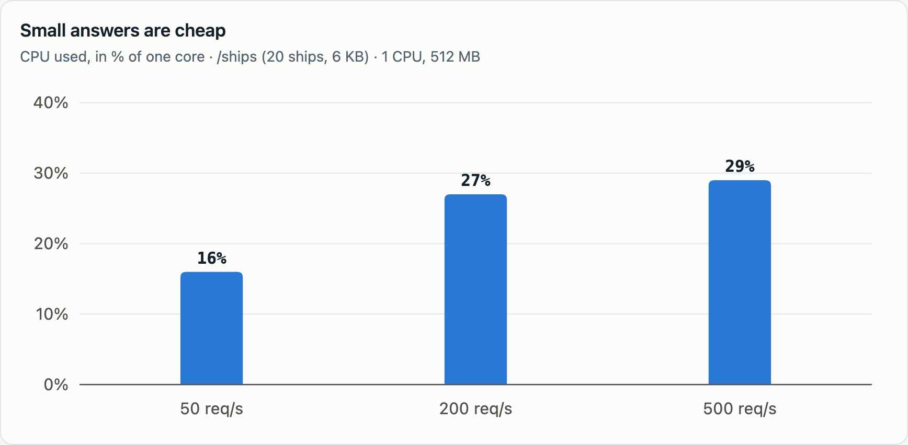
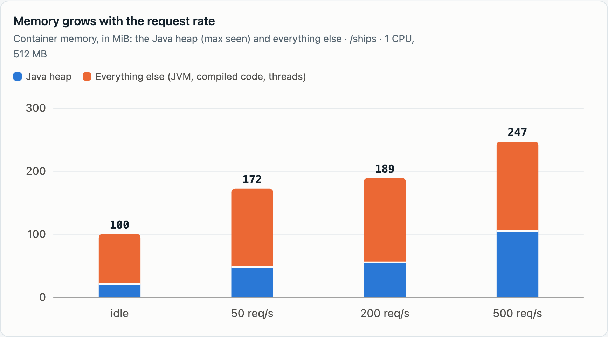
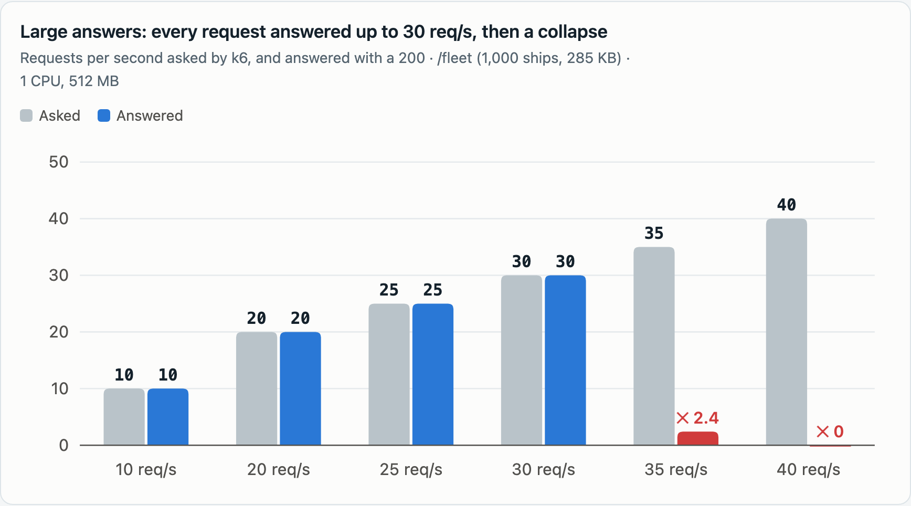
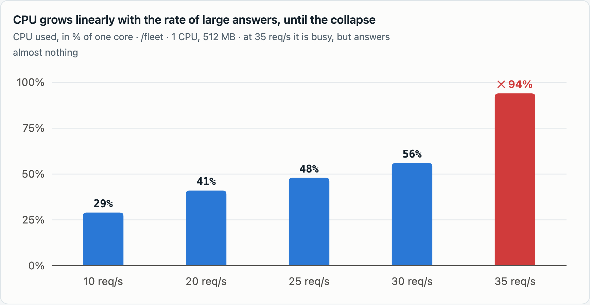

# Ikanos CPU/RAM benchmark: first results

A first baseline from [`run.sh`](run.sh), on 2026-11-04, with the jar of `main` plus the JVM metrics of issue
#737 (Java 21, Temurin, Alpine image).

**Where it ran:** Docker Desktop on an Apple Silicon Mac. The Docker VM has 15 CPUs and 7.9 GB, and k6 and nginx
run in the same VM as Ikanos, so at high rates they compete with it for the VM's CPUs. Ikanos had fixed CPU and
memory limits and **no swap** (`memswap_limit` = `mem_limit`, as in Kubernetes), but the host was not dedicated:
treat these figures as an order of magnitude. The issue asks for a dedicated, resource-fixed machine for the
reference figures: the same `run.sh` runs there unchanged.

## Figures

The capability proxies an upstream API and reshapes its JSON (see [README.md](README.md)): **small** is
`/ships` (20 ships, 6 KB from the upstream), **large** is `/fleet` (1,000 ships, 285 KB). Each step is a 20 s
warm-up at its rate, a 60 s measured run, and a recovery check; the first step of a run, or the first after a
restart, gets a longer warm-up (each run's `environment` block says which). The tables below are the `summary.md` that `run.sh` wrote, unedited, in [`runs/`](runs/); each one
starts with the environment and explains its columns. The main columns:

- **Answered** is the requests per second that got a 200 (k6's completed requests count failures too), and
  **Ikanos 200/s** the same counted by Ikanos itself. **Dropped**: requests k6 couldn't even send.
- **Heap after GC** shows a really full heap, unlike the used heap, which with the Serial collector rises to the
  heap size under any load. **GC s**: seconds of garbage collection in the 60 s.
- **Recovery s**: after the step, how long until `/ships` answers within 1 s again. `120+` means it didn't, and
  `run.sh` restarted Ikanos.

### Small answers, 1 CPU, 512 MB ([run](runs/2026-11-04-1cpu-512m-small.md))

| Load | Asked | Answered | Ikanos 200/s | Dropped | p50 ms | p99 ms | Errors | CPU avg / max % | Memory max MiB | Heap max MiB | Heap after GC max MiB | Threads | GC s | Recovery s |
|---|---|---|---|---|---|---|---|---|---|---|---|---|---|---|
| idle | – | – | – | – | – | – | – | 0.4 / 2.5 | 100 | 21 | 10 | 32 | – | – |
| /ships | 50 | 50.0 | 50.0 | 0 | 2.8 | 5.4 | 0.0% | 16 / 25 | 172 | 48 | 26 | 110 | 0.4 | 0 |
| /ships | 200 | 200.0 | 200.0 | 0 | 1.3 | 3.7 | 0.0% | 27 / 33 | 189 | 55 | 29 | 161 | 1.5 | 0 |
| /ships | 500 | 500.0 | 500.0 | 0 | 0.7 | 1.8 | 0.0% | 29 / 31 | 247 | 105 | 65 | 229 | 1.3 | 0 |

### Large answers, 1 CPU, 512 MB ([run](runs/2026-11-04-1cpu-512m-large.md))

| Load | Asked | Answered | Ikanos 200/s | Dropped | p50 ms | p99 ms | Errors | CPU avg / max % | Memory max MiB | Heap max MiB | Heap after GC max MiB | Threads | GC s | Recovery s |
|---|---|---|---|---|---|---|---|---|---|---|---|---|---|---|
| idle | – | – | – | – | – | – | – | 0.2 / 0.3 | 94 | 21 | 10 | 32 | – | – |
| /fleet | 10 | 10.0 | 10.0 | 0 | 27.3 | 29.5 | 0.0% | 29 / 34 | 222 | 100 | 55 | 79 | 1.8 | 0 |
| /fleet | 20 | 20.0 | 20.0 | 0 | 20.3 | 22.0 | 0.0% | 41 / 45 | 226 | 103 | 55 | 78 | 2.6 | 0 |
| /fleet | 25 | 25.0 | 25.0 | 0 | 19.3 | 21.1 | 0.0% | 48 / 51 | 231 | 112 | 55 | 77 | 3.0 | 0 |
| /fleet | 30 | 30.0 | 30.0 | 0 | 18.2 | 19.8 | 0.0% | 56 / 66 | 232 | 113 | 54 | 76 | 3.5 | 0 |
| /fleet | 35 | 2.4 | no answer | 1656 | 17.4 | 681.5 | 48.8% | 94 / 102 | 259 | 119 | 85 | 85 | no answer | 120+ |
| /fleet | 40 | 0.0 | 0.0 | 2221 | – | – | 100.0% | 100 / 102 | 271 | no answer | no answer | no answer | 0.0 | 120+ |

"no answer": the Control Port didn't answer during the collapse either.

### Large answers, 2 CPUs, 1 GB ([run](runs/2026-11-04-2cpu-1g-large.md))

| Load | Asked | Answered | Ikanos 200/s | Dropped | p50 ms | p99 ms | Errors | CPU avg / max % | Memory max MiB | Heap max MiB | Heap after GC max MiB | Threads | GC s | Recovery s |
|---|---|---|---|---|---|---|---|---|---|---|---|---|---|---|
| idle | – | – | – | – | – | – | – | 0.2 / 0.4 | 100 | 21 | 12 | 32 | – | – |
| /fleet | 40 | 40.0 | 40.0 | 0 | 16.6 | 36.2 | 0.0% | 76 / 82 | 156 | 51 | 24 | 48 | 10.6 | 0 |
| /fleet | 50 | 50.0 | 50.0 | 0 | 16.0 | 36.5 | 0.0% | 94 / 111 | 163 | 48 | 25 | 69 | 12.4 | 0 |
| /fleet | 60 | 60.0 | 60.0 | 0 | 18.5 | 37.1 | 0.0% | 113 / 128 | 168 | 51 | 26 | 87 | 13.9 | 0 |
| /fleet | 75 | 75.0 | 75.0 | 0 | 25.6 | 44.1 | 0.0% | 167 / 171 | 176 | 59 | 30 | 102 | 18.4 | 0 |

The highest step tried, 75 req/s, held: the edge at 2 CPUs is above it.

### Large answers with a bigger heap, 1 CPU, 1 GB, `-XX:MaxRAMPercentage=75` ([run](runs/2026-11-04-1cpu-1g-heap75-large.md))

| Load | Asked | Answered | Ikanos 200/s | Dropped | p50 ms | p99 ms | Errors | CPU avg / max % | Memory max MiB | Heap max MiB | Heap after GC max MiB | Threads | GC s | Recovery s |
|---|---|---|---|---|---|---|---|---|---|---|---|---|---|---|
| idle | – | – | – | – | – | – | – | 0.2 / 0.5 | 101 | 21 | 12 | 32 | – | – |
| /fleet | 30 | 30.0 | 30.0 | 0 | 17.3 | 20.3 | 0.0% | 53 / 56 | 849 | 549 | 270 | 174 | 1.0 | 0 |
| /fleet | 40 | 37.6 | 38.9 | 68 | 16.1 | 3762.7 | 0.0% | 71 / 105 | 858 | 566 | 268 | 173 | 3.6 | 0 |

### In charts

## What it shows

1. **Idle, Ikanos takes about 100 MB and no CPU.**
2. **Small answers are cheap.** 500 req/s used under a third of a core, with a p99 under 2 ms. Memory grows
   with the request rate, to about 250 MB, mostly outside the heap (threads, compiled code).
3. **A large answer costs about 19 ms of CPU** (56% of a core at 30 req/s). Most of it is avoidable: for each
   field it reads, the output mapping builds a new JSON mapper and JSONPath configuration
   (`Converter.jsonPathFind`), about 4,000 times per `/fleet` answer. Building them once gave the same answer for
   6.3 ms of CPU instead of 22.5, and a sixth of the garbage collection, in a quick test. That fix belongs in its
   own issue.
4. **The collapse is not CPU running out.** At 35 req/s, 35 × 19 ms is 66% of a core, yet Ikanos answered almost
   nothing. Nothing limits how many requests it works on at once (Jetty takes up to 200, with an unbounded queue
   behind), and the more it works on at once, the less it gets done: each large request in progress holds about
   2 MB of parsed JSON, the heap fills (heap after GC 54 → 85 MiB, out-of-memory errors in the log), and garbage
   collection takes the CPU. The edge is unstable: in separate tests, 25 req/s held for two minutes, then flipped
   after one short GC pause. A cold JVM can collapse at a rate it holds once warm: a first 2-CPU run, warmed
   up directly at its step's rate, collapsed even at 40 req/s, and the same steps after a gentle warm-up all held.
5. **It doesn't recover by itself.** After a collapse, Ikanos still answered nothing 120 s after the load
   stopped (and 20 minutes in a separate test): it keeps working on requests whose clients have already left.
   Meanwhile the Control Port's `/health` stays green, so a Kubernetes liveness probe on it would not restart
   the pod.
6. **A bigger heap only moves the edge a little.** With 75% of 1 GB, 40 req/s mostly held (with a 3.8 s p99 and
   dropped requests), and the container used 858 of its 1,024 MiB. At 512 MB, 75% would leave 128 MiB for
   everything outside the heap, which already takes about 140 MiB under load: Kubernetes would kill the
   container. In separate tests with more heap sizes, the collapse moved but always came.
7. **Two CPUs more than double the capacity.** At 2 CPUs and 1 GB, every step up to 75 req/s held (167% CPU,
   about 22 ms per answer, heap after GC at most 30 MiB), where 1 CPU collapsed at 35. The second CPU leaves room
   for garbage collection and for the requests waiting their turn. In a test that shared the VM with other
   load, 2 CPUs collapsed at 60 req/s, so this edge too depends on conditions.
8. **The JVM sizes itself small in a container.** By default the heap is 25% of the container's memory, and with
   fewer than 2 CPUs (and less than 1.75 GB) the JVM uses the Serial garbage collector.

## Sizing recommendations

These hold until Ikanos limits the requests it works on at once; see Next.

| Capability profile | CPU request / limit | Memory request / limit |
|---|---|---|
| Small answers (a few KB), up to a few hundred req/s | 250m / 1 | 256Mi / 512Mi |
| Large answers (hundreds of KB) | at least 2 CPUs; keep the peak under about 50 req/s per pod | 512Mi / 1Gi |

- **What breaks is concurrency, not CPU.** Size for the peak, with a wide margin under the edge measured above:
  a burst or a GC pause past it takes the pod down for good, CPU-based autoscaling can't react in time, and the
  pod doesn't come back by itself.
- **Raise the heap only with the memory to match.** `-XX:MaxRAMPercentage=75` fits a 1Gi limit (858 MiB used
  under load), not 512Mi. At 512Mi, keep the default.
- **Probe the API, not only `/health`.** A liveness probe that calls a cheap operation of the capability restarts
  a collapsed pod; `/health` alone doesn't see the collapse.

## Next

- Run the same benchmark on a dedicated, resource-fixed machine for the reference figures.
- Separate issues, found while measuring:
  - a limit on requests in progress (with a fast 503 for the excess), so overload degrades instead of collapsing;
    a prototype capped at 4 kept answering about 49 of 50 req/s at 1 CPU, where today answers none;
  - building the JSON mapper and JSONPath configuration once in `Converter.jsonPathFind`;
  - a REST request with `Connection: close` (sent by HTTPie Desktop, for instance) hangs instead of being
    answered, and any exception that escapes a REST operation leaves its client waiting forever.
- More capability profiles: MCP tools, aggregates with several calls, scripting steps.
