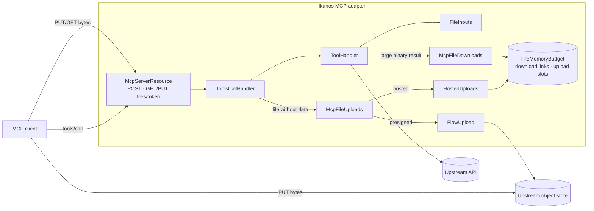
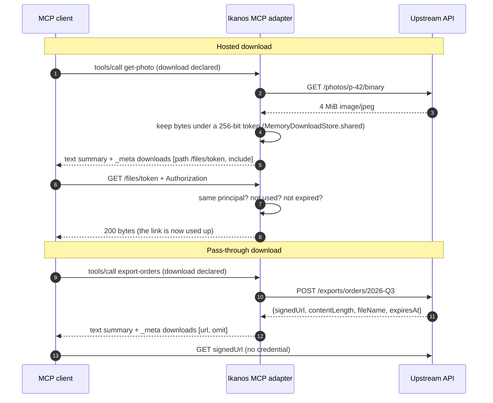
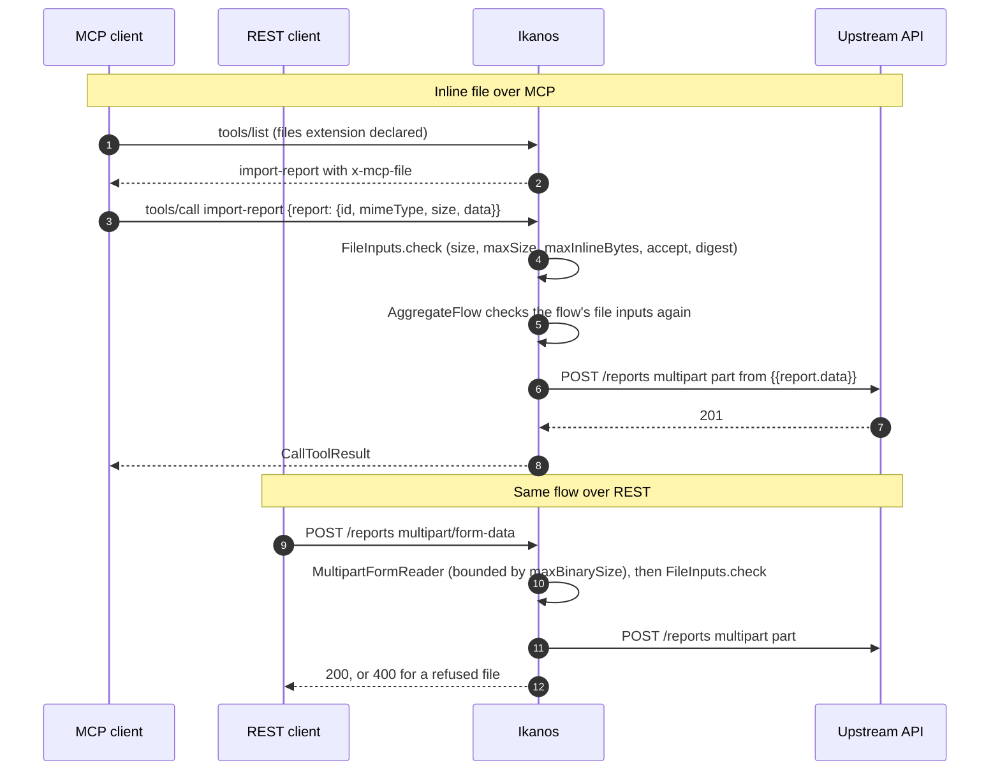
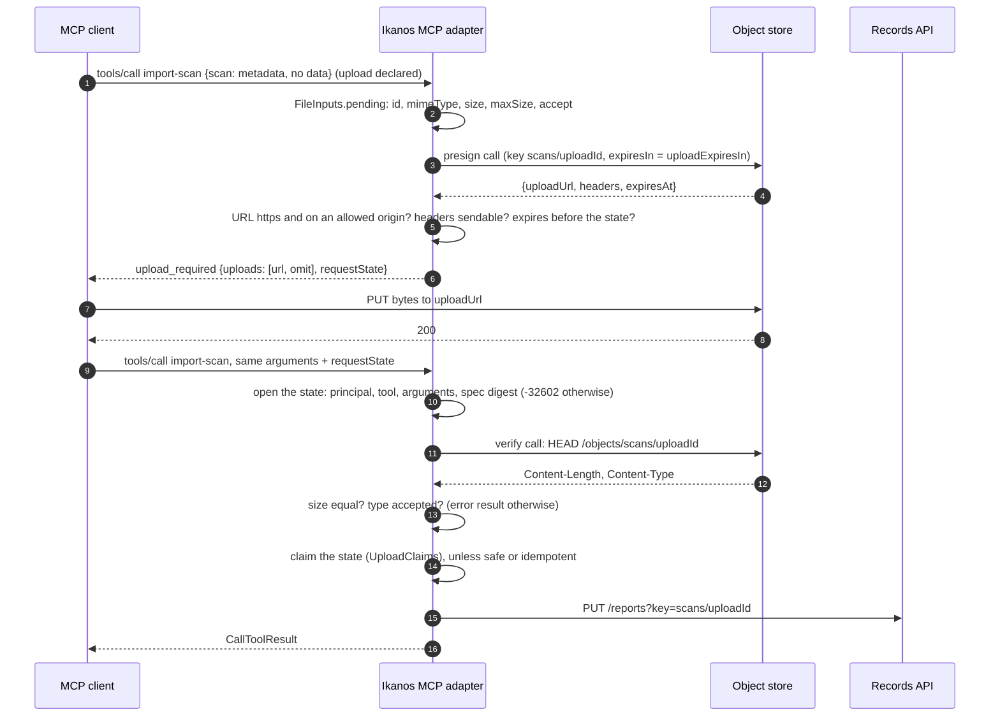
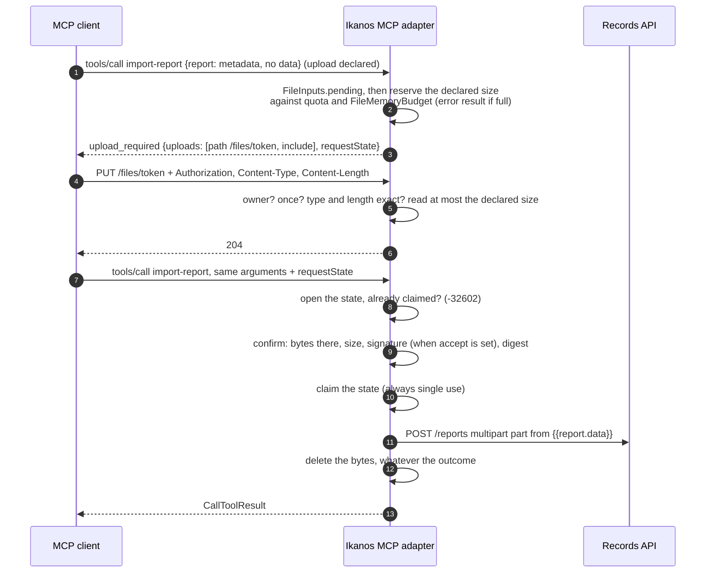

# MCP Files Extension
## Uploads and downloads for MCP tools through the draft `io.modelcontextprotocol/files` extension

**Status**: Experimental. The extension is a working-group draft, and every block described here is marked **experimental** in the schema.

**Spec version**: 1.0.0-beta11

**Date**: November 27, 2026

**Tracking**: epic [#1048](https://github.com/naftiko/ikanos/issues/1048), phases [#1043](https://github.com/naftiko/ikanos/issues/1043), [#1044](https://github.com/naftiko/ikanos/issues/1044), [#1045](https://github.com/naftiko/ikanos/issues/1045), [#1046](https://github.com/naftiko/ikanos/issues/1046) and [#1047](https://github.com/naftiko/ikanos/issues/1047)

**MCP protocol**: revision `2026-07-28`, with the draft [File Uploads and Downloads extension](https://github.com/modelcontextprotocol/experimental-ext-file-uploads/pull/1) of the MCP File Uploads Working Group (published November 10, 2026)

**Worked example**: [`capability-mcp-files.yml`](../ikanos-spec/src/main/resources/schemas/examples/capability-mcp-files.yml)

---

This document describes how Ikanos implements the draft MCP files extension: what a capability author declares, what goes over the wire, what the engine does, and why it was built this way. It follows the five phases the work shipped in, then lists the known limits and the questions Ikanos can help the working group answer. For how the code fits in the engine as a whole, read the Files extension bullet of [architecture.md](architecture.md#an-mcp-toolscall-over-http). For the field-by-field contract, read the schema descriptions in `ikanos-schema.json`.

## Table of Contents

1. [Summary](#1-summary)
2. [Overview](#2-overview)
3. [The draft in brief](#3-the-draft-in-brief)
4. [Phase 1: downloads and negotiation](#4-phase-1-downloads-and-negotiation)
5. [Phase 2: file inputs](#5-phase-2-file-inputs)
6. [Phase 3: uploads through upstream presigned URLs](#6-phase-3-uploads-through-upstream-presigned-urls)
7. [Phase 4: uploads hosted on the adapter](#7-phase-4-uploads-hosted-on-the-adapter)
8. [Phase 5: lint rules and the origin allowlist](#8-phase-5-lint-rules-and-the-origin-allowlist)
9. [Bounds, state and security](#9-bounds-state-and-security)
10. [Load-time checks](#10-load-time-checks)
11. [Tests](#11-tests)
12. [Known limits and follow-ups](#12-known-limits-and-follow-ups)
13. [Open questions for the File Uploads Working Group](#13-open-questions-for-the-file-uploads-working-group)
14. [Backward compatibility](#14-backward-compatibility)

---

## 1. Summary

### What it does

MCP has had no standard way to move files. Ikanos returned binary results inline as base64 (`outputRawFormat: binary`, capped by `maxBinarySize`) and had no way to declare a file input. The draft extension keeps file bytes out of the model's context: tools take file metadata, and bytes move over HTTPS between the client and a target the server names. Ikanos implements it in five phases:

1. **Downloads and negotiation.** An MCP adapter opts in with a `files` block. `server/discover` advertises the extension. A binary tool result above a threshold becomes a single-use download link on the adapter itself, and a tool whose upstream already returns a presigned URL can return that URL as a download target.
2. **File inputs.** A flow or tool input can be `type: file`. Over MCP it is the draft's file object marked `x-mcp-file`, with the bytes inline in `data`. Over REST it is a `multipart/form-data` part. One check (`FileInputs`) runs for both adapters.
3. **Uploads through upstream presigned URLs.** A flow that declares `upload` answers a file sent without its bytes with an `upload_required` result whose targets are presigned URLs from the upstream's storage. On the retry, the flow's `verify` call confirms the bytes arrived, and the flow runs with the stored object's key.
4. **Uploads hosted on the adapter.** With `files.uploads.hosted: true`, the adapter receives out-of-band uploads itself, on a path under its MCP address, within a quota, and passes the bytes to the tool as if they had been sent inline.
5. **Lint rules and an origin allowlist.** Five Polychro rules check file inputs and transfer targets, and `files.allowedOrigins` bounds where the targets that carry no credential may point.

### What it does not do

- **Change anything without `files`.** An MCP adapter that does not declare `files` does not advertise the extension and behaves as before.
- **Change resources.** The draft applies to tools only. `resources/read` keeps returning `BlobResourceContents` for binary content.
- **Return download targets from tasks or from the `call-tool` meta-tool.** Only a direct `tools/call` that declared `download` gets them.
- **Stream or spool to disk.** Hosted bytes are buffered in memory, under one process-wide bound.
- **Share state across replicas.** Download links, hosted upload slots and single-use claims live in the process that issued them.
- **Issue `form` or `POST` upload targets.** Every upload target is a `PUT`.
- **Sniff files it never reads.** Out-of-band files stored by an upstream (phase 3) and inline files (phase 2) are not inspected for their type. Only hosted uploads (phase 4) are.

### Key design decisions

1. **Opt-in per adapter.** The `files` block on an MCP exposes block is the only switch. It is marked experimental in the schema.
2. **One place for the wire shape.** `McpFiles` holds the extension identifier, the setting names, the file input schema and the `_meta` placement of download targets. The working group may move the placement; only that class would change.
3. **Hosted targets use `path`, not `url`.** A `path` resolves under the MCP address the client already uses, so it works behind any mount path or proxy, and keeps `credentials: include` on the server's own origin by construction.
4. **In-memory stores behind interfaces, not the durable `BlobStore`.** `BlobStore` is keyed by execution, offers only `deleteAll(executionId)` and exists only in a durable mode, while a file belongs to a `tools/call` that has no execution. `DownloadStore` and `UploadStore` let a shared backend replace the memory ones later.
5. **One memory budget for the process.** Hosted downloads and hosted uploads draw from `FileMemoryBudget.shared()`: 1/8 of the maximum heap, at most 256 MiB, and a quarter of it per caller. Hosted downloads hold every caller to that quarter, including the anonymous principal that all requests share on an adapter without caller identity; hosted uploads of that anonymous principal draw on the total only, with the adapter's `quota` bounding them.
6. **Server-chosen object names.** A file stored through a presigned URL is named by a random `uploadId`, never by the client's `id`.
7. **A refused file is an error result, never a protocol error.** That is what the draft's error table asks, and it lets the model act on the message. Protocol errors are kept for a missing capability (`-32021`) and a bad or reused `requestState` (`-32602`).
8. **Durations are ISO 8601** (`PT5M`), like `durability.retention`, the only duration string the spec had before. Sizes are sized strings (`1MiB`), like `maxBinarySize`.

---

## 2. Overview

### Opting in

```yaml
exposes:
  - type: "mcp"
    namespace: "photos-mcp"
    port: 8765
    files:                              # experimental: opts into io.modelcontextprotocol/files
      allowedOrigins:                   # phase 5: where credentials: omit targets may point
        - "https://scans.storage.example.org"
      downloads:                        # phase 1
        inlineThreshold: "1MiB"         # default 1MiB
        ttl: "PT5M"                     # default PT5M
      uploads:                          # phases 2 and 4
        maxInlineBytes: "1MiB"          # default 1MiB
        hosted: true                    # default false
        quota: "64MiB"                  # default 100MiB
        ttl: "PT5M"                     # default PT5M
```

Every member of `files` is optional: `files: {}` turns the extension on with the defaults.

### Where the code lives

| Class | Package | Role |
|---|---|---|
| `McpFiles` | `exposes.mcp.files` | Extension id, settings, file input schema, `_meta` placement, the `download` thread-local |
| `McpFileDownloads` | `exposes.mcp.files` | Hosted and pass-through download targets (phase 1) |
| `DownloadStore`, `MemoryDownloadStore` | `exposes.mcp.files` | Hosted download links |
| `FileMemoryBudget` | `exposes.mcp.files` | The process-wide bound on hosted bytes |
| `FileInputs`, `MultipartFormReader`, `FileSignatures` | `util` | File argument checks (MCP and REST), multipart bodies, byte signatures |
| `McpFileUploads` | `exposes.mcp.files` | The `upload_required` round and its retry (phases 3 and 4) |
| `FlowUpload` | `aggregates` | A flow's `presign` and `verify` calls, and staging of inline files (phase 3) |
| `UploadClaims` | `exposes.mcp.files` | Single use of a `requestState` (phase 3) |
| `HostedUploads`, `UploadStore`, `MemoryUploadStore` | `exposes.mcp.files` | Hosted upload targets and their bytes (phase 4) |
| `OriginAllowlist` | `exposes.mcp.files` | `files.allowedOrigins` (phase 5) |
| `mcp-files.js` | `rules/functions` | The five Polychro rules (phase 5) |

The MCP adapter wires them in: `McpServerAdapter` builds `McpFileDownloads` and `McpFileUploads` at load, `ServerDiscoverHandler` advertises the settings, `ToolsListHandler` filters tools that take files, `ToolsCallHandler` runs the upload round and sets the `download` flag, `ToolHandler` checks file arguments and asks for download targets, and `McpServerResource` serves `GET` and `PUT` on `<MCP address>/files/<token>`.



---

## 3. The draft in brief

The parts of the draft the phases below refer to.

**Negotiation.** Clients declare the extension per request, in `params._meta["io.modelcontextprotocol/clientCapabilities"].extensions["io.modelcontextprotocol/files"]`, with the settings `upload` and `download` (each an empty object). Servers advertise it in `server/discover` with `upload` and `maxInlineBytes`. `download` is a client setting only. An inline-only client declares empty settings on `tools/list`.

**File inputs.** A tool argument that takes a file is an object `{id, name?, mimeType, size, digest?, data?}`, where `digest` is `{algorithm: "sha-256", value}` (base64url, no padding) and `data` is the file in base64. Its schema carries `x-mcp-file: {accept?, maxSize?}`. A file with `data` is inline; a non-empty file without `data` is sent out of band.

**Upload request.** A server answers a call whose files must go out of band with `resultType: "upload_required"`, one `UploadTarget` per file (`fileId`, `url` or `path`, `method` default `PUT`, `headers`, `credentials: "omit" | "include"`, `expiresAt`), and a `requestState`. The client sends the bytes to each target, then retries the same call, with unchanged arguments, and the `requestState`. The server verifies the state, confirms the bytes, consumes the state if the tool must not run twice, then runs the tool.

**Download targets.** A tool returns a file by listing a `DownloadTarget` (`name?`, `mimeType`, `size`, `digest?`, `url` or `path`, `headers?`, `credentials`, `expiresAt?`) in `result._meta["io.modelcontextprotocol/files"].downloads`, and describes the result in `content`.

**Credentials.** With `omit`, the client sends the target no credential: the URL carries its own authorization, such as a presigned URL. With `include`, it sends the `Authorization` credential it sends on MCP requests, and no other, so an `include` target must be on the MCP server's own origin.

How Ikanos maps the draft's outcomes:

| Situation | Ikanos answer |
|---|---|
| A file refused on its metadata or inline bytes (type, size, `maxSize`, `maxInlineBytes`, base64, digest, duplicate `id`, no way to accept it) | Error result (`isError: true`); the tool does not run |
| A file sent without `data` to a tool that takes uploads, by a request that did not declare `upload` | `-32021` with `requiredCapabilities.extensions["io.modelcontextprotocol/files"].upload` |
| No usable upload target (presign failed, off-list origin, quota full) | Error result, before any target or `requestState` is returned |
| A retry whose bytes are missing, of another size, of a refused type or digest | Error result; the tool does not run |
| A retry with a `requestState` that is invalid, bound to another call or principal, or already used | `-32602` |

---

## 4. Phase 1: downloads and negotiation

[#1043](https://github.com/naftiko/ikanos/issues/1043), PR [#1186](https://github.com/naftiko/ikanos/pull/1186).

### 4.1 Problem

A binary tool result is returned inline as base64, up to `maxBinarySize`. A large photo or report fills the model's context with bytes it cannot use, and some upstreams already return a presigned URL that the tool can only hand over as text.

### 4.2 YAML surface

`files.downloads` sets the threshold and the link lifetime. A tool may declare `download`, naming top-level properties of its mapped output (`url` and `size` required, `mimeType`, `name` and `expiresAt` optional).

```yaml
consumes:
  - type: "http"
    namespace: "photo-library"
    baseUri: "https://photos.example.org"
    resources:
      photos:
        path: "/photos/{{id}}/binary"
        operations:
          download-photo:
            method: "GET"
            outputRawFormat: "binary"
            outputMediaType: "image/jpeg"
  - type: "http"
    namespace: "exports"
    baseUri: "https://exports.example.org"
    resources:
      order-exports:
        path: "/exports/orders/{{quarter}}"
        operations:
          export-orders:
            method: "POST"

exposes:
  - type: "mcp"
    namespace: "photos-mcp"
    port: 8765
    maxBinarySize: "25MiB"
    files:
      downloads:
        inlineThreshold: "1MiB"
        ttl: "PT5M"
    tools:
      get-photo:                         # hosted download: a binary result above 1 MiB
        hints:
          readOnly: true
        inputParameters:
          id:
            type: "string"
            required: true
        call: "photo-library.download-photo"
        with:
          id: "{{id}}"
      export-orders:                     # pass-through download: the upstream's presigned URL
        inputParameters:
          quarter:
            type: "string"
            required: true
        call: "exports.export-orders"
        with:
          quarter: "{{quarter}}"
        outputParameters:
          - type: "object"
            mapping: "$"
            properties:
              url:
                type: "string"
                mapping: "$.signedUrl"
              size:
                type: "number"
                mapping: "$.contentLength"
              file-name:
                type: "string"
                mapping: "$.fileName"
              expires-at:
                type: "string"
                mapping: "$.expiresAt"
        download:
          url: "url"
          size: "size"
          name: "file-name"
          expiresAt: "expires-at"
```

### 4.3 Wire exchange

`server/discover`, for an adapter that declares `files` (with the phase 2 and 4 settings that the stack added later; phase 1 alone advertised `{}`):

```json
{
  "capabilities": {
    "tools": {},
    "extensions": {
      "io.modelcontextprotocol/files": { "upload": {}, "maxInlineBytes": 1048576 }
    }
  }
}
```

A `tools/call` that declares `download`:

```json
{
  "jsonrpc": "2.0",
  "id": 7,
  "method": "tools/call",
  "params": {
    "name": "get-photo",
    "arguments": { "id": "p-42" },
    "_meta": {
      "io.modelcontextprotocol/clientCapabilities": {
        "extensions": { "io.modelcontextprotocol/files": { "download": {} } }
      }
    }
  }
}
```

A 4 MiB photo becomes a hosted target. The other members the adapter adds to `_meta` (server information) are left out here:

```json
{
  "jsonrpc": "2.0",
  "id": 7,
  "result": {
    "content": [
      {
        "type": "text",
        "text": "The file get-photo.jpg (image/jpeg, 4194304 bytes) is ready to download; its content is not part of this result."
      }
    ],
    "isError": false,
    "_meta": {
      "io.modelcontextprotocol/files": {
        "downloads": [
          {
            "name": "get-photo.jpg",
            "mimeType": "image/jpeg",
            "size": 4194304,
            "digest": { "algorithm": "sha-256", "value": "…" },
            "path": "/files/Q2x1Ym…43 characters",
            "credentials": "include",
            "expiresAt": "2026-11-27T10:05:00Z"
          }
        ]
      }
    }
  }
}
```

The client then sends `GET <MCP address>/files/<token>` with the `Authorization` header of its MCP requests and gets the bytes, with `Content-Disposition: attachment; filename=get-photo.jpg` and `Cache-Control: no-store`.

`export-orders` returns the upstream's URL instead, with `credentials: omit`:

```json
{
  "name": "q3-orders.csv",
  "mimeType": "application/octet-stream",
  "size": 209715200,
  "url": "https://files.exports.example.org/d/01JD3V9P4Q?sig=…",
  "credentials": "omit",
  "expiresAt": "2026-11-27T10:30:00Z"
}
```

The example declares no `mimeType` property in `download`, so the target says `application/octet-stream`.

### 4.4 Round trips



### 4.5 Engine behaviour and limits

- **When a target is returned.** Only for a direct `tools/call` whose request declared `download`. `ToolsCallHandler` runs the call under `McpFiles.withDownloads(...)`, a thread-local, and `ToolHandler` asks `McpFileDownloads` for a target. Tasks and the `call-tool` meta-tool never set the flag, so their results stay inline: a task result can be read after its link has expired, and the meta-tool batches results. Below `inlineThreshold`, or without `download`, the result is inline as before.
- **Hosted targets.** A binary result (`outputRawFormat: binary`) larger than `inlineThreshold` is kept in the process-wide `MemoryDownloadStore.shared()` under a token of 32 random bytes (43 base64url characters). The result is still read under `maxBinarySize`: the threshold moves the bytes out of the result, it does not raise the cap. The target carries a SHA-256 `digest`, `path: /files/<token>`, `credentials: include` and `expiresAt` (now plus `ttl`, to the second). The file name is the tool name with the media type's usual extension.
- **Serving the link.** `McpServerResource` serves `GET <address>/files/<token>` behind the adapter's authentication chain, once, only to the principal the tool call ran for (`ProtocolDispatcher.ownerOf`, the same owner `requestState` and tasks use), and before `expiresAt`. The link is recognized as the last two path segments, `files/<43-char token>`, whatever the MCP address path is. An unknown, used, expired or foreign link gets the same `404`, so a link cannot be probed, and a foreign principal does not use it up. A `HEAD` gets `405` with `Allow: GET` and leaves the file in the store (Restlet answers `HEAD` with the `GET` handler, which would otherwise consume the link).
- **Which authentication supports hosted links.** With `credentials: include`, a client resends only the `Authorization` header of its MCP requests and keeps the query string of the MCP address. `McpFileDownloads.resendsCredential` therefore allows no authentication, `bearer`, `basic`, `oauth2` and an `apikey` in the query. Behind an `apikey` in another header or `digest` (bound to one request), binary results stay inline and a warning at load names the adapter; pass-through targets still work.
- **Transport.** Hosted targets need HTTP: on stdio, binary results stay inline. Pass-through targets work on both.
- **Memory.** The store keeps at most 256 files, and its bytes come from `FileMemoryBudget.shared()`: 1/8 of `Runtime.maxMemory()`, at most 256 MiB, and at most a quarter of that per principal. On an adapter without caller identity (no authentication, `bearer`, `basic`, `apikey`), every request has the adapter's anonymous principal, so all its hosted downloads together hold at most that quarter. A result that does not fit is returned inline, with a warning. Expired files are dropped on every put and take, and by a daemon thread every 30 s. Stopping the adapter drops its links (`McpFileDownloads.dropLinksOf`) and gives their bytes back.
- **Pass-through targets.** The mapped output must be a JSON object whose `url` property is an absolute `https` URL without user info and whose `size` property is a non-negative integer (a number or a string of digits). Otherwise the tool returns its mapped output as it is, and a warning is logged (with `files.allowedOrigins` set, a URL on another origin is an error result instead, see [§8.4](#84-engine-behaviour)). `expiresAt` is parsed as an ISO 8601 timestamp with an offset and sent in UTC; a value that does not parse is left out of the target, with a warning, since a client must reject a target with a value its type does not allow. `mimeType` defaults to `application/octet-stream`. The threshold does not apply: the bytes never pass through Ikanos.
- **No `outputSchema` for `download` tools.** A tool that declares `download` advertises no `outputSchema`, since its result may carry no `structuredContent` (the draft forbids a target in `content` or `structuredContent`).
- **`_meta` merge.** `ServerDataAppender`, which adds the server information to every result's `_meta`, used to replace the whole `_meta`, which would have dropped the targets. It now merges into an existing `_meta`, from a copy of the shared server-info node.

### 4.6 Design choices

- **Advertise `{}` in phase 1.** The draft defines `download` as a client-only setting, and advertising the extension is what lets a client declare it. The first version advertised `{"download": {}}`; review ([#1186](https://github.com/naftiko/ikanos/pull/1186)) changed it. Later phases add `maxInlineBytes` and `upload`, and `McpFiles.serverSettings` builds the object. On the client side, any value but `false` or `null` counts as a declared setting.
- **Hosted links bound to the principal, single use.** The draft requires `include` targets to be bound to the caller. Reusing the owner that tasks and `requestState` use keeps one notion of "the same caller" across the adapter.
- **Fall back to inline rather than fail.** A full store, an authentication a client cannot resend, stdio, a missing `download` setting or an unusable pass-through output all return the result the tool returned before the extension. A download is an optimization of a result that already worked.
- **A process-wide bound, not one per adapter.** The first store was bounded per adapter at a fixed size. Review showed that a caller could pin memory across adapters, on a container whose heap defaults to a quarter of its memory, and that idle adapters kept expired entries. The store is now one per process, sized from the heap, with a share per caller and a scheduled sweep.
- **Resources unchanged.** The draft defines download targets on `CallToolResult` only.

---

## 5. Phase 2: file inputs

[#1044](https://github.com/naftiko/ikanos/issues/1044), PR [#1193](https://github.com/naftiko/ikanos/pull/1193).

### 5.1 Problem

A capability could not declare that a tool or operation takes a file. Authors had to take base64 strings as plain `string` inputs, with no type, size or integrity check, and no way for a client to know a file was expected.

### 5.2 YAML surface

`type: file` on an aggregate flow input or an MCP tool input, with `accept` (media types, ranges such as `image/*`, or dot-prefixed extensions such as `.csv`) and `maxSize` (a sized string). The schema refuses `accept` and `maxSize` on any other type. `files.uploads.maxInlineBytes` (default `1MiB`) bounds the inline files of one call. A consumed body of `type: binary` sends the decoded bytes of a base64 template.

```yaml
consumes:
  - type: "http"
    namespace: "records"
    baseUri: "https://records.example.org"
    resources:
      reports:
        path: "/reports"
        operations:
          upload-report:
            method: "POST"
            body:
              type: "multipartForm"
              data:
                - name: "label"
                  value: "{{label}}"
                - name: "file"
                  value: "{{report.data}}"       # the file's bytes, in base64
                  encoding: "base64"
                  filename: "{{report.name}}"
                  contentType: "{{report.mimeType}}"

aggregates:
  - namespace: "documents"
    flows:
      import-report:
        semantics:
          idempotent: false
        inputParameters:
          report:
            type: "file"
            accept: ["application/pdf", "text/csv"]
            maxSize: "50MiB"
            required: true
          label:
            type: "string"
        call: "records.upload-report"

exposes:
  - type: "rest"
    namespace: "documents-api"
    port: 8080
    maxBinarySize: "50MiB"
    resources:
      reports:
        path: "/reports"
        operations:
          import-report:
            method: "POST"
            ref: "documents.import-report"     # takes a multipart/form-data body
  - type: "mcp"
    namespace: "photos-mcp"
    port: 8765
    files:
      uploads:
        maxInlineBytes: "1MiB"
    tools:
      import-report:
        ref: "documents.import-report"         # takes the x-mcp-file object
```

A `binary` body sends one file as the whole request body instead of a form part:

```yaml
body:
  type: "binary"
  data: "{{report.data}}"
  contentType: "{{report.mimeType}}"           # default application/octet-stream
```

### 5.3 Wire exchange

`tools/list`, for a request that declares the extension, advertises the file argument as the draft's file object:

```json
{
  "name": "import-report",
  "inputSchema": {
    "type": "object",
    "properties": {
      "report": {
        "type": "object",
        "description": "The report to import.",
        "x-mcp-file": { "accept": ["application/pdf", "text/csv"], "maxSize": 52428800 },
        "properties": {
          "id": { "type": "string", "minLength": 1, "maxLength": 128 },
          "name": { "type": "string" },
          "mimeType": { "type": "string" },
          "size": { "type": "integer", "minimum": 0 },
          "digest": {
            "type": "object",
            "properties": { "algorithm": { "const": "sha-256" }, "value": { "type": "string" } },
            "required": ["algorithm", "value"]
          },
          "data": { "type": "string" }
        },
        "required": ["id", "mimeType", "size"]
      },
      "label": { "type": "string", "description": "A label for the report." }
    },
    "required": ["report"]
  }
}
```

An inline call:

```json
{
  "name": "import-report",
  "arguments": {
    "report": {
      "id": "f1",
      "name": "lab-2026-11.pdf",
      "mimeType": "application/pdf",
      "size": 18342,
      "digest": { "algorithm": "sha-256", "value": "…" },
      "data": "JVBERi0xLjcK…"
    },
    "label": "November"
  }
}
```

A refused file is an error result that names the input but never echoes its content:

```json
{
  "content": [{ "type": "text", "text": "File input 'report' is of a type it does not accept" }],
  "isError": true
}
```

Over REST, the same flow takes `multipart/form-data`:

```http
POST /reports HTTP/1.1
Content-Type: multipart/form-data; boundary=x

--x
Content-Disposition: form-data; name="label"

November
--x
Content-Disposition: form-data; name="report"; filename="lab-2026-11.pdf"
Content-Type: application/pdf

%PDF-1.7 …
--x--
```

### 5.4 Round trips



### 5.5 Engine behaviour and limits

- **Projection.** `McpToolInputSchema` advertises a file input with `McpFiles.fileInputSchema`: the draft's file object, `x-mcp-file` with `accept` and `maxSize` in bytes. `server/discover` advertises `maxInlineBytes` whenever the adapter declares `files`.
- **Listing.** `tools/list` lists a tool that takes a file only to a request that declares the extension (`RequestClientCapabilities.supportsFiles`), as the draft recommends: a client without it could not fill the argument. The filter applies to listed tools and to the pinned tools of deferred mode. A tool found through the `search-tools` meta-tool is not filtered, and a call by name still works, since servers must not reject inline `data` because a request did not declare the extension.
- **Which tools take a file.** A tool takes a file when its own inputs do, or when it has a `ref` to a flow whose inputs do, whatever the tool declares (`McpServerAdapter.fileTools`). A tool that takes a file on an adapter without `files` fails the load: no client could ever fill it.
- **The checks** (`FileInputs.check`, in `util`, shared with REST), before the tool runs:
  - the value is an object with an `id` of 1 to 128 characters, a non-blank `mimeType`, a `size` that is a non-negative integer, and a `name`, when present, that is a string;
  - `size` is within `maxSize`, and the type matches `accept` (media type, range or extension of `name`; parameters and case ignored);
  - a non-empty file has `data`; a file of size 0 needs none;
  - `data` is standard base64; its length is checked against `size` before decoding, so an oversized value is never decoded, and the decoded length must equal `size`;
  - the decoded sizes of all inline files of the call stay within `maxInlineBytes`;
  - no two files of the call share an `id`;
  - a `digest`, when present, is a SHA-256 over the bytes in base64url without padding, compared with `Arrays.equals`.
- **Where the checks run.** `ToolHandler` checks the tool's inputs, and a `ref` tool whose own inputs take no file checks its flow's inputs against `maxInlineBytes` as well. `AggregateFlow` checks the flow's own file inputs again, without a per-call total, whatever adapter or step calls it. So a `ref` tool or operation that redeclares a flow file input as another type cannot skip the checks. A file already checked passes again unchanged. A file the flow refuses is an error result over MCP and a `400` over REST.
- **What steps see.** A file is `{id, name, mimeType, size, digest?, data}` with `data` in base64. `{{report.data}}` goes into a `multipartForm` part with `encoding: base64`, or into a `binary` body.
- **The `binary` body.** `data` is rendered, whitespace is stripped and the result is base64-decoded. `contentType` is rendered, refused if it contains a line break, and defaults to `application/octet-stream`. A `Content-Type` header input replaces it, as for JSON and text bodies.
- **REST.** An operation whose flow takes a file (through `ref`) reads a `multipart/form-data` body with `MultipartFormReader`. A part without a filename is a text member, decoded as UTF-8. A part with one is a file object: `id` is the part name, `name` the file name, `mimeType` the part's `Content-Type` (else `application/octet-stream`). When two parts share a name, the last wins. The body is read up to the adapter's `maxBinarySize` (default 10 MiB) plus 64 KiB for headers and text parts, and `FileInputs.check` runs with `maxBinarySize` as the call total. A REST client may also send the file object as JSON in a JSON body. `OasExportBuilder` exports the body as `multipart/form-data`, the file as `type: string, format: binary`, with an `encoding.contentType` that lists the accepted types.

### 5.6 Design choices

- **`upload` not advertised for inline files.** In the draft, `upload` announces out-of-band uploads and the `upload_required` result. Inline transfer needs only `maxInlineBytes` ("If `0` or absent, the server does not accept inline transfer"). Until phase 3, a non-empty file without `data` was refused as "no way to accept a file".
- **`maxInlineBytes` advertised whenever `files` is declared**, with its default, even when no tool takes a file. Simpler than deriving it, and harmless: the draft treats it as a ceiling.
- **The digest is checked whenever present**, not only when a schema requires it. The schema keeps `digest` optional; there is no per-input option to require it yet. A digest is not a secret, so a plain comparison is enough.
- **One check for both adapters.** `FileInputs` sits in `util` because the REST adapter runs it too. The MCP-specific parts (`x-mcp-file`, `maxInlineBytes`, listing) stay in `McpFiles` and `McpServerAdapter`.
- **Bytes as base64 in the arguments**, not a new binary value type. That is how a file arrives over MCP, it is what the existing `multipartForm` `encoding: base64` takes, and it needs no change to the step context. The cost is one base64 copy per file, bounded by the limits above.
- **A flow-level check, not a load error for redeclared inputs.** Review found that a `ref` tool or operation that declares its own inputs skipped the flow's file checks. Checking in `AggregateFlow` closes every path into the flow, including a call from a step, and still allows a `ref` unit to rename or place its inputs.
- **Multipart only where a file input is declared.** An operation whose flow takes no file reads its body as before.

---

## 6. Phase 3: uploads through upstream presigned URLs

[#1045](https://github.com/naftiko/ikanos/issues/1045), PR [#1197](https://github.com/naftiko/ikanos/pull/1197).

### 6.1 Problem

Inline files are bounded by `maxInlineBytes` and pass through the JSON-RPC body. A scan of several hundred megabytes should go straight to the storage that will keep it, as the draft's out-of-band upload allows, without passing through Ikanos.

### 6.2 YAML surface

A flow with a file input declares `upload` with two consumed calls. `presign` returns a presigned URL for one file; JsonPath expressions say where its JSON answer carries `url` (default `$.url`), `headers` and `expiresAt`. `verify` confirms the bytes arrived, typically a `HEAD` on the object; size and type come from `Content-Length` and `Content-Type`, or from the JsonPath `size` and `mimeType` of a status API. Consumed HTTP operations gain the `HEAD` method for this.

```yaml
consumes:
  - type: "http"
    namespace: "storage"
    baseUri: "https://storage.example.org"
    resources:
      upload-urls:
        path: "/upload-urls/{{key}}"
        operations:
          create-upload-url:
            method: "POST"
            inputParameters:
              contentType: { in: "query" }
              size: { in: "query" }
              expiresIn: { in: "query" }
      objects:
        path: "/objects/{{key}}"
        operations:
          head-object:
            method: "HEAD"
  - type: "http"
    namespace: "records"
    baseUri: "https://records.example.org"
    resources:
      reports:
        path: "/reports"
        operations:
          import-from-storage:
            method: "PUT"
            inputParameters:
              key: { in: "query" }

aggregates:
  - namespace: "documents"
    flows:
      import-scan:
        semantics:
          idempotent: false                    # each requestState runs the flow at most once
        inputParameters:
          scan:
            type: "file"
            accept: ["application/pdf", "image/tiff"]
            maxSize: "2GiB"
            required: true
        upload:
          presign:
            call: "storage.create-upload-url"
            with:
              key: "scans/{{scan.uploadId}}"   # server-chosen, never the client's id
              contentType: "{{scan.mimeType}}"
              size: "{{scan.size}}"
              expiresIn: "{{scan.uploadExpiresIn}}"
            url: "$.uploadUrl"
            headers: "$.headers"
            expiresAt: "$.expiresAt"
          verify:
            call: "storage.head-object"
            with:
              key: "scans/{{scan.uploadId}}"
        call: "records.import-from-storage"
        with:
          key: "scans/{{scan.uploadId}}"

exposes:
  - type: "mcp"
    namespace: "photos-mcp"
    port: 8765
    files:
      allowedOrigins:
        - "https://scans.storage.example.org"
    tools:
      import-scan:
        ref: "documents.import-scan"
```

### 6.3 Wire exchange

`server/discover` adds `"upload": {}` once a tool takes files out of band.

The initial call sends the file's metadata without `data`, from a client that declares `upload`:

```json
{
  "name": "import-scan",
  "arguments": {
    "scan": { "id": "f1", "name": "scan.pdf", "mimeType": "application/pdf", "size": 314572800 }
  },
  "_meta": {
    "io.modelcontextprotocol/clientCapabilities": {
      "extensions": { "io.modelcontextprotocol/files": { "upload": {}, "download": {} } }
    }
  }
}
```

The result:

```json
{
  "resultType": "upload_required",
  "uploads": [
    {
      "fileId": "f1",
      "url": "https://scans.storage.example.org/scans/7Q2…?X-Amz-Signature=…",
      "headers": { "Content-Type": "application/pdf" },
      "credentials": "omit",
      "expiresAt": "2026-11-27T10:09:30Z"
    }
  ],
  "requestState": "eyJ…sealed…"
}
```

The client `PUT`s the bytes to the URL with those headers, then retries the same call, with the same arguments and `"requestState": "eyJ…"` in `params`. A client that did not declare `upload` gets:

```json
{
  "jsonrpc": "2.0",
  "id": 9,
  "error": {
    "code": -32021,
    "message": "Tool 'import-scan' takes a file without its data only out of band; it needs the files extension's upload setting",
    "data": {
      "requiredCapabilities": { "extensions": { "io.modelcontextprotocol/files": { "upload": {} } } }
    }
  }
}
```

### 6.4 Round trip



### 6.5 Engine behaviour and limits

- **Initial call.** `ToolsCallHandler` asks `McpFileUploads` first, before any task or input round. `FileInputs.pending` runs every check that needs no bytes (id, `mimeType`, `size`, `maxSize`, `accept`, unique ids), and checks the inline files of the same call in full. A file refused there is an error result before any target is issued. A call that sends every file inline is not an upload round and runs as in phase 2.
- **Targets.** The flow's presign call runs once per file, under a new `uploadId` (128 random bits, base64url). Its `with` templates see the call's arguments, where the file is `{id, name, mimeType, size, uploadId, uploadExpiresIn}`, and the caller's validated claims. The answer must give an absolute `https` URL without user info, or `http` on a literal loopback host (`localhost`, `127.x.x.x`, `::1`), which the draft lets an operator allow. Headers a client may not send are refused, so the call fails with an error result instead of handing out a target the client would reject: `Authorization`, `Cookie`, `Host` and the other Fetch-forbidden headers, `Proxy-*`, `Sec-*`, `X-Forwarded-*`, `Forwarded`, method and URL overrides, and invalid names or values. Targets are always `PUT` with `credentials: omit`.
- **Expiry.** The `requestState` lives 10 minutes. The draft forbids a target that stays valid after it, and Ikanos cannot shorten or revoke a presigned URL, so a presign answer whose `expiresAt` is later than the state's expiry is refused (error result). To let the presigner ask for a matching lifetime, `{{<input>.uploadExpiresIn}}` gives the seconds left until the state expires, less 30 s for clock skew and the presign round trip. When the answer gives no `expiresAt` (or one that does not parse), the target advertises the state's expiry, and the operator is responsible for presigning within it.
- **The `requestState`.** `McpRequestState.sealUploads` seals it like any multi round-trip state: AES-GCM, bound to the principal, the request digest (tool and arguments, canonical JSON) and the spec digest, with the capability's sealing key (`durability.sealingKey`, or a random key per process). It adds the upload record: a random id, and each file's input name, id, size and `uploadId`.
- **Retry**, in the draft's order:
  1. The state is opened and checked against the request, or the answer is `-32602`. A state already claimed fails here too.
  2. `verify` runs for each recorded file. A missing object, another size, or a type outside `accept` is an error result, and the tool does not run.
  3. The state is claimed in `UploadClaims` when the flow is unsafe to run twice; a retry that loses the claim gets `-32602`.
  4. The tool runs under `FileInputs.withUploads`. `FileInputs.check` accepts the confirmed files without `data`, and the flow sees `{id, name, mimeType, size, uploadId}`. A client-sent `uploadId` is ignored: only the files confirmed on this retry, held in a thread-local and never read from the arguments, get one.
- **Single use.** The state is claimed unless the flow's `semantics` declare `idempotent: true` or `safe: true` (`FlowUpload.singleUse`). Claims are kept in memory until the state expires, at most 100,000 unexpired at once; when full, the call is refused rather than risk running the flow twice.
- **The digest.** A client's `digest` on an out-of-band file is never checked, since Ikanos never sees the bytes, so it is dropped from what the flow sees: the draft says servers must not rely on a digest they did not verify.
- **The type check is a documented gap.** The draft's retry step says to inspect the bytes when the tool restricts its type. Ikanos checks the type the storage reports against `accept`. With the default `HEAD` verify, that is the `Content-Type` label the client sent with its `PUT` (usually pinned by a signed header), not a type derived from the content. The `FlowUploadVerify` schema description says so: to meet the draft's rule, point `verify.mimeType` at a status API whose type the storage derived from the bytes.
- **Inline files to an `upload` flow.** A file that reaches such a flow inline, over MCP or REST, is stored the same way by Ikanos before the flow runs (`FlowUpload.stage`: presign, `PUT` with a 2-minute timeout and no redirects followed, verify). The flow's steps always see `uploadId`, never `data`.
- **Scope.** Only tools with a `ref` to a flow that declares `upload` take presigned uploads. A tool that takes uploads and may elicit fails the load: an upload state carries no answers, and a later `input_required` would have to carry the upload confirmations. The retry runs synchronously, and the initial call returns before any task is created, as the draft asks. The `call-tool` meta-tool keeps refusing a file without `data`.

### 6.6 Design choices

- **`uploadId`, not the client's `id`, names the stored object.** The client chooses its `id`: two calls would write to the same object, and a client could pick the key (`../`). 128 random bits per file avoid both.
- **Single use derived from `semantics`.** Stricter than "only when `idempotent: false`": a flow without semantics is treated as unsafe to run twice, which matches the default of MCP's `idempotentHint`.
- **Claims in memory, per process.** No store is shared across replicas: the durable stores (`memory`, and `local` H2) are single-process, and an atomic create in the execution index would mix claims into it. Replicas behind one address need sticky routing for flows that are not idempotent.
- **Refuse a late expiry rather than clamp it.** The first version capped the advertised `expiresAt` at the state's. Review pointed out that `expiresAt` is advisory and the URL keeps working until its own expiry, so a late answer is now refused, and `uploadExpiresIn` lets the presigner ask for the right lifetime.
- **No sniffing.** Sniffing would need a third call on the flow (a ranged `GET`) and a signature table that covers only some accepted types. The gap is documented where operators configure `verify`.
- **`PUT` only.** No `form` targets: the draft keeps `form` for storage APIs that take only multipart, which none of the targets here needs.

---

## 7. Phase 4: uploads hosted on the adapter

[#1046](https://github.com/naftiko/ikanos/issues/1046), PR [#1198](https://github.com/naftiko/ikanos/pull/1198).

### 7.1 Problem

Phase 3 needs an upstream that issues presigned URLs. Many upstreams take a file only in the request body, as `import-report` does with its multipart part. Large files for such tools could only be sent inline, within `maxInlineBytes`.

### 7.2 YAML surface

`files.uploads` gains `hosted` (default `false`), `quota` (sized string, default `100MiB`) and `ttl` (ISO 8601 duration, default `PT5M`). With `hosted: true`, every tool that takes a file and whose flow declares no `upload` takes it out of band too, on the adapter. Nothing changes in the flow: `import-report` keeps sending `{{report.data}}`.

```yaml
exposes:
  - type: "mcp"
    namespace: "photos-mcp"
    port: 8765
    files:
      uploads:
        maxInlineBytes: "1MiB"
        hosted: true
        quota: "64MiB"
        ttl: "PT5M"
    tools:
      import-report:
        ref: "documents.import-report"         # report: type file, maxSize 50MiB
```

### 7.3 Wire exchange

The initial call is the same as in phase 3. The target is a path on the adapter, with `credentials: include`:

```json
{
  "resultType": "upload_required",
  "uploads": [
    {
      "fileId": "f1",
      "path": "/files/Tm9uY2…43 characters",
      "headers": { "Content-Type": "application/pdf" },
      "credentials": "include",
      "expiresAt": "2026-11-27T10:05:00Z"
    }
  ],
  "requestState": "eyJ…sealed…"
}
```

The transfer:

```http
PUT /mcp/files/Tm9uY2… HTTP/1.1
Authorization: Bearer eyJ…
Content-Type: application/pdf
Content-Length: 31457280

%PDF-1.7 …
```

| Answer | When |
|---|---|
| `204` | Stored |
| `401` | No valid credential (the adapter's authentication chain) |
| `404` | Unknown, expired, or issued to another principal; the target stays open for its owner |
| `409` | The target already received its file |
| `411` | No `Content-Length` |
| `413` | `Content-Length` above the declared size, or more bytes than it follows |
| `400` | `Content-Length` below the declared size, or a body that ends early |
| `415` | Another `Content-Type` than the target lists |

### 7.4 Round trip



### 7.5 Engine behaviour and limits

- **Which tools.** `McpFileUploads.of` gives a hosted round to every tool that takes a file, through its own inputs or, when they take none, its flow's, unless the flow declares `upload` (that tool keeps its presigned URLs). `server/discover` advertises `upload` when such a tool exists.
- **Issuing targets.** `HostedUploads.issue` gives each file a slot keyed by a 256-bit token (43 base64url characters), bound to the principal and to the id of the upload record sealed in the `requestState`. The slots of a call are reserved together, all or none, at their declared sizes, against the adapter's `quota` and `FileMemoryBudget.shared()`; sizes are summed with an overflow check. When they do not fit, the call gets an error result ("try again later") and no target. A `mimeType` that is not a valid media type is an error result too, so a target never carries an invalid header value. `expiresAt` is `ttl` from now, never later than the `requestState` expiry (10 minutes), advertised to the second and never later than the target really closes.
- **Receiving the bytes.** `McpServerResource` takes `PUT <address>/files/<token>` behind the adapter's authentication chain and hands it to `HostedUploads.receive`, with the statuses of the table above. The body is read into a buffer of exactly the declared size and no further, so a client that lies about its length cannot make the server buffer more. What is left of a refused body is read and dropped up to 1 MiB, so the answer can be sent; a larger body is left unread and the connection breaks.
- **Confirming on the retry.** `HostedUploads.confirm` checks that the bytes arrived for this principal and this `requestState`, their size, their type from their first bytes when the input sets `accept` (`FileSignatures`), and the `digest` when the arguments give one, all before the state is claimed. A failed check is an error result.
- **Type check by signature.** `FileSignatures` recognizes PDF, PNG, JPEG, GIF, WebP, gzip, ZIP and the formats built on it (OOXML, ODF, EPUB, JAR), and text (`text/*`, JSON, XML, YAML, `+json`, `+xml`). Text is checked leniently, in any charset: the first 8 KiB must hold no NUL and must not start with a binary signature; UTF-16 with a byte order mark passes. Any other type is not checked (`UNKNOWN` passes). Only a bounded prefix is read.
- **Running the tool.** The tool runs under `FileInputs.withUploads` with the bytes, so `FileInputs.check` passes the file on as if it had been sent inline (`{{report.data}}`, `binary` and `multipartForm` bodies), without counting it against `maxInlineBytes`.
- **Always single use.** A hosted `requestState` is claimed whatever the flow's `semantics`, since its bytes are deleted once the call completes. A replay gets `-32602`.
- **Cleanup.** `ToolsCallHandler` deletes the bytes once the retry is answered, whatever its outcome, including a refused confirmation; a retry that lost the claim leaves them to the winner. A daemon schedule, started and stopped with the adapter, purges every 30 s the slots whose `requestState` has expired and those never written once their target has; reservations also purge lazily. Stopping the adapter drops every slot and gives its bytes back to the budget, and the store then refuses new reservations, so a call that arrives between stop and the listener closing gets an error result and holds nothing.
- **Memory and callers.** Each slot counts at its declared size from the moment its target is issued, so hosted uploads never hold more than `quota`, nor more than the shared budget. A caller the adapter can tell apart (`oauth2`, or a `trust: forwarded` identity) holds at most a quarter of the budget. Without caller identity (no authentication, `bearer`, `basic`, `apikey`), every request has the adapter's anonymous principal; its slots draw on the budget's total only, with `quota` bounding them, rather than one quarter for all callers together. A `quota` above the budget logs a warning at load. The example's `quota: 64MiB` fits the budget of a 512 MiB heap and takes one 50 MiB report at a time.
- **Load checks.** `hosted: true` fails the load on stdio (the draft allows only `url` targets with `omit` there), behind an authentication a client does not resend on an `include` target (header `apikey` or `digest`; the same `resendsCredential` rule as downloads), and on an adapter whose file tools may elicit.

### 7.6 Design choices

- **`UploadStore` and `MemoryUploadStore`, not `BlobStore`.** The same misfit as for downloads: `BlobStore` is keyed by execution, has no per-file delete or expiry, and exists only in durable mode. No JDBC implementation either: the durable stores are single-process too, so it would not make uploads work across replicas.
- **One memory budget, two stores.** Hosted uploads and download links draw from one `FileMemoryBudget.shared()`, so every byte the extension holds in a process stays under one bound, whatever the number of adapters. `quota` is the operator's per-adapter limit inside it. The two stores stay separate classes because their lifecycles differ: a download is put once, taken once, and falls back to inline when full; an upload is reserved before its bytes exist, written once, read on the retry, then deleted, and is refused when full.
- **Buffering, bounded, no spooling.** Spooling to disk adds temp-file handling and cleanup for little gain at these sizes; the quota is the operator's control.
- **The anonymous principal draws on the total.** Review found that without OAuth, the per-caller quarter capped every caller of the adapter together, well below `quota`, and that the shipped example refused every report over 4 MiB on a 512 MiB container. The anonymous principal now draws on the total only.
- **`PUT` only, raw body.** Ikanos owns this endpoint, so a raw body is simpler than `form` and lets the server enforce `Content-Length` equal to `size` exactly.
- **The same path shape as download links.** `/files/<43-char token>`, so `McpFileDownloads.tokenOf` recognizes both; the method tells them apart, and each store knows only its own tokens. `allowedOrigins` is not needed for `include` targets on the adapter's own origin.
- **`Content-Type` listed in `headers`.** The draft makes clients send exactly the listed headers, so the server can require the declared type.
- **Sniff where Ikanos holds the bytes.** The draft asks to inspect the bytes when the tool restricts type. Hosted uploads are the only path where Ikanos has them; inline files keep their phase 2 behaviour.
- **A load error, not a silent fallback.** Downloads fall back to inline behind an authentication a client cannot resend. Uploads have no fallback, and the operator asked for hosting, so a load error is clearer than a feature that is silently off.
- **Delete on every outcome.** The client must start a new logical call after a failure anyway, and deleting frees the quota at once.

---

## 8. Phase 5: lint rules and the origin allowlist

[#1047](https://github.com/naftiko/ikanos/issues/1047), PR [#1201](https://github.com/naftiko/ikanos/pull/1201).

### 8.1 Problem

The engine checks a capability at load, but some mistakes only show at run time or are a matter of policy: a file input without a size limit, a transfer target on plain HTTP, `credentials: omit` targets with no bound on where they point. The draft also asks hosts to restrict `omit` targets to an allowlist of origins where an operator can provide one.

### 8.2 YAML surface

`files.allowedOrigins`: a list of origins (`scheme://host[:port]`, `http` or `https`, no path, query, fragment or user info, at least one entry, unique).

```yaml
files:
  allowedOrigins:
    - "https://scans.storage.example.org"     # presigned scan uploads
    - "https://files.exports.example.org"     # export downloads
```

### 8.3 Polychro rules

All five share one custom function, `rules/functions/mcp-files.js`. It walks `capability.*` and the root sections of shared section documents, and resolves `call` references to the consumed namespace itself, as `flow-calls.js` and `cache-hints.js` do.

| Rule | Severity | Fires when |
|---|---|---|
| `ikanos-file-input-max-size` | error | A `type: file` input declares no `maxSize` (flow inputs, MCP tool inputs, and the `definitions.inputParameterSets` of aggregates and MCP adapters) |
| `ikanos-file-input-accept` | warn | A `type: file` input declares no `accept` (same scope) |
| `ikanos-files-target-https` | error | A consumed HTTP operation called by a flow's `upload.presign` or `upload.verify`, or by an MCP tool with `download` (its `call`, its call steps, or those of the flow it `ref`s), has a `baseUri` that is neither `https` nor `http` on a loopback host |
| `ikanos-files-omit-allowlist` | warn | An MCP adapter with `files` returns `credentials: omit` targets (a tool that `ref`s a flow with `upload`, or a tool with `download`) but declares no `files.allowedOrigins` |
| `ikanos-files-non-idempotent-single-use` | info | A flow with a file input and `upload` is neither `safe` nor `idempotent`, or a tool takes hosted uploads: a second retry with the same `requestState` is refused (`-32602`) |

`ikanos-files-target-https` checks the consumed `baseUri`, not the returned URL, which is only known at run time. It skips a `baseUri` taken whole from a binding (`{{URL}}`) and a namespace imported from another document, which a single-document lint cannot see. The single-use rule matches the engine: it uses the logic of `FlowUpload.singleUse()` and finds hosted tools as `McpFileUploads.of` does. The shipped example has no error or warning under these rules, only the two intended `info` reminders (`import-scan` and `import-report`).

### 8.4 Engine behaviour

`OriginAllowlist.of` validates the entries at load; an entry that is not an origin fails the load. Origins compare as `scheme://host:port`, scheme and host in lower case, with the default port made explicit (`443` for `https`, `80` for `http`), and a trailing slash on an entry is ignored. When the list is set:

- `McpFileUploads.uploadRequired` refuses a presigned upload URL on another origin: the call gets an error result before any target or `requestState` is returned.
- `McpFileDownloads.passThrough` returns an error result for a tool with `download` whose output carries a URL on another origin, in place of both the target and the mapped output. That holds whether or not the request declared `download`, and whatever the URL's scheme: a relative or non-`http(s)` URL is on no allowed origin, so it is refused too. Only an output with no URL (the property missing, blank or not a string) is left alone, since there is nothing to hand over. Without the list, a URL that is not `https` gets no target and the tool returns its mapped output, URL included, as in [§4.5](#45-engine-behaviour-and-limits).

Hosted targets (`credentials: include`, on the adapter's own origin) are not checked, nor is the presigned URL Ikanos itself `PUT`s an inline file to (`FlowUpload.stage`): that transfer is not the client-trust problem the draft raises, and it also runs for REST, which has no `files` block. Without the list, behaviour is unchanged.

### 8.5 Design choices

- **Implemented, opt-in, linted.** The allowlist stayed small: one class, two checks and a schema field. The working group has not decided whether an allowlist should be mandatory, so Ikanos makes it opt-in and warns when it is missing.
- **One list on `files`, not under `uploads`.** It covers both kinds of `credentials: omit` target, presigned uploads and pass-through downloads.
- **`max-size` is an error.** Without `maxSize`, an inline file is bounded only by `files.uploads.maxInlineBytes` (MCP) or `maxBinarySize` (REST), a hosted upload only by the adapter's `quota` and the process memory budget, and a file sent to a presigned URL by nothing Ikanos checks: whatever size the client declares is presigned, and the storage accepts it.
- **One meaning for an off-list download URL.** Review settled that a URL outside `allowedOrigins` must never reach the client, so the refusal does not depend on what the request declared or on the URL's scheme: the mapped output would otherwise hand the URL over all the same.

---

## 9. Bounds, state and security

### Bounds

| Bound | Value | Where |
|---|---|---|
| Hosted bytes per process (downloads and uploads together) | 1/8 of the maximum heap, at most 256 MiB | `FileMemoryBudget.shared()` |
| Hosted download bytes per principal, the anonymous one included | A quarter of the above | `FileMemoryBudget`, `MemoryDownloadStore` |
| Hosted upload bytes per caller the adapter can tell apart (`oauth2`, `trust: forwarded`) | A quarter of the above; the anonymous principal draws on the total only | `FileMemoryBudget`, `MemoryUploadStore` |
| Hosted download links | 256 files per process | `MemoryDownloadStore` |
| Hosted upload bytes per adapter | `files.uploads.quota`, default 100 MiB | `MemoryUploadStore` |
| Hosted upload slots per adapter | 10,000 | `MemoryUploadStore` |
| Inline file bytes per MCP call | `files.uploads.maxInlineBytes`, default 1 MiB | `FileInputs` |
| File bytes per REST request | `maxBinarySize` (default 10 MiB), plus 64 KiB for the form | `MultipartFormReader`, `FileInputs` |
| One file, however it travels | The input's `maxSize` | `FileInputs` |
| Binary result read from the upstream | `maxBinarySize`, whether or not it becomes a download | `ToolHandler` |
| Download link lifetime | `files.downloads.ttl`, default 5 minutes | `McpFileDownloads` |
| Hosted upload target lifetime | `files.uploads.ttl`, default 5 minutes, never past the `requestState` | `HostedUploads` |
| `requestState` lifetime | 10 minutes | `McpRequestState` |
| Unexpired single-use claims | 100,000 per adapter | `UploadClaims` |

### State per replica

| State | Kept in | Shared across replicas |
|---|---|---|
| `requestState` and its upload record | Sealed in the token the client holds | Yes, when replicas share `durability.sealingKey` |
| Hosted download links and bytes | `MemoryDownloadStore.shared()` | No |
| Hosted upload slots and bytes | `MemoryUploadStore`, per adapter | No |
| Single-use claims | `UploadClaims`, per adapter | No |

So replicas behind one MCP address need session affinity for the whole logical call: a download link must reach the replica that issued it, and an upload retry the replica that holds its bytes or its claim.

### Security properties

- **Tokens.** Download links and hosted upload targets use 256-bit random tokens; `uploadId` and the upload record id use 128 bits. Neither a token nor a presigned URL is logged.
- **Principal binding.** Hosted links and targets serve only the principal the tool call ran for, through the same owner as tasks and `requestState`. A foreign caller gets `404` and does not use the link or target up.
- **No probing.** Unknown, used, expired and foreign links all get the same `404`.
- **No content in messages.** A refused file's message names the input and the reason, never its content.
- **Targets a client can use.** Upload URLs are `https` (or `http` on loopback), without user info, with no forbidden or credential headers; pass-through download URLs are `https` without user info.
- **Credentials stay on the origin.** `include` targets are `path` targets under the MCP address, and hosted features are refused or turned off when the client could not resend the credential.

---

## 10. Load-time checks

| Condition | Outcome |
|---|---|
| A tool declares `download` on an adapter without `files` | Load error |
| A tool takes a file (its inputs or its flow's) on an adapter without `files` | Load error |
| `files.downloads.ttl` or `files.uploads.ttl` is not a positive ISO 8601 duration | Load error |
| A flow declares `upload` without both calls, or takes no file | Load error |
| A tool takes files out of band (presigned or hosted) and may elicit | Load error |
| `files.uploads.hosted: true` on stdio | Load error |
| `files.uploads.hosted: true` behind a header `apikey` or `digest` | Load error |
| An `allowedOrigins` entry that is not an origin | Load error |
| `files` behind a header `apikey` or `digest` (downloads) | Warning: binary results stay inline |
| `files.uploads.quota` above the process budget | Warning |

---

## 11. Tests

Each phase ships unit tests and an integration test that boots the adapter on a real port:

- **Phase 1.** `McpFileDownloadsIntegrationTest` (Streamable HTTP with bearer authentication and a local upstream): discovery, a hosted link that refuses a request without the token, serves the exact bytes once, then answers `404`, a `HEAD` that does not use the link up, inline bytes behind a header API key, and a pass-through target. Unit tests: `McpFileDownloadsTest`, `MemoryDownloadStoreTest`, `ServerDataAppenderTest`, `McpFilesSpecTest`.
- **Phase 2.** `FileInputsIntegrationTest` (MCP and REST adapters with a stub upstream): discovery, listing with and without the extension, the exact `x-mcp-file` schema, files reaching the upstream as a multipart part and as a `binary` body, refusals that never call the upstream, REST multipart, and `ref` units that redeclare their inputs. Unit tests: `FileInputsTest`, `MultipartFormReaderTest`, `HttpClientAdapterBinaryBodyTest`, `McpServerAdapterFileToolsTest`, `McpToolInputSchemaTest`, `OasExportBuilderTest`, `McpFileInputsSpecTest`.
- **Phase 3.** `McpFileUploadsIntegrationTest` (a stub object store on loopback that presigns on itself, stores what is `PUT` and answers `HEAD`): the asked lifetime, a late expiry refused, the full round trip, missing or resized uploads, replays of idempotent and non-idempotent flows, changed arguments, `-32021`, a refused type, staging of an inline file, and the allowlist. Unit tests: `FlowUploadTest`, `UploadClaimsTest`, `McpRequestStateTest`, `FlowUploadSpecTest`.
- **Phase 4.** `McpHostedUploadsIntegrationTest` (OAuth 2.1 with a mock authorization server issuing tokens for two subjects): the round trip with exact bytes, `401` without credentials, another principal, quota and `maxSize`, quota freed after the call, wrong lengths, an expired target, a replay, a digest mismatch and non-PDF bytes for a PDF-only input. Unit tests: `HostedUploadsTest`, `MemoryUploadStoreTest`, `FileSignaturesTest`.
- **Phase 5.** `IkanosPolychroRulesetTest` with `polychro-mcp-files-violations.yaml` and `polychro-mcp-files-compliant.yaml`, the shipped example linted at `warn`, `OriginAllowlistTest`, and allowlist cases in `McpFileDownloadsTest` and `McpFileUploadsIntegrationTest`.

---

## 12. Known limits and follow-ups

- **A shared store across replicas.** Download links, hosted upload slots and single-use claims are per process. Thomas asked, on [#1186](https://github.com/naftiko/ikanos/pull/1186), for hosted links to be backed by a shared store before the feature leaves experimental, using the same backend as uploads. `DownloadStore`, `UploadStore` and `UploadClaims` are the seams; Ikanos has no storage every replica sees yet. Until then, the limit is stated in the schema, the example and this document.
- **MCP POST body size.** `McpServerResource.handlePost` still reads the whole JSON-RPC body with no limit. Hosted uploads do not go through it. A cap for adapters that declare `files` (for example about 4/3 × `maxInlineBytes` plus room for the envelope) would bound inline uploads too, but it would also bound large non-file arguments on those adapters, so it needs a decision.
- **Per-call budget of the `call-tool` meta-tool.** Each inner call gets its own `maxInlineBytes`, so one meta-tool call can carry several times the advertised total. The meta-tool refuses files without `data`, so out-of-band uploads do not reach it.
- **Durable tasks store inline data.** A task's arguments, inline file `data` included, are kept in the task store. Out-of-band retries run synchronously and keep their bytes out of it.
- **No sniffing of inline files.** The signature check of phase 4 could apply to inline files too, for consistency with the draft's type rule. That would change phase 2 behaviour, so it is left for a decision. Presigned uploads are not sniffed either (§6.5).
- **Without the allowlist, a non-`https` download URL still reaches the client.** A `download` URL that is not `https` gets no target, and the tool returns its mapped output, which carries the URL. Declaring `files.allowedOrigins` closes that path; `ikanos-files-omit-allowlist` warns when it is missing.
- **A Shipyard page for the files extension.** Thomas asked, on [#1186](https://github.com/naftiko/ikanos/pull/1186), for one specification page for the experimental extension once #1044 landed, covering `files:`, `download:` and the limits of hosted links (replicas, memory, authentication). It is in review as [naftiko/shipyard#424](https://github.com/naftiko/shipyard/pull/424), to merge once this stack ships.
- **Spooling.** If quotas above a few hundred MiB per adapter become common, a disk-backed `UploadStore` could replace the memory one.
- **Uploads and elicitation together.** A tool cannot do both: an upload `requestState` would have to carry answers, and a later `input_required` the upload confirmations.
- **`form` and `POST` targets.** Not issued; a storage API that takes only multipart cannot be a presigned target yet.
- **Client side.** The MCP client adapter (binary content, [#781](https://github.com/naftiko/ikanos/issues/781), phase 3) should consume the same extension when it calls upstream MCP servers.

---

## 13. Open questions for the File Uploads Working Group

The epic's last item is to share Ikanos as a candidate reference implementation and report on two of the draft's open questions. This is what the implementation suggests.

### Download placement in `_meta` (draft open question 6)

The draft lists download targets in `result._meta["io.modelcontextprotocol/files"].downloads`, and asks whether a `resource_link` would be better.

What Ikanos found:

- **`_meta` is shared, and implementations write to it.** Ikanos already added server information to every result's `_meta`, and replaced the whole object, which silently dropped the targets until it was changed to merge. SDKs, gateways and post-processors that treat `_meta` as theirs will hit the same bug. If targets stay in `_meta`, the draft could say that every hop must merge `_meta` rather than replace it, or targets could move to a field of their own.
- **One place in the code is enough.** Keeping the identifier and the placement in `McpFiles` made the placement cheap to change; a server can follow the working group either way.
- **A target is not structured content.** A tool that may return a target cannot promise an `outputSchema`, since its result may carry no `structuredContent`. Ikanos advertises none for such tools. A `resource_link` in `content` would keep that tension, since `content` is what the model reads.
- **Delivery other than a direct call.** The draft requires targets only for a request that declared `download`, "however that result is delivered". Ikanos returns no targets from tasks, because a task result can be read after a short-lived link has expired, nor from a meta-tool that batches several calls, where a `_meta` entry cannot say which inner call a target belongs to. The draft could say how targets interact with tasks and with tools behind an executor (open question 2).
- **`resource_link` costs more for one-shot files.** A link to a resource needs a resource lifecycle (listing, `resources/read`, expiry) for a file that is fetched once. A `path` target with `credentials: include` reuses the MCP endpoint's authentication and needs no new method.

Suggestion: keep a dedicated list of targets on the result rather than a `resource_link`, and either give it its own field or state the merge rule for `_meta`.

### A mandatory origin allowlist (draft open question 4)

The draft asks hosts to restrict `omit` targets to an allowlist of origins where an operator can provide one, and asks whether that allowlist should become mandatory, and whether wildcard hosts should be allowed.

What Ikanos found:

- **A server-side allowlist is cheap.** `files.allowedOrigins` is one class of about a hundred lines, two checks and a schema field. Origin comparison needs care (case, default ports, trailing slash, user info, IPv6 literals), and failing closed on anything that does not parse was the simplest safe rule.
- **It protects against a different threat.** A server-side list catches a misconfigured or compromised upstream that returns a URL on an unexpected origin. It cannot protect a client from a malicious server, which is the risk the draft describes under Server-Directed Requests and Exfiltration. The host-side allowlist the draft asks for stays necessary.
- **Making it mandatory on the server would block valid setups.** The origin of a presigned URL is often a configuration value (a bucket host) the server only knows at deployment. Ikanos keeps the list optional and lints for its absence (`ikanos-files-omit-allowlist`, warn).
- **Exact origins were enough.** The example's storage has one origin per bucket. Ikanos does not support wildcard hosts; storage that signs a different host per object would need them.

Suggestion: keep the server-side list optional and recommended, make the host-side list mandatory for unattended use, and if wildcards are allowed, limit them to a single leftmost label.

### Other findings

- **`HEAD` and single-use links.** A server framework that answers `HEAD` with its `GET` handler consumes a single-use download link, so a client or proxy that checks the size first leaves the real `GET` with a `404`. The draft could say that a `HEAD` must not consume a download target.
- **Type checks on out-of-band files.** The draft asks servers to inspect the bytes when a tool restricts its type. A server that stores files through presigned URLs never sees them; with a `HEAD` verify, the type it checks is the client's own label. The draft could name a storage-reported type as an acceptable check, or say what a server that never reads the bytes must do.
- **A target's expiry against the `requestState`.** A presigned URL cannot be revoked, so the only way to meet "no target valid after its `requestState` expires" is to ask the presigner for a short enough lifetime. Ikanos passes the remaining seconds to the presign call; the draft could suggest that pattern.

---

## 14. Backward compatibility

| Surface | Impact |
|---|---|
| MCP adapters without `files` | No change: the extension is not advertised, results are as before, and no new route answers |
| Tools without file inputs or `download` | No change, also on adapters with `files`, except that `server/discover` advertises the extension |
| REST operations whose flow takes no file | No change: the body is read as JSON as before |
| Binary results on adapters with `files` | Inline for clients that do not declare `download`, for tasks and for the `call-tool` meta-tool |
| `resources/read` | No change |
| Schema | Additive: `files`, `download`, `type: file` with `accept` and `maxSize`, `upload` on flows, the `binary` body, the `HEAD` method on consumed operations, and the `IsoDuration` definition (now also used by `durability.retention`) |
| `ServerDataAppender` | Merges into an existing `_meta` instead of replacing it; results without `_meta` are unchanged |
| Polychro | `ikanos-file-input-max-size` is an error, so a file input without `maxSize` fails `polychro lint`; no capability declared file inputs before this work |

The work is experimental: the draft may change, and Ikanos will follow it without compatibility shims for these blocks.
